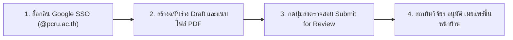

# คู่มือฉบับย่อสำหรับนักวิจัย: การส่งผลงานและขออนุมัติเผยแพร่ใน 3 นาที (Researcher Quick-Start Cheatsheet)
## ระบบฐานข้อมูลงานวิจัย มหาวิทยาลัยราชภัฏเพชรบูรณ์ (PCRU Research Database)

---

### ภาพรวม 4 ขั้นตอนหลักของนักวิจัย

---

### ขั้นตอนที่ 1: การเข้าสู่ระบบและการเข้าถึงเมนูนักวิจัย
1. เปิดเว็บเบราว์เซอร์ไปที่หน้าเข้าสู่ระบบ (`/login`)
2. คลิกปุ่ม **"เข้าสู่ระบบด้วยบัญชี Google (@pcru.ac.th)"**
3. เมื่อเข้าสู่ระบบสำเร็จ ท่านจะเห็นเมนูจัดการผลงานเฉพาะของท่านในแถบเมนูด้านซ้าย ได้แก่:
   * **โครงการวิจัย** (`/backend/rdb_project`)
   * **ผลงานตีพิมพ์** (`/backend/rdb_published`)
   * **ทรัพย์สินทางปัญญา** (`/backend/rdb_dip`)
   * **การนำไปใช้ประโยชน์** (`/backend/rdbprojectutilize`)

---

### ขั้นตอนที่ 2: การบันทึกข้อมูลฉบับร่าง (`Draft`) และการแนบไฟล์ PDF
1. เข้าไปยังโมดูลที่ต้องการบันทึก (เช่น **ผลงานตีพิมพ์** หรือ **โครงการวิจัย**) แล้วคลิกปุ่ม **"+ เพิ่มข้อมูลใหม่"**
2. กรอกรายละเอียดข้อมูลให้ครบถ้วน (วันที่ทั้งหมดในระบบใช้รูปแบบ **พ.ศ.**)
3. อัปโหลดไฟล์เอกสาร PDF ฉบับเต็ม:
   * ระบบจะ **ตรวจนับจำนวนหน้าของไฟล์ PDF อัตโนมัติ**
   * ระบบจะ **เรนเดอร์หน้าแรกของ PDF มาทำเป็นภาพปก `.webp` อัตโนมัติ** (พร้อมปุ่ม "ดึงภาพหน้าปกไฟล์ใหม่ อีกครั้ง" หากต้องการรีโหลด)
4. คลิก **"บันทึกข้อมูล"** ➔ รายการจะถูกบันทึกในสถานะ **`ฉบับร่าง (Draft)`** (ท่านยังสามารถแก้ไขเพิ่มเติมได้ตลอดเวลา และข้อมูลจะยังไม่แสดงต่อสาธารณะ)

---

### ขั้นตอนที่ 3: การกดส่งผลงานให้สถาบันวิจัยฯ ตรวจสอบ (`Submit for Review`)
1. เมื่อตรวจสอบความถูกต้องของข้อมูลและไฟล์แนบเรียบร้อยแล้ว ให้เปิดหน้ารายละเอียดของผลงานนั้น
2. คลิกปุ่มสีน้ำเงิน **"ส่งตรวจสอบ (Submit for Review)"**
3. สถานะจะเปลี่ยนเป็น **`รอตรวจสอบ (Pending Review)`**:
   * ข้อมูลจะถูกล็อกชั่วคราวระหว่างรอเจ้าหน้าที่ตรวจ
   * ระบบส่งการแจ้งเตือนไปยังเจ้าหน้าที่สถาบันวิจัยและพัฒนาโดยอัตโนมัติ

---

### ขั้นตอนที่ 4: การติดตามผลและการแก้ไขข้อมูลภายหลัง

| สถานการณ์ที่เกิดขึ้น | ป้ายสถานะในระบบ | สิ่งที่นักวิจัยต้องดำเนินการ |
| :--- | :--- | :--- |
| **1. เจ้าหน้าที่ส่งกลับให้แก้ไข** | `ต้องแก้ไข (Revision Required)` | อ่านข้อความชี้แจงในกล่องหมายเหตุสีแดง ➔ คลิก **"แก้ไขข้อมูล"** ➔ ปรับปรุงข้อมูล/ไฟล์ ➔ กด **"ส่งตรวจสอบ"** อีกครั้ง |
| **2. เจ้าหน้าที่อนุมัติผลงานแล้ว** | `เผยแพร่แล้ว (Published)` | ผลงานแสดงผลบนหน้าเว็บไซต์สาธารณะทันที พร้อมภาพปก `.webp` และระบบคัดลอกการอ้างอิง (APA 7 / IEEE / MLA 9) |
| **3. ต้องการแก้ไขผลงานที่เผยแพร่ไปแล้ว** | `เผยแพร่แล้ว (Published)` | คลิกปุ่ม **"ขอปลดล็อกเพื่อแก้ไข (Request Unlock)"** ➔ ระบุเหตุผลความจำเป็น ➔ รอผู้ดูแลระบบกดอนุมัติคืนสถานะเป็น `ฉบับร่าง (Draft)` จึงจะแก้ไขได้ |

---

> [!TIP]
> **การส่งเล่มรายงานวิจัยฉบับสมบูรณ์เพื่อประเมินคุณภาพ (Peer Review)**:
> สำหรับโครงการวิจัยที่ต้องการส่งเล่มรายงานเพื่อให้ผู้ทรงคุณวุฒิประเมิน (Single-Blind Peer Review) ให้เข้าไปที่หน้ารายละเอียดโครงการ แล้วคลิกปุ่ม **"ระบบประเมินรายงานวิจัย"** เพื่ออัปโหลดไฟล์ร่างรายงานฉบับสมบูรณ์ (`Initial Draft`) ได้ทันที

