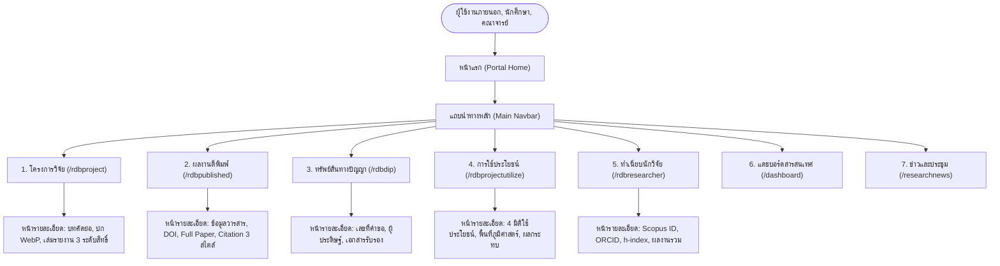
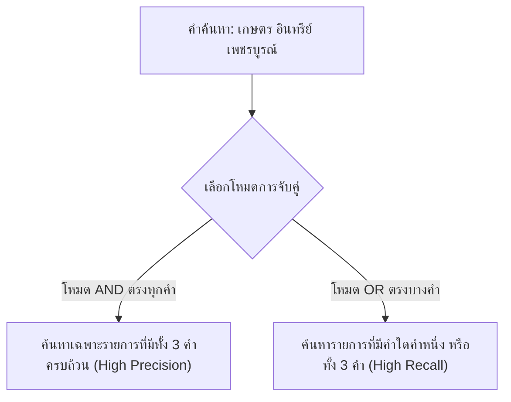
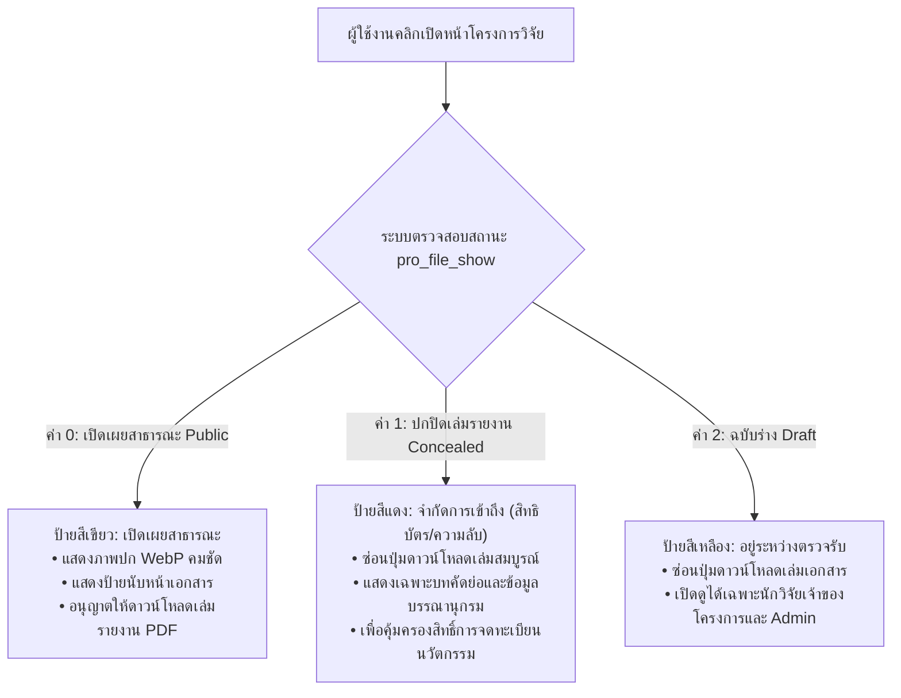
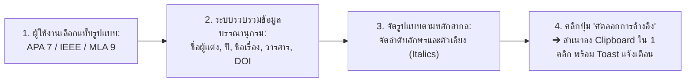
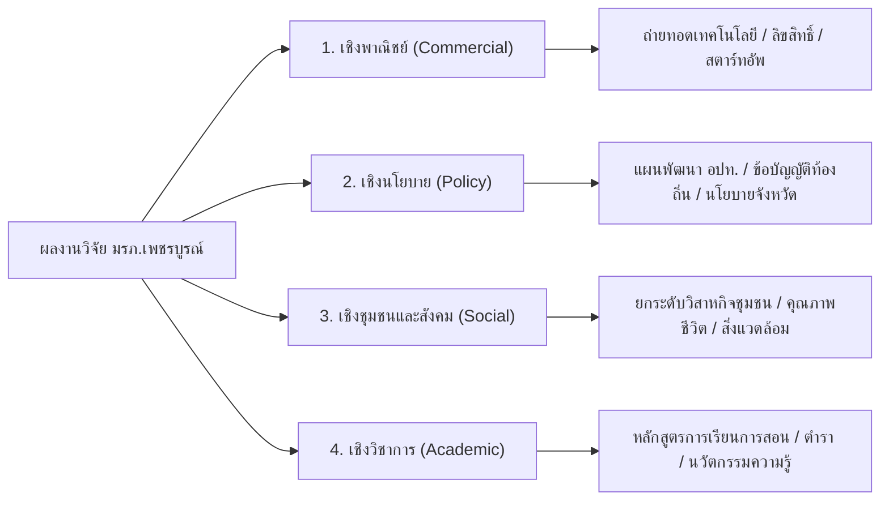

# เล่มที่ 1: คู่มือการใช้งานระบบหน้าบ้าน (Volume 1: Frontend Public User Manual)
## ระบบฐานข้อมูลงานวิจัย มหาวิทยาลัยราชภัฏเพชรบูรณ์ (PCRU Research Database)

> [!NOTE]
> **ข้อมูลจำเพาะของเอกสาร (Document Control)**
> - **รหัสเอกสาร**: `PCRU-RDB-MAN-VOL1-2569`
> - **กลุ่มผู้ใช้งานเป้าหมาย**: คณาจารย์, นักวิจัย, นักศึกษา, บุคลากรทางการศึกษา, หน่วยงานภาครัฐ/เอกชน และประชาชนทั่วไป
> - **รูปแบบการใช้งาน**: ระบบเว็บแอปพลิเคชันสาธารณะ (Public Web Portal) รองรับคอมพิวเตอร์ แท็บเล็ต และสมาร์ตโฟน
> - **URL เข้าใช้งาน**: `http://laravel_rdb.test/` (หรือโดเมนหลักของสถาบันวิจัยและพัฒนา มหาวิทยาลัยราชภัฏเพชรบูรณ์)

---

## สารบัญ (Table of Contents)
1. [บทที่ 1: ภาพรวมระบบและการนำทาง (System Overview & Interface Navigation)](#บทที่-1-ภาพรวมระบบและการนำทาง-system-overview--interface-navigation)
   * 1.1 แนะนำระบบและพันธกิจคลังปัญญา มรภ.เพชรบูรณ์
   * 1.2 แผนผังสถาปัตยกรรมระบบหน้าบ้าน (Public System Architecture)
   * 1.3 โครงสร้างหน้าจอหลักและแถบเมนูนำทาง (Portal Layout Walkthrough)
   * 1.4 การสลับโหมดการแสดงผล สว่าง/มืด (Light Mode & Dark Mode Switcher)
2. [บทที่ 2: ระบบการสืบค้นข้อมูลงานวิจัยอัจฉริยะ (Smart Search & Dynamic Filtering)](#บทที่-2-ระบบการสืบค้นข้อมูลงานวิจัยอัจฉริยะ-smart-search--dynamic-filtering)
   * 2.1 การค้นหาด่วนจากหน้าแรก (Global Quick Search)
   * 2.2 การใช้ตัวกรองปีงบประมาณ พ.ศ. (Fiscal Year Filtering)
   * 2.3 กลไกการค้นหาแบบกลุ่มคำ (Multi-Keyword Search Logic: AND / OR)
   * 2.4 ระบบตัดคำนำหน้าชื่อภาษาไทยอัตโนมัติ (Thai Title Prefix Normalization)
   * 2.5 ปฏิทิน พ.ศ. และการตรวจสอบช่วงวันที่ (Thai Date Range Validation)
3. [บทที่ 3: การใช้งานโมดูลโครงการวิจัย (Research Projects Directory)](#บทที่-3-การใช้งานโมดูลโครงการวิจัย-research-projects-directory)
   * 3.1 หน้ารวมรายการโครงการวิจัยและแผงค้นหาละเอียด (`/rdbproject`)
   * 3.2 พจนานุกรมช่องค้นหาและตัวกรองโครงการวิจัย (Filter Fields Dictionary)
   * 3.3 ตารางแสดงผลรายการโครงการและป้ายสถานะ (Status Badges Reference)
   * 3.4 หน้าแสดงรายละเอียดโครงการวิจัยฉบับเต็ม (`/rdbproject/{id}`)
   * 3.5 ระดับการเข้าถึงและสิทธิ์เปิดเผยเล่มรายงานวิจัย 3 ระดับ (Document Access Policy)
   * 3.6 ระบบพรีวิวภาพปกหน้าแรก (.webp) และป้ายแสดงจำนวนหน้าเอกสาร
4. [บทที่ 4: การใช้งานโมดูลผลงานตีพิมพ์และงานวิชาการ (Publications & Academic Citations)](#บทที่-4-การใช้งานโมดูลผลงานตีพิมพ์และงานวิชาการ-publications--academic-citations)
   * 4.1 หน้ารวมรายการบทความตีพิมพ์และตัวกรองฐานข้อมูล (`/rdbpublished`)
   * 4.2 ระดับชั้นฐานข้อมูลวิชาการ (Academic Database Tiers)
   * 4.3 หน้ารายละเอียดบทความวิจัยและการดาวน์โหลดไฟล์ Full Paper (`/rdbpublished/{id}`)
   * 4.4 ระบบสร้างข้อความอ้างอิงอัตโนมัติใน 1 คลิก (Academic Citations Generator)
5. [บทที่ 5: การใช้งานโมดูลทรัพย์สินทางปัญญา (Intellectual Property - DIP)](#บทที่-5-การใช้งานโมดูลทรัพย์สินทางปัญญา-intellectual-property---dip)
   * 5.1 หน้ารวมรายการทรัพย์สินทางปัญญา (`/rdbdip`)
   * 5.2 การจำแนกประเภททรัพย์สินทางปัญญา
   * 5.3 หน้ารายละเอียดคำขอ การตรวจสอบเลขที่คำขอ และเอกสารสำคัญ (`/rdbdip/{id}`)
6. [บทที่ 6: การใช้งานโมดูลการนำงานวิจัยไปใช้ประโยชน์ (Research Utilizations)](#บทที่-6-การใช้งานโมดูลการนำงานวิจัยไปใช้ประโยชน์-research-utilizations)
   * 6.1 มิติการนำผลงานวิจัยไปใช้ประโยชน์ 4 ด้าน
   * 6.2 การสืบค้นผลงานตามพื้นที่ภูมิศาสตร์ (จังหวัด / อำเภอ / ตำบล)
   * 6.3 หน้ารายละเอียดการใช้ประโยชน์ การประเมินผลกระทบ และหลักฐานรับรอง (`/rdbprojectutilize/{id}`)
7. [บทที่ 7: การใช้งานทำเนียบนักวิจัย (Researchers Directory & Academic Portfolio)](#บทที่-7-การใช้งานทำเนียบนักวิจัย-researchers-directory--academic-portfolio)
   * 7.1 หน้ารวมทำเนียบนักวิจัยและการค้นหาตามสังกัดคณะ (`/rdbresearcher`)
   * 7.2 หน้าแฟ้มประวัติและผลงานวิจัยสะสมของนักวิจัย (`/rdbresearcher/{id}`)
   * 7.3 การเชื่อมต่อฐานข้อมูลสากล Scopus Author ID, ORCID iD และดัชนี h-index
   * 7.4 แท็บรวมผลงานแบบบูรณาการ 4 มิติในหน้าเดียว (Portfolio Tabs)
8. [บทที่ 8: แดชบอร์ดสถิติ ข่าวสารทุนวิจัย และบริการข้อมูลเปิด (Dashboards, News & Open Data APIs)](#บทที่-8-แดชบอร์ดสถิติ-ข่าวสารทุนวิจัย-และบริการข้อมูลเปิด-dashboards-news--open-data-apis)
   * 8.1 การใช้งานศูนย์สารสนเทศงานวิจัย (Intelligence Dashboards: 6 มิติ)
   * 8.2 แถบตัวกรองแดชบอร์ดและการวิเคราะห์ข้อมูลเปรียบเทียบข้ามปี พ.ศ. (พร้อม YoY Deltas & Small Base Rule)
   * 8.3 กราฟสถิติแบบโต้ตอบ (Chart.js) และตารางจัดอันดับพร้อมเส้นสัดส่วน 3px (Ranked Breakdown Lists)
   * 8.4 ศูนย์ข่าวสารทุนวิจัยและงานประชุมวิชาการ (Research News & Conference Directory)
   * 8.5 การสมัครรับฟีดข่าวสารผ่าน XML RSS Feeds
   * 8.6 บริการข้อมูลเปิดสำหรับนักพัฒนา (Open Public REST APIs: News & Conferences)
9. [บทที่ 9: การเชื่อมโยงสากลและการจัดทำดัชนีทางวิชาการ (Academic SEO, Google Scholar & Dynamic Sitemaps)](#บทที่-9-การเชื่อมโยงสากลและการจัดทำดัชนีทางวิชาการ-academic-seo-google-scholar--dynamic-sitemaps)
   * 9.1 การจัดทำดัชนีสำหรับ Google Scholar (Highwire Press Metadata)
   * 9.2 มาตรฐานคลังสารสนเทศสถาบัน Dublin Core (DC.*)
   * 9.3 การแสดงผลพรีวิวบนโซเชียลมีเดียด้วย Open Graph และภาพปก .webp
   * 9.4 ข้อมูลโครงสร้าง Schema.org JSON-LD สำหรับ Search Engine ยุคใหม่
   * 9.5 แผนผังเว็บไซต์ไดนามิก Dynamic XML Sitemaps (/sitemap.xml)
---

## บทที่ 1: ภาพรวมระบบและการนำทาง (System Overview & Interface Navigation)

### 1.1 แนะนำระบบและพันธกิจคลังปัญญา มรภ.เพชรบูรณ์
ระบบฐานข้อมูลงานวิจัย (PCRU Research Database) พัฒนาขึ้นภายใต้แนวคิด **Scholarly Editorial Craftsmanship** โดยสถาบันวิจัยและพัฒนา มหาวิทยาลัยราชภัฏเพชรบูรณ์ เพื่อเป็นคลังสารสนเทศกลางระดับสถาบันในการรวบรวม จัดหมวดหมู่ เผยแพร่ และคุ้มครองสิทธิ์ผลงานทางวิชาการ ปัจจุบันระบบจัดเก็บและให้บริการข้อมูลอย่างเป็นรูปธรรม ประกอบด้วย:
* **โครงการวิจัย (Research Projects)**: กว่า 2,870 โครงการ ครอบคลุมทั้งทุนงบประมาณแผ่นดิน, ทุนงบประมาณรายได้, ทุน บพข./บพท./วช. และทุนจากภาคเอกชน
* **ผลงานตีพิมพ์ทางวิชาการ (Publications)**: กว่า 1,873 บทความ ทั้งในวารสารระดับนานาชาติ (Scopus / Web of Science) และวารสารระดับชาติ (TCI กลุ่ม 1 และ 2)
* **การนำงานวิจัยไปใช้ประโยชน์ (Research Utilizations)**: กว่า 1,112 รายการ ครอบคลุม 4 มิติการพัฒนาพื้นที่
* **ทรัพย์สินทางปัญญา (Intellectual Property)**: สิทธิบัตร อนุสิทธิบัตร และลิขสิทธิ์รวม 59 รายการ
* **ทำเนียบนักวิจัย (Researchers Portfolio)**: กว่า 1,072 ท่าน พร้อมข้อมูลเชื่อมโยงดัชนีสากล

---

### 1.2 แผนผังสถาปัตยกรรมระบบหน้าบ้าน (Public System Architecture)



---

### 1.3 โครงสร้างหน้าจอหลักและแถบเมนูนำทาง (Portal Layout Walkthrough)


#### คำอธิบายส่วนประกอบหน้าจอหลัก:
* **หมายเลข `[1]` แถบเมนูนำทางหลัก (Universal Navigation Bar)**:
  * **โลโก้มหาวิทยาลัย**: คลิกเพื่อกลับสู่หน้าแรกของระบบได้ตลอดเวลา
  * **เมนูโมดูลสารสนเทศ 7 เมนู**: เข้าถึงโมดูลวิจัยได้อย่างรวดเร็ว
  * **ปุ่มสลับโหมดสี (Theme Switcher)**: ปุ่มรูปดวงอาทิตย์/พระจันทร์
  * **ปุ่มเข้าสู่ระบบ (Login)**: นำเข้าสู่ระบบหลังบ้านด้วย Google Workspace หรือ Username
* **หมายเลข `[2]` แบนเนอร์ค้นหาและตัวกรองปี พ.ศ. (Hero Search & Year Filter)**:
  * **ช่องสืบค้นรวม**: พิมพ์คำค้นหาเพื่อค้นหาข้อมูลข้ามทุกโมดูลในระบบ
  * **Dropdown ปีงบประมาณ พ.ศ.**: เลือกปีงบประมาณที่ต้องการเจาะจงดูข้อมูลสถิติ
* **หมายเลข `[3]` การ์ดสถิติภาพรวมงานวิจัย (Executive Counter Cards)**:
  * แสดงยอดรวมสะสมของโครงการวิจัย, งบประมาณสนับสนุนรวม, บทความตีพิมพ์ และการนำไปใช้ประโยชน์ โดยแสดงตัวเลขด้วยรูปแบบ `tabular-nums` เพื่อให้แนวหลักตัวเลขตรงกันอย่างเป็นระเบียบ

---

### 1.4 การสลับโหมดการแสดงผล สว่าง/มืด (Light Mode & Dark Mode Switcher)
ระบบถูกออกแบบให้รองรับการอ่านเอกสารทางวิชาการที่ใช้ระยะเวลานาน โดยมี 2 โหมดสีมาตรฐาน:
1. **Daylight Editorial Slate (โหมดสว่าง)**: พื้นหลังโทนสว่างนวลตา สบายตา ตัวหนังสือคมชัดระดับ 1px Hairline เหมาะสำหรับการทำงานเวลากลางวันและการสั่งพิมพ์
2. **Carbon-Navy Night Reading (โหมดมืด)**: พื้นหลังโทนสีน้ำเงินเข้มวิชาการ (`#0F172A`) ผสมผสานสีกรมท่า (`#1E293B`) ตัดแสงสีฟ้าสะท้อนเข้าตา เหมาะสำหรับการอ่านบทคัดย่อหรือวิเคราะห์สถิติในเวลากลางคืน

**ขั้นตอนการใช้งาน:**
1. คลิกที่ไอคอน **ดวงอาทิตย์ (`☀️`) / พระจันทร์ (`🌙`)** บนแถบเมนูขวาบน
2. ธีมของหน้าจอจะสลับทันทีโดยไม่มีการรีเฟรชหน้าเว็บ (Zero-Flicker Transition)
3. ระบบจะบันทึกสถานะลงใน `localStorage` ของเบราว์เซอร์ เพื่อให้เปิดใช้งานโหมดเดิมเสมอในการเข้าชมครั้งถัดไป

---

## บทที่ 2: ระบบการสืบค้นข้อมูลงานวิจัยอัจฉริยะ (Smart Search & Dynamic Filtering)

### 2.1 การค้นหาด่วนจากหน้าแรก (Global Quick Search)
1. พิมพ์คำค้นหาลงในช่องค้นหาบนแบนเนอร์หลักหน้าแรก
2. ระบบจะค้นหาคำดังกล่าวครอบคลุมทั้ง:
   * ชื่อโครงการวิจัย (ไทยและอังกฤษ)
   * ชื่อบทความตีพิมพ์ และชื่อวารสาร
   * คำสำคัญ (Keywords)
   * บทคัดย่อ (Abstracts)
   * ชื่อ-นามสกุลของนักวิจัย
3. กดปุ่ม **Enter** หรือคลิกปุ่ม **"ค้นหา"** เพื่อเข้าสู่หน้ารายการผลการค้นหา

---

### 2.2 การใช้ตัวกรองปีงบประมาณ พ.ศ. (Fiscal Year Filtering)
* ที่แถบตัวกรองปีงบประมาณ สามารถเลือกดูสถิติและผลงานเฉพาะปี พ.ศ. ที่สนใจได้ (เช่น `2568`, `2567`, `2566`, ...)
* เมื่อเลือกปีงบประมาณ ตัวเลขสถิติบนการ์ดและรายการผลงานแนะนำด้านล่างจะปรับเปลี่ยนตามปีงบประมาณนั้นทันที

---

### 2.3 กลไกการค้นหาแบบกลุ่มคำ (Multi-Keyword Search Logic: AND / OR)
ในหน้ารายการของโครงการวิจัยและผลงานตีพิมพ์ ระบบมีกล่องค้นหาแบบกลุ่มคำที่ผู้ใช้สามารถพิมพ์หลายคำโดยคั่นด้วยช่องว่าง พร้อมเลือกตรรกะการจับคู่ได้ 2 โหมด:



* **1. โหมด "เจอทั้งหมด (ตรงทุกคำ - AND)"** *(ค่าเริ่มต้น)*:
  * ใช้เมื่อต้องการผลลัพธ์ที่ตรงจุดและแคบลง เช่น ค้นหา `"ข้าวไร่ เขาค้อ"` ผลลัพธ์จะต้องมีทั้งคำว่า "ข้าวไร่" และ "เขาค้อ" ปรากฏอยู่ในชื่อเรื่องพร้อมกัน
* **2. โหมด "เจอบางคำ (ตรงคำใดคำหนึ่ง - OR)"**:
  * ใช้เมื่อต้องการค้นหาทางเลือกหรือคำที่มีความหมายใกล้เคียงกัน เช่น ค้นหา `"พลังงาน แสงอาทิตย์ ลม ชีวมวล"` ระบบจะแสดงรายการที่มีคำใดคำหนึ่งปรากฏอยู่

---

### 2.4 ระบบตัดคำนำหน้าชื่อภาษาไทยอัตโนมัติ (Thai Title Prefix Normalization)
เพื่อแก้ปัญหาการค้นหาชื่อนักวิจัยไม่พบเนื่องจากการกรอกคำนำหน้าไม่ตรงกัน ระบบได้ติดตั้งอัลกอริทึมตัดคำนำหน้าชื่อไทยอัตโนมัติ:
* เมื่อผู้ใช้พิมพ์คำค้นหา เช่น `"ศ.ดร.สมชาย"`, `"ผศ.สมหญิง"`, `"อาจารย์นายแพทย์วิทยา"`, หรือ `"นางสาวกานดา"`
* ระบบจะทำการตัดคำนำหน้าทางวิชาการและคำนำหน้านามทั่วไป (`นาย`, `นาง`, `นางสาว`, `อาจารย์`, `ดร.`, `ผศ.`, `รศ.`, `ศ.`, `พญ.`, `นพ.`) ออกอย่างชาญฉลาด แล้วนำเฉพาะชื่อและนามสกุลไปสืบค้นในฐานข้อมูล
* ผลลัพธ์: ผู้ใช้จะค้นพบข้อมูลนักวิจัยอย่างแม่นยำ 100% เสมอ ไม่ว่าจะคัดลอกชื่อที่มีคำนำหน้าติดมาหรือไม่ก็ตาม

---

### 2.5 ปฏิทิน พ.ศ. และการตรวจสอบช่วงวันที่ (Thai Date Range Validation)
ทุกหน้าที่มีการกรองตามช่วงเวลา ระบบจะใช้ปฏิทินที่แสดงผลเป็นปีพุทธศักราช (พ.ศ.) เสมอ พร้อมกลไกการตรวจสอบความถูกต้อง 2 ขั้น:
1. **การกรอกข้อมูลแบบครบช่วง (Pair Requirement)**: หากผู้ใช้เลือกใส่วันที่เริ่มต้น จะต้องระบุวันที่สิ้นสุดด้วยเสมอ หรือหากใส่วันที่สิ้นสุด จะต้องระบุวันที่เริ่มต้นด้วยเช่นกัน
2. **การตรวจสอบลำดับเวลา (Chronological Order Check)**:
   * วันที่สิ้นสุด (`date_end`) จะต้อง **มากกว่าหรือเท่ากับ** วันที่เริ่มต้น (`date_start`) เสมอ
   * หากผู้ใช้เลือกวันที่สิ้นสุดมาก่อนวันที่เริ่มต้น ระบบจะปฏิเสธการค้นหาและแสดงข้อความแจ้งเตือนภาษาไทยทันที: `"วันที่สิ้นสุดต้องมากกว่าหรือเท่ากับวันที่เริ่มต้น"`

---

## บทที่ 3: การใช้งานโมดูลโครงการวิจัย (Research Projects Directory)

### 3.1 หน้ารวมรายการโครงการวิจัยและแผงค้นหาละเอียด (`/rdbproject`)


หน้ารวมโครงการวิจัยออกแบบมาเพื่อรองรับการสืบค้นข้อมูลระดับลึกตามตำแหน่งในภาพ:
* **หมายเลข `[1]` แผงค้นหาและตัวกรองละเอียด (Collapsible Search & Filter Panel)**:
  * **ช่องค้นหาชื่อโครงการวิจัย**: พิมพ์ชื่อโครงการเพื่อค้นหาแบบ Autocomplete ทันที
  * **โหมดคำค้นหากลุ่มคำ (AND / OR)**: สลับเลือกระหว่าง "ตรงทุกคำ (AND)" หรือ "ตรงบางคำ (OR)"
  * **ตัวกรองระดับลึก**: เลือกปีงบประมาณ พ.ศ., ประเภททุน, คณะ/สังกัด, และปฏิทินช่วงวันที่เริ่มต้น-สิ้นสุด
  * **ปุ่มค้นหาและล้างเงื่อนไข**: ปุ่มสีน้ำเงิน **"ค้นหา"** เมื่อกดแล้วแผงค้นหาจะพับเก็บลงอัตโนมัติเพื่อให้เห็นผลลัพธ์ชัดเจน และปุ่มสีเทา **"ล้างตัวกรอง"** เพื่อคืนค่าเริ่มต้น
* **หมายเลข `[2]` ตารางแสดงผลรายการโครงการและป้ายสถานะ (Projects Data Table & Badges)**:
  * **คอลัมน์รายละเอียด**: แสดงรหัสโครงการ, ชื่อโครงการภาษาไทยและภาษาอังกฤษ, แหล่งทุน, และงบประมาณรวม
  * **รายชื่อนักวิจัยและบทบาท**: ไฮไลต์ชื่อหัวหน้าโครงการและคณะผู้ร่วมวิจัย
  * **ป้ายสถานะโครงการ**: บ่งบอกสถานะ `เสร็จสิ้นโครงการ` (สีเขียว) หรือ `กำลังดำเนินการ` (สีเหลือง)
  * **ปุ่มเปิดดูรายละเอียด**: คลิกที่ชื่อโครงการเพื่อเปิดเข้าสู่หน้าแสดงข้อมูลฉบับเต็ม (`/rdbproject/{id}`)

---

### 3.2 พจนานุกรมช่องค้นหาและตัวกรองโครงการวิจัย (Filter Fields Dictionary)

| ชื่อฟิลด์ในฟอร์ม | ประเภทอินพุต | ความหมายและแนวทางการใช้งาน |
| :--- | :--- | :--- |
| **ปีงบประมาณ (`year_id`)** | Dropdown | เลือกปีงบประมาณ พ.ศ. ที่โครงการได้รับอนุมัติจัดสรรทุน |
| **ประเภททุนวิจัย (`pt_id`)** | Cascading Dropdown | ประเภทแหล่งทุน (จะแสดงรายการตามปีงบประมาณที่เลือก) |
| **ประเภทโครงการย่อย (`pts_id`)** | Cascading Dropdown | กลุ่มทุนย่อยเฉพาะด้าน |
| **รหัสโครงการ (`pro_code`)** | Text Input | รหัสอ้างอิงโครงการตามสัญญาหรือระบบงบประมาณ |
| **กลุ่มโครงการ (`pgroup_id`)** | Dropdown | หมวดหมู่โครงการตามพันธกิจมหาวิทยาลัย |
| **งบประมาณเริ่มต้น-สิ้นสุด** | Number Input (คู่) | ระบุช่วงจำนวนเงินงบประมาณ (บาท) เช่น `100,000` ถึง `500,000` |
| **ชื่อโครงการวิจัย (`pro_id`)** | TomSelect AJAX | ช่องค้นหาชื่อโครงการแบบพิมพ์แล้วมีรายชื่อแนะนำอัตโนมัติ |
| **ค้นหาแบบกลุ่มคำ (`title_keywords`)** | Text + Radio Mode | พิมพ์กลุ่มคำคั่นด้วยเว้นวรรค พร้อมเลือกว่าจะใช้โหมด AND หรือ OR |
| **นักวิจัย (`researcher_id`)** | TomSelect Autocomplete | พิมพ์ชื่อผู้วิจัยเพื่อค้นหาโครงการที่อาจารย์ท่านนั้นมีส่วนร่วม |
| **หน่วยงาน/คณะ (`department_id`)** | Dropdown | คัดกรองตามคณะหรือศูนย์สำนักที่สังกัด |
| **บทคัดย่อ (`pro_abstract`)** | Text Input | ค้นหาคำที่ปรากฏในเนื้อหาบทคัดย่อภาษาไทยหรือภาษาอังกฤษ |
| **ช่วงวันที่ (`date_start` - `date_end`)** | Buddhist Datepicker | ระบุช่วงวันเริ่มและวันสิ้นสุดสัญญาโครงการวิจัย |

---

### 3.3 ตารางแสดงผลรายการโครงการและป้ายสถานะ (Status Badges Reference)
ในตารางรายการโครงการ ข้อมูลแต่ละแถวจะแสดงป้ายสถานะ (Badges) เพื่อบ่งชี้คุณลักษณะสำคัญของโครงการ:

| สัญลักษณ์ / ป้ายสถานะ | สีของป้าย | ความหมาย |
| :--- | :---: | :--- |
| `#XXXX` | สีเทาอ่อน | รหัสไอดีโครงการในฐานข้อมูล |
| `ปี พ.ศ. 2568` | สีกรมท่าอ่อน | ปีงบประมาณที่ได้รับอนุมัติทุน |
| `฿500,000` | สีเขียวอ่อน | งบประมาณรวมที่ได้รับการจัดสรร |
| `เสร็จสิ้นโครงการ` | สีเขียวเข้ม | โครงการวิจัยได้ส่งมอบเล่มรายงานสมบูรณ์และปิดโครงการแล้ว |
| `กำลังดำเนินการ` | สีเหลืองส้ม | โครงการอยู่ระหว่างการดำเนินงานวิจัย |
| `พบคำค้นหาใน: ...` | สีส้มประกาย | ป้ายไฮไลต์ Match Sources แสดงให้ทราบว่าพบคำค้นหาในส่วนใด (ชื่อเรื่อง, นักวิจัย, หรือบทคัดย่อ) |

---

### 3.4 หน้าแสดงรายละเอียดโครงการวิจัยฉบับเต็ม (`/rdbproject/{id}`)


#### คำอธิบายส่วนประกอบสำคัญตามหมายเลขในภาพ:
* **หมายเลข `[1]` บัตรข้อมูลสรุปโครงการวิจัยและบทคัดย่อ (Project Profile & Abstract Card)**:
  * **ข้อมูลพื้นฐานโครงการ**: แสดงชื่อโครงการเต็มทั้งภาษาไทยและภาษาอังกฤษ, รหัสโครงการ, ปีงบประมาณ พ.ศ., แหล่งทุนวิจัย, สังกัดคณะ, และยอดเงินงบประมาณรวม
  * **คณะผู้วิจัยและสัดส่วนงาน**: แสดงรายชื่อหัวหน้าโครงการ ผู้ร่วมวิจัย และที่ปรึกษา พร้อมสัดส่วนการทำวิจัย (%) และลิงก์ไปยังหน้าโปรไฟล์นักวิจัย
  * **บทคัดย่อ 2 ภาษา (Abstracts)**: แสดงบทคัดย่อภาษาไทยและอังกฤษ พร้อมปุ่ม **"คัดลอกบทคัดย่อ"** สำหรับนำข้อความไปอ้างอิงได้อย่างสะดวกรวดเร็ว
* **หมายเลข `[2]` การ์ดเอกสารเล่มรายงานวิจัยและพรีวิวภาพปก WebP (Document Access Card)**:
  * **พรีวิวภาพปกหน้าแรก (.webp)**: สกัดจากหน้าแรกของ PDF ให้เห็นรูปเล่มเอกสารจริงอย่างคมชัด
  * **ป้ายจำนวนหน้าเอกสารจริง**: แสดงจำนวนหน้าทั้งหมดของเล่ม เช่น `<i class="bi bi-file-earmark-text"></i> 101 หน้า`
  * **ปุ่มดาวน์โหลดเอกสาร PDF**: คลิกเพื่อดาวน์โหลดเล่มรายงานวิจัยฉบับสมบูรณ์ (กรณีเป็นเอกสารเปิดเผยสาธารณะ)

---

### 3.5 ระดับการเข้าถึงและสิทธิ์เปิดเผยเล่มรายงานวิจัย 3 ระดับ (Document Access Policy)
เพื่อรักษาสมดุลระหว่างการเปิดเผยองค์ความรู้กับการคุ้มครองสิทธิ์ทางปัญญา ระบบกำหนดนโยบายเปิดเผยไฟล์เล่มรายงานวิจัยฉบับสมบูรณ์ (`pro_file_show`) ออกเป็น 3 ระดับ:



| ระดับสิทธิ์ | ป้ายสถานะ | การแสดงภาพปก WebP | สิทธิ์ดาวน์โหลด PDF | วัตถุประสงค์การใช้งาน |
| :--- | :---: | :---: | :---: | :--- |
| **1. เปิดเผยสาธารณะ (Public - ค่า 0)** | `badge bg-success-subtle` | แสดงปกจริง | **ดาวน์โหลดได้ทันที** | เผยแพร่องค์ความรู้สู่สังคมและชุมชน |
| **2. ปกปิดเล่มรายงาน (Concealed - ค่า 1)** | `badge bg-danger-subtle` | ซ่อนปก / แสดงโลโก้ | **จำกัดการเข้าถึง** | คุ้มครองทรัพย์สินทางปัญญา / รอจดสิทธิบัตร |
| **3. ฉบับร่าง (Draft - ค่า 2)** | `badge bg-warning-subtle` | ซ่อนปก | **ล็อกดาวน์โหลด** | เอกสารอยู่ระหว่างรอบตรวจรับและแก้ไข |

---

### 3.6 ระบบพรีวิวภาพปกหน้าแรก (.webp) และป้ายแสดงจำนวนหน้าเอกสาร
* **ภาพปกหน้าแรก (Cover Preview)**: ระบบสกัดหน้าแรกของไฟล์ PDF มาบีบอัดเป็นรูปภาพแบบ `.webp` อัตโนมัติ แสดงผลอย่างคมชัด สวยงาม ช่วยให้ผู้ใช้งานมองเห็นรูปแบบรูปเล่มเอกสารจริงก่อนตัดสินใจดาวน์โหลด
* **ป้ายแสดงจำนวนหน้า**: แสดงจำนวนหน้าทั้งหมดของเอกสาร เช่น `120 หน้า` (แสดงเฉพาะในหน้ารายละเอียดโครงการ เพื่อความสะอาดตาของตารางรายการ)

---

## บทที่ 4: การใช้งานโมดูลผลงานตีพิมพ์และงานวิชาการ (Publications & Academic Citations)

### 4.1 หน้ารวมรายการบทความตีพิมพ์และตัวกรองฐานข้อมูล (`/rdbpublished`)


#### คำอธิบายส่วนประกอบตามหมายเลขในภาพ:
* **หมายเลข `[1]` แผงตัวกรองผลงานตีพิมพ์และฐานข้อมูลวารสาร (Publication Database Filters)**:
  * **ช่องค้นหาชื่อบทความ / วารสาร**: พิมพ์ชื่อผลงาน หรือชื่อวารสารทางวิชาการ
  * **ตัวกรองระดับฐานข้อมูล (Database Tiers)**: เลือกคัดกรองเฉพาะวารสารระดับนานาชาติ `Scopus`, `Web of Science`, หรือระดับชาติ `TCI กลุ่ม 1`, `TCI กลุ่ม 2`
  * **ตัวกรองปี พ.ศ. และสังกัดคณะ**: เจาะจงปีที่ตีพิมพ์เผยแพร่ และคณะของอาจารย์ผู้ประพันธ์
  * **ปุ่มดำเนินการ**: คลิก **"ค้นหา"** เพื่อประมวลผลทันที หรือคลิก **"ล้างตัวกรอง"** เพื่อรีเซ็ต
* **หมายเลข `[2]` ตารางรายการผลงานตีพิมพ์และระดับฐานข้อมูลสากล (Publications Directory Table)**:
  * **ชื่อเรื่องและข้อมูลวารสาร**: แสดงชื่อบทความภาษาอังกฤษ/ไทย พร้อมชื่อวารสาร, Volume, Issue, หน้า และปี พ.ศ.
  * **ป้ายระดับฐานข้อมูล (Database Badges)**: แสดงป้ายสีสดใส เช่น `Scopus Q1`, `Scopus Q2`, หรือ `TCI 1`
  * **คณะผู้ประพันธ์**: ระบุชื่อผู้เขียน First Author และ Corresponding Author อย่างชัดเจน
  * **ปุ่มเข้าดูรายละเอียด**: คลิกที่ชื่อบทความเพื่อเปิดหน้าดูบทคัดย่อและคัดลอก Citation

---

### 4.2 ระดับชั้นฐานข้อมูลวิชาการ (Academic Database Tiers)
ระบบจัดหมวดหมู่ฐานข้อมูลวารสารตามเกณฑ์มาตรฐาน ก.พ.อ. และ กพอ. ดังนี้:
1. **ฐานข้อมูลระดับนานาชาติชั้นนำ**:
   * `Scopus` (Q1, Q2, Q3, Q4)
   * `Web of Science` (SCIE, SSCI, AHCI, ESCI)
2. **ฐานข้อมูลระดับชาติ (ศูนย์ดัชนีการอ้างอิงวารสารไทย - TCI)**:
   * `TCI กลุ่ม 1` (วารสารที่มีคุณภาพระดับประเทศสูง ผ่านการรับรอง)
   * `TCI กลุ่ม 2` (วารสารที่ผ่านการรับรองคุณภาพมาตรฐาน)
3. **รายงานสืบเนื่องจากการประชุมวิชาการ (Proceedings)**:
   * การประชุมวิชาการระดับนานาชาติ (International Conference Proceedings)
   * การประชุมวิชาการระดับชาติ (National Conference Proceedings)

---

### 4.3 หน้ารายละเอียดบทความวิจัยและการดาวน์โหลดไฟล์ Full Paper (`/rdbpublished/{id}`)


#### คำอธิบายส่วนประกอบตามหมายเลขในภาพ:
* **หมายเลข `[1]` ข้อมูลบรรณานุกรม วารสาร และบทคัดย่อ (Bibliographic Metadata & Abstract Card)**:
  * **ข้อมูลวารสารต้นทาง**: แสดงชื่อวารสารวิชาการ, Volume, Issue, เลขหน้า และปี พ.ศ. ที่ตีพิมพ์
  * **ป้ายลิงก์ DOI สากล**: หากบทความมีรหัส DOI จะมีปุ่มลิงก์สีน้ำเงินเชื่อมต่อไปยังเว็บไซต์สำนักพิมพ์ต้นทางโดยตรง
  * **คณะผู้แต่งและบทบาท**: ระบุชัดเจนว่าท่านใดเป็น `First Author (ผู้แต่งชื่อแรก)` หรือ `Corresponding Author (ผู้แต่งบรรณกิจ)`
  * **กล่องบทคัดย่อ (Abstract)**: แสดงบทคัดย่อภาษาอังกฤษและไทยอย่างสมบูรณ์ พร้อมปุ่มคัดลอกบทคัดย่อ
* **หมายเลข `[2]` กล่องคัดลอก Citation อัตโนมัติและการ์ดดาวน์โหลด Full Paper (1-Click Citation & Download)**:
  * **เครื่องมือสร้างข้อความอ้างอิงอัตโนมัติ**: เลือกแท็บ `APA 7`, `IEEE`, หรือ `MLA 9` แล้วกดปุ่มสีน้ำเงิน **"คัดลอกการอ้างอิง"** ข้อความที่จัดรูปแบบถูกต้องจะถูกคัดลอกลง Clipboard ทันทีในคลิกเดียว
  * **การ์ดดาวน์โหลดเอกสาร Full Paper**: แสดงภาพหน้าแรก `.webp` ขนาดกะทัดรัด, จำนวนหน้าจริง และปุ่มดาวน์โหลดไฟล์บทความฉบับเต็ม PDF

---

### 4.4 ระบบสร้างข้อความอ้างอิงอัตโนมัติใน 1 คลิก (Academic Citations Generator)
ที่ด้านขวาล่างของหน้ารายละเอียดบทความ ระบบได้ติดตั้งเครื่องมือสร้างข้อความอ้างอิงทางวิชาการ (Citations) อัตโนมัติ 3 รูปแบบมาตรฐาน:



| รูปแบบ (Style) | สายวิชาการที่นิยมใช้ | โครงสร้างการจัดวาง | ตัวอย่างผลลัพธ์ที่ได้จากการคัดลอก |
| :--- | :--- | :--- | :--- |
| **APA 7th** | สังคมศาสตร์, การศึกษา, วิทยาศาสตร์ทั่วไป | `Author(s). (Year). Title. *Journal*, Vol(Issue), Pages. https://doi.org/...` | `Somchai, J. (2567). AI in Thai Agriculture. *PCRU Academic Journal*, 12(2), 45-58. https://doi.org/10.1234/pcru.2024.01` |
| **IEEE** | วิศวกรรมศาสตร์, คอมพิวเตอร์, เทคโนโลยี | `[1] Author(s), "Title," *Journal*, vol. X, no. Y, pp. xx-yy, Month Year.` | `[1] J. Somchai and S. Jai, "AI in Thai Agriculture," *PCRU Academic Journal*, vol. 12, no. 2, pp. 45-58, 2567.` |
| **MLA 9th** | มนุษยศาสตร์, ภาษาศาสตร์, วรรณกรรม | `Author(s). "Title." *Journal*, vol. X, no. Y, Year, pp. xx-yy.` | `Somchai, Jai. "AI in Thai Agriculture." *PCRU Academic Journal*, vol. 12, no. 2, 2567, pp. 45-58.` |

**ขั้นตอนการใช้งาน:**
1. คลิกเลือกแท็บรูปแบบที่ต้องการใช้งาน (`APA 7`, `IEEE`, หรือ `MLA 9`)
2. คลิกปุ่มสีน้ำเงิน **"คัดลอกการอ้างอิง (Copy Citation)"**
3. ระบบจะคัดลอกข้อความพร้อมจัดรูปแบบตัวเอียงลงใน Clipboard ทันที และแสดงกล่องแจ้งเตือน Toast สีเขียวมุมขวาบน

---

## บทที่ 5: การใช้งานโมดูลทรัพย์สินทางปัญญา (Intellectual Property - DIP)

### 5.1 หน้ารวมรายการทรัพย์สินทางปัญญา (`/rdbdip`)


#### คำอธิบายส่วนประกอบตามหมายเลขในภาพ:
* **หมายเลข `[1]` แผงค้นหาและตัวกรองทรัพย์สินทางปัญญา (IP Filter Panel)**:
  * **ช่องค้นหาชื่อผลงาน / สิ่งประดิษฐ์**: ค้นหาตามชื่อนวัตกรรมหรืองานสร้างสรรค์
  * **ตัวกรองประเภททรัพย์สินทางปัญญา**: สิทธิบัตรการประดิษฐ์, อนุสิทธิบัตร, สิทธิบัตรการออกแบบ, หรือลิขสิทธิ์
  * **ค้นหาตามเลขที่คำขอ / เลขที่ประกาศ**: พิมพ์เลขที่คำขอรับความคุ้มครอง หรือเลขที่สิทธิบัตร
  * **ตัวกรองสังกัดคณะและปี พ.ศ.**: เจาะจงคณะของผู้ประดิษฐ์และปีที่ยื่นคำขอ
* **หมายเลข `[2]` ตารางแสดงผลรายการทรัพย์สินทางปัญญา (IP Registry Table)**:
  * **ชื่อผลงานและคณะผู้ประดิษฐ์**: แสดงชื่อนวัตกรรมพร้อมรายชื่ออาจารย์และนักวิจัยเจ้าของผลงาน
  * **ป้ายประเภทและสถานะความคุ้มครอง**: แสดงป้ายประเภท เช่น `อนุสิทธิบัตร`, `ลิขสิทธิ์` พร้อมเลขที่คำขอ
  * **วันที่สำคัญ**: แสดงวันที่ยื่นคำขอรับความคุ้มครอง และวันที่ได้รับการจดทะเบียน (รูปแบบ พ.ศ.)
  * **ปุ่มเปิดดูรายละเอียด**: คลิกเพื่อเปิดดูข้อมูลทางเทคนิค โครงการวิจัยต้นทาง และหนังสือรับรอง

---

### 5.2 การจำแนกประเภททรัพย์สินทางปัญญา
ระบบรองรับการจัดเก็บทรัพย์สินทางปัญญา 4 ประเภทหลัก:
1. **สิทธิบัตรการประดิษฐ์ (Invention Patent)**: การประดิษฐ์คิดค้นที่มีการแก้ปัญหาทางเทคนิคและมีความใหม่ในระดับก้าวหน้า
2. **อนุสิทธิบัตร (Petty Patent)**: การประดิษฐ์ที่มีการปรับปรุงหรือพัฒนาขึ้นใหม่ที่มีประโยชน์ในทางอุตสาหกรรม
3. **สิทธิบัตรการออกแบบผลิตภัณฑ์ (Design Patent)**: ความคิดสร้างสรรค์เกี่ยวกับรูปร่าง ลวดลาย หรือสีสันของผลิตภัณฑ์
4. **ลิขสิทธิ์ (Copyright)**: งานสร้างสรรค์ทางวรรณกรรม โปรแกรมคอมพิวเตอร์ ดนตรีกรรม หรืองานศิลปะ

---

### 5.3 หน้ารายละเอียดคำขอ การตรวจสอบเลขที่คำขอ และเอกสารสำคัญ (`/rdbdip/{id}`)
* **ข้อมูลสถานะคำขอ**: แสดงเลขที่คำขอ (Application No.), วันที่ยื่นคำขอรับความคุ้มครอง (แสดงรูปแบบ พ.ศ.), วันที่ได้รับการจดทะเบียน และเลขที่สิทธิบัตร (ถ้ามี)
* **คณะผู้ประดิษฐ์**: แสดงรายชื่ออาจารย์และนักวิจัยผู้ประดิษฐ์คิดค้นผลงาน
* **โครงการวิจัยต้นทาง**: ลิงก์เชื่อมโยงไปยังโครงการวิจัยที่เป็นที่มาของสิ่งประดิษฐ์ดังกล่าว
* **เอกสารรับรอง**: กรณีที่มีการอนุญาตให้เปิดเผย สามารถคลิกเปิดดูไฟล์หนังสือสำคัญการจดทะเบียนได้

---

## บทที่ 6: การใช้งานโมดูลการนำงานวิจัยไปใช้ประโยชน์ (Research Utilizations)

### 6.1 มิติการนำผลงานวิจัยไปใช้ประโยชน์ 4 ด้าน
ระบบจำแนกประโยชน์ที่เกิดขึ้นจากงานวิจัยตามกรอบมาตรฐานของสำนักงานการวิจัยแห่งชาติ (วช.) เป็น 4 มิติ:



---

### 6.2 การสืบค้นผลงานตามพื้นที่ภูมิศาสตร์ (จังหวัด / อำเภอ / ตำบล)
จุดเด่นของระบบฐานข้อมูลวิจัย มรภ.เพชรบูรณ์ คือการบันทึกพิกัดพื้นที่การใช้ประโยชน์อย่างละเอียด:
* **ตัวกรองระดับจังหวัด**: เลือกจังหวัดที่นำผลงานวิจัยไปประยุกต์ใช้ (เช่น เพชรบูรณ์, พิษณุโลก, พิจิตร ฯลฯ)
* **ตัวกรองระดับอำเภอและตำบล**: สามารถเจาะจงลึกไปถึงระดับอำเภอ (เช่น อำเภอเมืองเพชรบูรณ์, อำเภอหล่มสัก, อำเภอเขาค้อ) และระดับตำบล เพื่อติดตามการขับเคลื่อนการพัฒนาท้องถิ่น

---

### 6.3 หน้ารายละเอียดการใช้ประโยชน์ การประเมินผลกระทบ และหลักฐานรับรอง (`/rdbprojectutilize/{id}`)


#### คำอธิบายส่วนประกอบตามหมายเลขในภาพ:
* **หมายเลข `[1]` แผงตัวกรองมิติการใช้ประโยชน์และพื้นที่ภูมิศาสตร์ (Utilization Dimension & Location Filters)**:
  * **ตัวกรองมิติ 4 ด้าน**: เลือกดูผลงานเฉพาะเชิงพาณิชย์, เชิงนโยบาย, เชิงชุมชนและสังคม, หรือเชิงวิชาการ
  * **ตัวกรองพื้นที่ภูมิศาสตร์**: ระบุจังหวัด (เช่น เพชรบูรณ์), อำเภอ (เช่น เมือง, หล่มสัก, เขาค้อ) และตำบล
  * **ค้นหาตามชื่อโครงการวิจัย / หน่วยงานที่นำไปใช้**: ระบุชื่อกลุ่มวิสาหกิจชุมชน หรือ อปท. ผู้ใช้ประโยชน์
* **หมายเลข `[2]` ตารางรายการผลงานนำไปใช้ประโยชน์และหลักฐานรับรอง (Research Utilizations Table)**:
  * **ชื่อผลงานและโครงการต้นทาง**: ลิงก์เชื่อมโยงกลับไปยังโครงการวิจัยที่เป็นฐานความรู้
  * **ป้ายมิติการใช้ประโยชน์**: แสดงป้ายสีเด่นชัด เช่น `เชิงชุมชนและสังคม (Social)` หรือ `เชิงพาณิชย์ (Commercial)`
  * **หน่วยงานและพื้นที่ประยุกต์ใช้**: แสดงชื่อองค์กรผู้รับการถ่ายทอดเทคโนโลยีและพิกัดพื้นที่
  * **หลักฐานรับรองผลกระทบ**: ปุ่มเปิดดูไฟล์หนังสือรับรองการใช้ประโยชน์จริงที่ลงนามโดยหน่วยงานภายนอก

---

## บทที่ 7: การใช้งานทำเนียบนักวิจัย (Researchers Directory & Academic Portfolio)

### 7.1 หน้ารวมทำเนียบนักวิจัยและการค้นหาตามสังกัดคณะ (`/rdbresearcher`)


#### คำอธิบายส่วนประกอบตามหมายเลขในภาพ:
* **หมายเลข `[1]` แผงค้นหานักวิจัยและตัวกรองสังกัดคณะ (Researcher Search & Filter Panel)**:
  * **ช่องค้นหาชื่อนักวิจัย**: พิมพ์ชื่อหรือนามสกุล (มีระบบตัดคำนำหน้า ศ./รศ./ผศ./ดร./นาย/นาง อัตโนมัติ)
  * **ตัวกรองคณะ/หน่วยงาน**: เลือกแสดงนักวิจัยเฉพาะคณะ เช่น วิทยาศาสตร์ฯ, ครุศาสตร์, วิทยาการจัดการ ฯลฯ
  * **ปุ่มค้นหาและล้างเงื่อนไข**: ปุ่มสีน้ำเงินสั่งค้นหาทันที และปุ่มสีเทาคืนค่าเริ่มต้น
* **หมายเลข `[2]` ทำเนียบรายชื่อนักวิจัย (Researcher Cards Grid)**:
  * **รูปถ่ายและข้อมูลวิชาการ**: แสดงภาพถ่ายนักวิจัย, ตำแหน่งทางวิชาการ (ศ., รศ., ผศ., อ.), และสาขาวิชาเชี่ยวชาญ
  * **ป้ายดัชนีทางวิชาการ**: ไฮไลต์ป้าย `Scopus Author ID`, `ORCID iD` และค่า `h-index` ประจำตัว
  * **ปุ่มเปิดดูแฟ้มประวัติ (View Portfolio)**: คลิกเพื่อเปิดดูหน้าประวัติและผลงานวิจัยสะสมทั้ง 4 มิติ

---

### 7.2 หน้าแฟ้มประวัติและผลงานวิจัยสะสมของนักวิจัย (`/rdbresearcher/{id}`)


#### คำอธิบายส่วนประกอบตามหมายเลขในภาพ:
* **หมายเลข `[1]` แฟ้มประวัตินักวิจัย สังกัด และดัชนีทางวิชาการสากล (Researcher Academic Identity Card)**:
  * **ข้อมูลส่วนบุคคลและตำแหน่ง**: ตำแหน่งทางวิชาการ, สาขาความเชี่ยวชาญ, สังกัดคณะ/ภาควิชา, และอีเมลติดต่อทางการ
  * **ป้ายเชื่อมโยงฐานข้อมูลสากล**:
    * ปุ่มสีส้ม `Scopus Author ID`: ลิงก์ตรงไปยังฐานข้อมูล Elsevier พร้อมแสดงค่า **h-index** และจำนวนการอ้างอิง
    * ปุ่มสีเขียว `ORCID iD`: ลิงก์ตรงไปยังประวัติผลงานวิจัยระดับนานาชาติ 16 หลัก
* **หมายเลข `[2]` แผงแท็บผลงานวิจัยแบบบูรณาการ 4 มิติ (Integrated Portfolio Tabs)**:
  * **แท็บที่ 1 โครงการวิจัย**: แสดงทุกโครงการที่อาจารย์เป็นหัวหน้าหรือผู้ร่วมวิจัย พร้อมปีงบประมาณและบทบาท
  * **แท็บที่ 2 ผลงานตีพิมพ์**: แสดงบทความวิจัยที่ได้รับการตีพิมพ์ใน Scopus, WoS, และ TCI
  * **แท็บที่ 3 ทรัพย์สินทางปัญญา**: แสดงสิทธิบัตรและลิขสิทธิ์ที่อาจารย์เป็นผู้ประดิษฐ์
  * **แท็บที่ 4 การนำไปใช้ประโยชน์**: แสดงโครงการที่นำผลงานไปขับเคลื่อนชุมชนและสังคมจริง

---

### 7.3 การเชื่อมต่อฐานข้อมูลสากล Scopus Author ID, ORCID iD และดัชนี h-index
ระบบเชื่อมโยงข้อมูลนักวิจัยเข้ากับฐานข้อมูลระดับโลกอย่างเป็นทางการ:
* **Scopus Author ID**: แสดงป้ายลิงก์สีส้มไปยังโปรไฟล์ของนักวิจัยบนฐานข้อมูล Elsevier Scopus พร้อมดัชนี **h-index** และจำนวนการอ้างอิงสะสม
* **ORCID iD**: แสดงป้ายสีเขียวพร้อมรหัส 16 หลักสากล (`XXXX-XXXX-XXXX-XXXX`) สามารถคลิกเพื่อเปิดดูประวัติการตีพิมพ์ระดับนานาชาติบนเว็บไซต์ ORCID ได้ทันที

---

### 7.4 แท็บรวมผลงานแบบบูรณาการ 4 มิติในหน้าเดียว (Portfolio Tabs)
ด้านล่างของหน้าโปรไฟล์นักวิจัย มีแท็บรวบรวมผลงานวิชาการทั้งหมดของนักวิจัยท่านนั้นในที่เดียว:
* **แท็บโครงการวิจัย**: แสดงทุกโครงการที่อาจารย์เป็นหัวหน้าหรือผู้ร่วมวิจัย พร้อมระบุปีงบประมาณและบทบาท
* **แท็บผลงานตีพิมพ์**: แสดงบทความวิจัยที่ได้รับการตีพิมพ์ทั้งหมด จัดเรียงตามปีล่าสุด
* **แท็บทรัพย์สินทางปัญญา**: แสดงรายการสิทธิบัตรและลิขสิทธิ์ที่มีชื่ออาจารย์เป็นผู้ประดิษฐ์
* **แท็บการนำไปใช้ประโยชน์**: แสดงโครงการที่นำผลงานของอาจารย์ไปสร้างผลกระทบต่อชุมชนและสังคม

---

## บทที่ 8: แดชบอร์ดสถิติ ข่าวสารทุนวิจัย และบริการข้อมูลเปิด (Dashboards, News & Open Data APIs)

### 8.1 การใช้งานศูนย์สารสนเทศงานวิจัย (Intelligence Dashboards: 6 มิติ)


#### คำอธิบายส่วนประกอบตามหมายเลขในภาพ:
* **หมายเลข `[1]` แถบตัวกรองแดชบอร์ดข้ามปีงบประมาณและหน่วยงาน (Dashboard Filter Bar)**:
  * **ตัวกรองปีงบประมาณ พ.ศ.**: เลือกเปรียบเทียบสถิติย้อนหลังรายปี หรือเลือก "ทุกปีงบประมาณ"
  * **ตัวกรองสังกัดคณะ**: เจาะจงดูตัวเลขสถิติเฉพาะหน่วยงานที่ต้องการวิเคราะห์
  * **ระบบพับเก็บอัตโนมัติ**: เมื่อกดค้นหา แถบตัวกรองจะพับเก็บลงทันที เพื่อเปิดพื้นที่ให้เห็นกราฟสถิติเต็มหน้าจอ
* **หมายเลข `[2]` พื้นที่แสดงผลกราฟสถิติแบบโต้ตอบและการ์ดสรุปเชิงลึก (Interactive Visualization Area)**:
  * **การ์ดตัวเลขสรุป 4 มิติ**: แสดงยอดรวมสะสมของโครงการ งบประมาณ บทความ และการใช้ประโยชน์ ด้วยฟอนต์ `tabular-nums`
  * **กราฟแท่งและกราฟโดนัท (Chart.js)**: แสดงการกระจายตัวของงบประมาณและผลงาน สามารถนำเมาส์ไปชี้ (Hover) เพื่อดู Tooltip ละเอียด และคลิกชื่อกลุ่มข้อมูลบน Legend เพื่อเปิด/ปิดชุดข้อมูลได้อย่างอิสระ

---

### 8.2 แถบตัวกรองแดชบอร์ดและการวิเคราะห์ข้อมูลเปรียบเทียบข้ามปี พ.ศ. (พร้อม YoY Deltas & Small Base Rule)
* **แผงตัวกรองสารสนเทศ (Intelligence Filters)**: สามารถเลือกกรองเฉพาะปีงบประมาณ พ.ศ. หรือคณะที่สนใจ
* **ระบบเปรียบเทียบกับปีก่อนหน้า (Honest YoY Comparison)**:
  * ทุกการ์ด KPI สถิติหลักจะแสดงป้ายส่วนต่างเทียบกับปีก่อนหน้า (YoY Delta Badge) อัตโนมัติ:
    * สีเขียว `↗ +N%`: ตัวเลขเพิ่มขึ้นจากปีก่อนหน้า
    * สีแดง `↘ -N%`: ตัวเลขลดลงจากปีก่อนหน้า
    * สีเทา `– 0%`: ตัวเลขเท่าเดิม
  * **กฎป้องกันตัวเลขก้าวกระโดด (Small Base Rule)**: หากข้อมูลปีก่อนหน้าน้อยกว่า 5 รายการ ระบบจะไม่แสดงเปอร์เซ็นต์ที่อาจดูเกินจริง แต่จะแสดงข้อความเชิงซื่อตรง เช่น `ปีก่อนหน้า N` สีเทาแทน เพื่อความถูกต้องตามหลักสถิติวิชาการ
  * **ตัวเลขแนวตรงกัน (Tabular Numbers)**: ตัวเลขทั้งหมดจัดแสดงผลด้วย CSS `font-variant-numeric: tabular-nums` ทำให้หลักหน่วย สิบ ร้อย ตรงแนวกันเสมอแม้อ่านในมุมมองตัวเลขขนาดใหญ่

---

### 8.3 กราฟสถิติแบบโต้ตอบ (Chart.js) และตารางจัดอันดับพร้อมเส้นสัดส่วน 3px (Ranked Breakdown Lists)
* กราฟทั้งหมดสร้างด้วย **Chart.js 4.x** รองรับการโต้ตอบแบบอินเทอร์แอคทีฟ
* **Hover Inspection**: เมื่อนำเมาส์ไปชี้ที่แท่งกราฟหรือเส้นข้อมูล จะมี Tooltip แสดงตัวเลขงบประมาณ, ร้อยละสัดส่วน และจำนวนโครงการอย่างแม่นยำ
* **Responsive Legend Toggle**: สามารถคลิกที่ชื่อกลุ่มข้อมูลบนแถบคำอธิบาย (Legend) เพื่อเปิด/ปิดการแสดงผลของชุดข้อมูลนั้นๆ ได้อย่างอิสระ
* **ตารางจัดอันดับพร้อมแถบสัดส่วน 3px (Ranked Breakdown Lists with Slim Share Bars)**:
  * ในหน้าหลักและหน้าภาพรวม จะมีตารางแสดง 5 อันดับคณะที่มีผลงานสูงสุดควบคู่กับกราฟโดนัท
  * มีเส้นหลอดสี 3px ใต้ชื่อคณะแสดงสัดส่วนร้อยละ ทำให้ผู้บริหารและอาจารย์มองเห็นภาพรวมสัดส่วนได้ทันทีในแวบแรก (At a glance) โดยไม่ต้องเสียเวลานำเมาส์ไปชี้กราฟ

---

### 8.4 ศูนย์ข่าวสารทุนวิจัยและงานประชุมวิชาการ (Research News & Conference Directory)

นอกจากผลงานวิจัย ระบบยังให้บริการศูนย์ข่าวสารทุนวิจัยและงานประชุมวิชาการแบบครบวงจรสำหรับคณาจารย์ นักวิจัย และบุคคลทั่วไป:

#### 1. ข่าวสารทุนวิจัยและกิจกรรม (`/researchnews`)
* **แหล่งข้อมูลกลาง**: รวบรวมประกาศรับข้อเสนอโครงการวิจัยจาก **ระบบข้อมูลสารสนเทศวิจัยและนวัตกรรมแห่งชาติ (NRIIS)**, วช., สกสว., บพข., บพท. และทุนวิจัยภายในมหาวิทยาลัย
* **คุณสมบัติเด่นของหน้าข่าว**:
  * **ภาพประกอบฟอร์แมต WebP**: ภาพข่าวทุกภาพถูกประมวลผลเป็น `.webp` โหลดเร็ว ประหยัดอินเทอร์เน็ตบนมือถือ
  * **ป้ายประเภทข่าว**: แยกหมวดหมู่ชัดเจน เช่น `ข่าวทุนวิจัย`, `ข่าวประชาสัมพันธ์`, `กิจกรรมวิชาการ`
  * **เอกสารประกาศหลักและไฟล์แนบ**: หน้ารายละเอียดข่าวแสดงกล่องดาวน์โหลดเอกสารประกาศฉบับเต็ม (`.pdf`) และลิงก์ดาวน์โหลดไฟล์แนบ (แบบฟอร์มข้อเสนอโครงการ, เอกสารชี้แจง) ให้คลิกเปิดดูได้ทันที
  * **ระบบสืบค้นข่าว**: ค้นหาตามคำสำคัญในชื่อข่าว หรือเลือกกรองตามหมวดหมู่ข่าวสาร

#### 2. งานประชุมวิชาการระดับชาติและนานาชาติ (`/researchcoferenceinthai`)
* **ศูนย์รวมงานประชุม**: รวบรวมข้อมูลการเปิดรับบทความวิจัย (Call for Papers) การประชุมวิชาการทั้งในประเทศและต่างประเทศ
* **ข้อมูลสำคัญสำหรับการตีพิมพ์ผลงาน**:
  * **📅 วันที่จัดงาน (Event Date)**: แสดงกำหนดการจัดงานประชุมวิชาการอย่างชัดเจน
  * **⏰ วันหมดเขตรับผลงาน (Submission Deadline)**: ไฮไลต์กำหนดส่งบทคัดย่อ/บทความฉบับเต็ม เพื่อให้นักวิจัยเตรียมส่งผลงานได้ทันตามรอบ
  * **📍 สถานที่จัดงาน (Venue)**: ระบุสถานที่จัดงาน เช่น โรงแรม มหาวิทยาลัยเจ้าภาพ หรือการจัดแบบออนไลน์ (Virtual Conference)
  * **🔗 ลิงก์ตรงสู่เว็บไซต์หลัก**: ปุ่มเชื่อมโยงไปยังเว็บไซต์ผู้จัดงาน หรือลิงก์โพสต์ประชาสัมพันธ์ต้นฉบับ

---

### 8.5 การสมัครรับฟีดข่าวสารผ่าน XML RSS Feeds

สำหรับผู้ใช้งานที่ใช้โปรแกรมอ่านข่าว RSS Reader หรือผู้ดูแลเว็บไซต์คณะที่ต้องการดึงข่าวสารไปแสดงผลอัตโนมัติ ระบบเปิดให้บริการฟีดมาตรฐาน XML RSS 2.0:
* **RSS ข่าวประชาสัมพันธ์และทุนวิจัย**: `http://laravel_rdb.test/feeds/news`
* **RSS งานประชุมวิชาการระดับชาติและนานาชาติ**: `http://laravel_rdb.test/feeds/conferences`

---

### 8.6 บริการข้อมูลเปิดสำหรับนักพัฒนา (Open Public REST APIs: News & Conferences)

สำหรับหน่วยงานภายนอก คณะ หรือนักพัฒนาที่ต้องการนำข้อมูลข่าวสารไปฝังบนเว็บไซต์หรือแอปพลิเคชันมือถือ ระบบมีบริการ **Open Public REST APIs (Tier 3)** ที่สามารถเรียกใช้งานได้ทันที **โดยไม่ต้องขอ Bearer Token**:

| ฟังก์ชัน | HTTP Method | Endpoint URL | รูปแบบผลลัพธ์ | คำอธิบาย |
| :--- | :---: | :--- | :---: | :--- |
| **รายการข่าวทุนวิจัย** | `GET` | `/api/v1/news` | JSON | ดึงรายการข่าวทุนวิจัยล่าสุด พร้อมระบบแบ่งหน้า (Pagination) ตัวกรองคำค้นหา และลิงก์รูปภาพ `.webp` |
| **รายละเอียดข่าวรายข้อ** | `GET` | `/api/v1/news/{id}` | JSON | ข้อมูลข่าวฉบับเต็ม เนื้อหาข่าว ลิงก์เอกสารประกาศ และไฟล์แนบ |
| **รายการงานประชุมวิชาการ** | `GET` | `/api/v1/conferences` | JSON | ดึงรายการงานประชุมวิชาการล่าสุด วันที่จัดงาน กำหนดส่งผลงาน และสถานที่ |
| **รายละเอียดงานประชุมรายข้อ** | `GET` | `/api/v1/conferences/{id}` | JSON | รายละเอียดงานประชุมฉบับเต็ม ลิงก์เว็บไซต์ และภาพโปสเตอร์ |

> [!TIP]
> **ตัวอย่างการเรียกใช้งานผ่าน cURL (ไม่ต้องใช้ Header Authorization):**
> ```bash
> curl -X GET "http://laravel_rdb.test/api/v1/news?limit=5" -H "Accept: application/json"
> ```
> ข้อมูลผลลัพธ์จะส่งคืนในรูปแบบ UTF-8 JSON พร้อมโครงสร้างข้อมูลตามมาตรฐานสากล สามารถนำไปพัฒนาส่วนติดต่อผู้ใช้ต่อได้ทันที

---

## บทที่ 9: การเชื่อมโยงสากลและการจัดทำดัชนีทางวิชาการ (Academic SEO, Google Scholar & Dynamic Sitemaps)

> [!NOTE]
> ระบบฐานข้อมูลงานวิจัย มรภ.เพชรบูรณ์ ติดตั้งสถาปัตยกรรม **Academic SEO & Universal Indexing** ตามมาตรฐานสากลของ **Google Scholar, Dublin Core, และ Schema.org** ทำให้ผลงานวิจัยของคณาจารย์ถูกค้นพบ จัดทำดัชนี และนำไปอ้างอิงได้อย่างกว้างขวางทั่วโลก

### 9.1 การจัดทำดัชนีสำหรับ Google Scholar (Highwire Press Metadata)
ในหน้าบทความตีพิมพ์ (`/rdbpublished/{id}`) และหน้ารายงานโครงการวิจัย (`/rdbproject/{id}`) ระบบจะฝังแท็กเมทาดาทามาตรฐาน Highwire Press ในส่วน `<head>` ของ HTML โดยอัตโนมัติ:
* `<meta name="citation_title" content="...">`: ชื่อเรื่องบทความวิจัยภาษาไทยและอังกฤษ
* `<meta name="citation_author" content="...">`: รายชื่อผู้แต่งและนักวิจัยทุกคน (แยก 1 แท็กต่อ 1 ท่าน)
* `<meta name="citation_publication_date" content="YYYY/MM/DD">`: วันที่ตีพิมพ์ในรูปแบบ ค.ศ. สากล
* `<meta name="citation_journal_title" content="...">`: ชื่อวารสารวิชาการ
* `<meta name="citation_pdf_url" content="...">`: ลิงก์ตรงสำหรับหุ่นยนต์ Google Scholar ดาวน์โหลดเอกสาร PDF

### 9.2 มาตรฐานคลังสารสนเทศสถาบัน Dublin Core (`DC.*`)
รองรับการสืบค้นและแลกเปลี่ยนข้อมูลระหว่างคลังสารสนเทศสถาบัน (Institutional Repositories):
* `DC.title`, `DC.creator`, `DC.date`, `DC.publisher`, `DC.identifier`

### 9.3 การแสดงผลพรีวิวบนโซเชียลมีเดียด้วย Open Graph และภาพปก `.webp`
เมื่อนำลิงก์บทความวิจัยหรือโครงการวิจัยไปแชร์บน Facebook, LINE, X (Twitter), หรือแอปพลิเคชันส่งข้อความ:
* ระบบส่งแท็ก `og:image` และ `twitter:image` เป็น**ภาพหน้าปกหน้าแรกของ PDF ฉบับเต็ม (.webp)**
* แสดงภาพขนาดใหญ่ คมชัด มีตรามหาวิทยาลัยและชื่อเรื่องบทความภาษาไทยอย่างเป็นทางการ เพิ่มความน่าเชื่อถือและยอดการเข้าชม

### 9.4 ข้อมูลโครงสร้าง Schema.org JSON-LD สำหรับ Search Engine ยุคใหม่
ฝังบล็อกสคริปต์ `<script type="application/ld+json">` ตามมาตรฐาน W3C:
* **บทความตีพิมพ์**: สคีมา `@type: "ScholarlyArticle"`
* **โครงการวิจัย**: สคีมา `@type: "ResearchProject"`
* **ทำเนียบนักวิจัย**: สคีมา `@type: "Person"` พร้อมระบุลิงก์ `sameAs` ชี้ไปยังโปรไฟล์ Scopus Author ID และ ORCID iD

### 9.5 แผนผังเว็บไซต์ไดนามิก Dynamic XML Sitemaps (`/sitemap.xml`)
สำหรับหุ่นยนต์ Search Engine ของ Google, Bing, และ Google Scholar เข้ามาสำรวจข้อมูล:
* **Sitemap Index หลัก**: `http://laravel_rdb.test/sitemap.xml`
* **ระบบจัดกลุ่มออกเป็น 5 ซับไซต์แมป**:
  1. `sitemap-projects.xml`: โครงการวิจัยทั้งหมด
  2. `sitemap-publications.xml`: ผลงานตีพิมพ์และบทความวิจัย
  3. `sitemap-ip.xml`: ทรัพย์สินทางปัญญา
  4. `sitemap-utilizations.xml`: การนำไปใช้ประโยชน์
  5. `sitemap-researchers.xml`: ข้อมูลอาจารย์และนักวิจัย
* **ความถูกต้อง 100%**: ทุกรายการใน Sitemap กรองเฉพาะข้อมูลที่ได้รับอนุมัติให้เปิดเผยต่อสาธารณะ (`data_show = 1`) เท่านั้น ข้อมูลฉบับร่างหรือที่ถูกลบจะไม่ปรากฏใน Sitemap โดยเด็ดขาด
