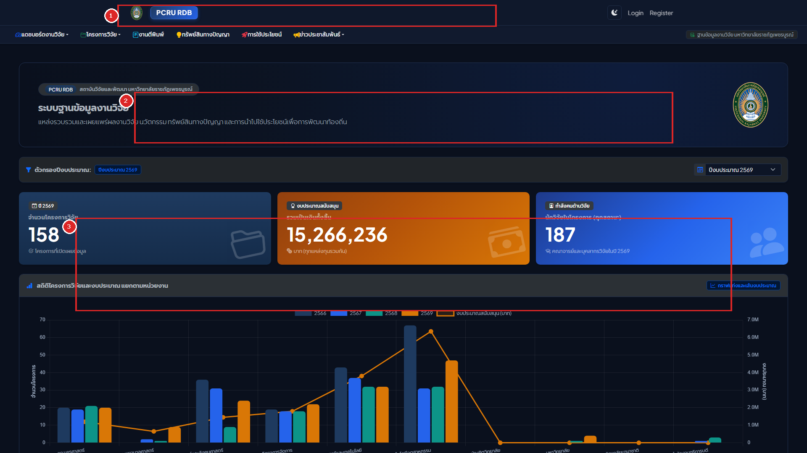
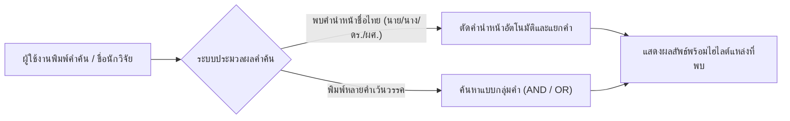
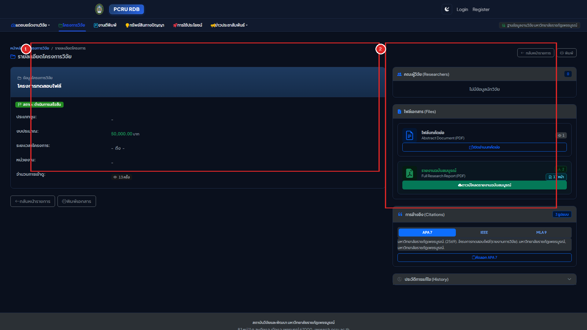
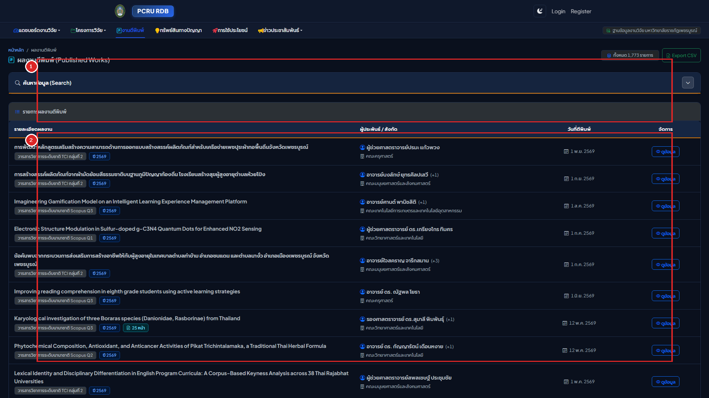
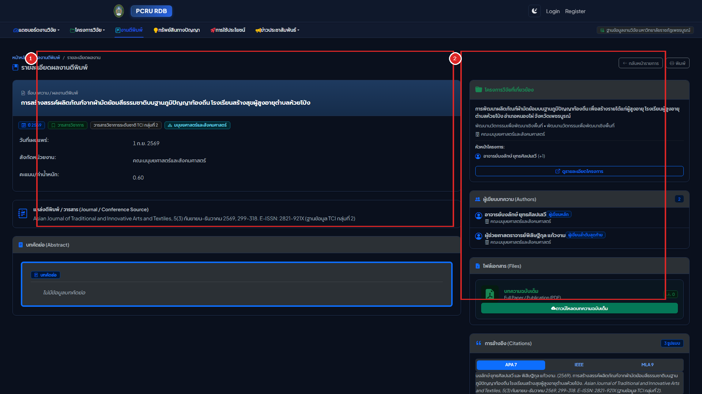
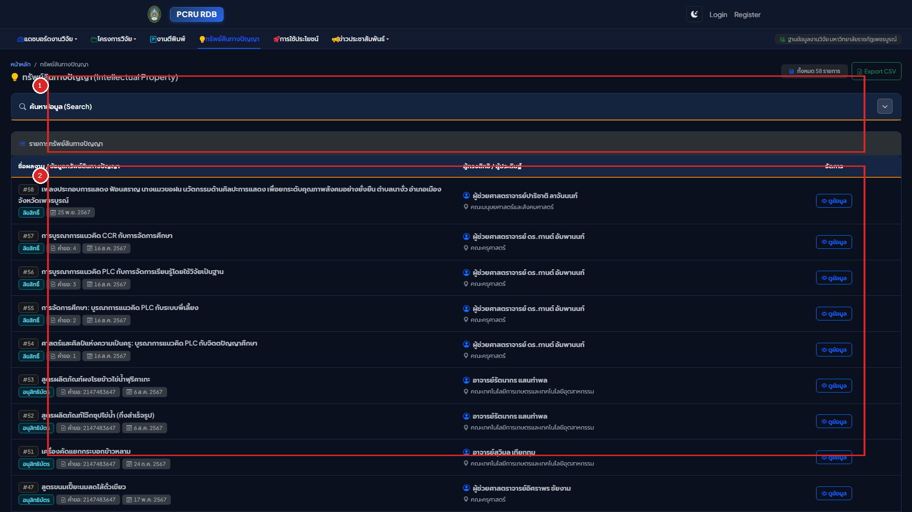
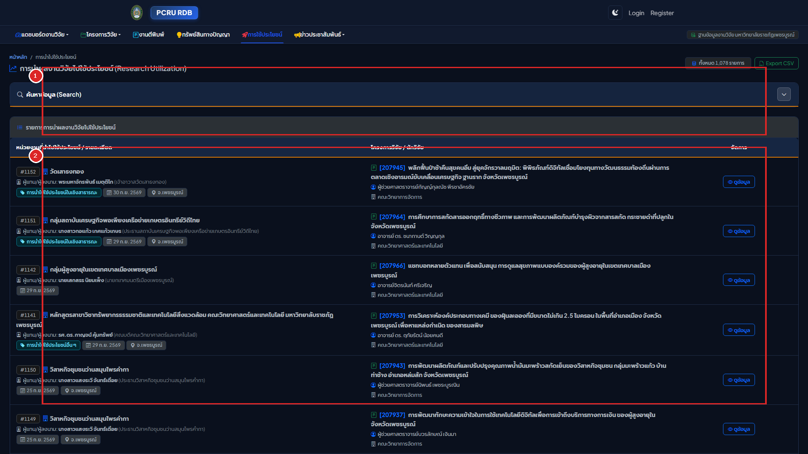
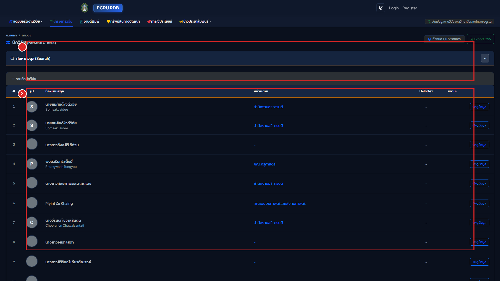
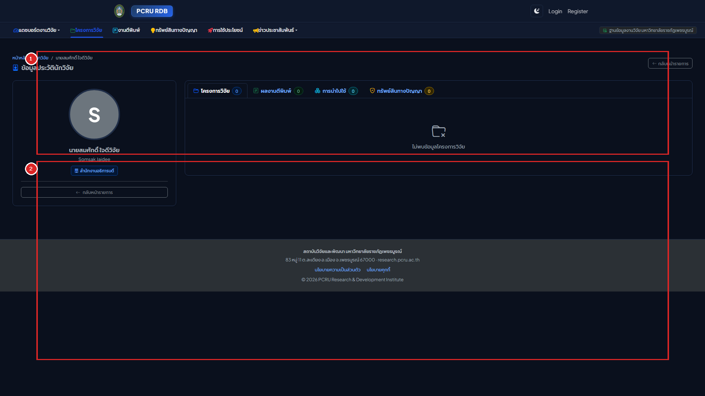
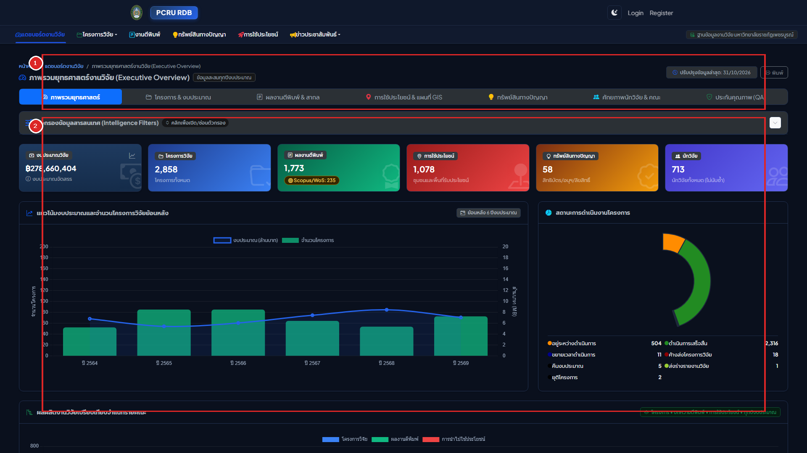

# เล่มที่ 1: คู่มือการใช้งานระบบหน้าบ้าน (Volume 1: Frontend Public User Manual)
## ระบบฐานข้อมูลงานวิจัย มหาวิทยาลัยราชภัฏเพชรบูรณ์ (PCRU Research Database)

> [!NOTE]
> **ข้อมูลจำเพาะของเอกสาร (Document Control)**
> - **รหัสเอกสาร**: `PCRU-RDB-MAN-VOL1-2569`
> - **กลุ่มผู้ใช้งานเป้าหมาย**: คณาจารย์, นักวิจัย, นักศึกษา, บุคลากรทางการศึกษา, หน่วยงานภาครัฐ/เอกชน และประชาชนทั่วไป
> - **รูปแบบการใช้งาน**: ระบบเว็บแอปพลิเคชันสาธารณะ (Public Web Portal) รองรับคอมพิวเตอร์ แท็บเล็ต และสมาร์ตโฟน
> - **URL เข้าใช้งาน**: `http://laravel_rdb.test/` (หรือโดเมนหลักของสถาบันวิจัยและพัฒนา มหาวิทยาลัยราชภัฏเพชรบูรณ์)

---

## สารบัญ (Table of Contents)
1. [บทที่ 1: ภาพรวมระบบและการนำทาง (System Overview & Interface Navigation)](#บทที่-1-ภาพรวมระบบและการนำทาง-system-overview--interface-navigation)
2. [บทที่ 2: การสืบค้นข้อมูลงานวิจัยอัจฉริยะ (Smart Search & Dynamic Filtering)](#บทที่-2-การสืบค้นข้อมูลงานวิจัยอัจฉริยะ-smart-search--dynamic-filtering)
3. [บทที่ 3: การใช้งานโมดูลโครงการวิจัย (Research Projects Directory)](#บทที่-3-การใช้งานโมดูลโครงการวิจัย-research-projects-directory)
4. [บทที่ 4: การใช้งานโมดูลผลงานตีพิมพ์และงานวิชาการ (Publications & Academic Citations)](#บทที่-4-การใช้งานโมดูลผลงานตีพิมพ์และงานวิชาการ-publications--academic-citations)
5. [บทที่ 5: การใช้งานโมดูลทรัพย์สินทางปัญญา (Intellectual Property - DIP)](#บทที่-5-การใช้งานโมดูลทรัพย์สินทางปัญญา-intellectual-property---dip)
6. [บทที่ 6: การใช้งานโมดูลการนำงานวิจัยไปใช้ประโยชน์ (Research Utilizations)](#บทที่-6-การใช้งานโมดูลการนำงานวิจัยไปใช้ประโยชน์-research-utilizations)
7. [บทที่ 7: การใช้งานทำเนียบนักวิจัย (Researchers Directory & Academic Portfolio)](#บทที่-7-การใช้งานทำเนียบนักวิจัย-researchers-directory--academic-portfolio)
8. [บทที่ 8: แดชบอร์ดสถิติสารสนเทศและฟีดข่าวสาร (Dashboards & RSS Feeds)](#บทที่-8-แดชบอร์ดสถิติสารสนเทศและฟีดข่าวสาร-dashboards--rss-feeds)

---

## บทที่ 1: ภาพรวมระบบและการนำทาง (System Overview & Interface Navigation)

### 1.1 แนะนำระบบฐานข้อมูลงานวิจัย มหาวิทยาลัยราชภัฏเพชรบูรณ์
ระบบฐานข้อมูลงานวิจัย (PCRU Research Database) พัฒนาขึ้นภายใต้แนวคิด **Scholarly Editorial Craftsmanship** เพื่อเป็นศูนย์กลางคลังปัญญาและสารสนเทศงานวิจัยของมหาวิทยาลัยราชภัฏเพชรบูรณ์ โดยรวบรวมข้อมูลโครงการวิจัยกว่า **2,870 โครงการ**, ผลงานตีพิมพ์ทางวิชาการกว่า **1,873 บทความ**, ข้อมูลการนำไปใช้ประโยชน์กว่า **1,112 รายการ**, ทรัพย์สินทางปัญญา **59 รายการ** และทำเนียบนักวิจัยกว่า **1,072 ท่าน** ให้ประชาชนและนักวิชาการสามารถสืบค้นและเข้าถึงองค์ความรู้ได้อย่างสะดวกรวดเร็ว

### 1.2 โครงสร้างหน้าจอหลัก (Portal Layout Walkthrough)



**คำอธิบายหมายเลขกำกับบนหน้าจอ:**
* **หมายเลข `[1]` แถบเมนูนำทางหลัก (Main Navigation Bar)**: ใช้สำหรับสลับเข้าสู่โมดูลหลักทั้ง 7 ส่วน ได้แก่ หน้าแรก, โครงการวิจัย, ผลงานตีพิมพ์, ทรัพย์สินทางปัญญา, การนำไปใช้ประโยชน์, ทำเนียบนักวิจัย, แดชบอร์ดสถิติ รวมถึงปุ่มสลับธีมมืด/สว่าง และปุ่มเข้าสู่ระบบสำหรับเจ้าหน้าที่/นักวิจัย
* **หมายเลข `[2]` แบนเนอร์สืบค้นอัจฉริยะและตัวกรองปีงบประมาณ (Hero Search & Fiscal Year Filter)**: พื้นที่สำหรับพิมพ์คำค้นหาแบบครอบคลุมทุกโมดูล หรือเลือกกรองข้อมูลเฉพาะปีงบประมาณ พ.ศ. ที่ต้องการดูสถิติ
* **หมายเลข `[3]` การ์ดสรุปสถิติภาพรวมงานวิจัย (Executive Stat Cards)**: แสดงตัวเลขสถิติสำคัญของมหาวิทยาลัยด้วยรูปแบบตัวเลขเรียงหลักตรงกัน (`tabular-nums`) แยกตามจำนวนโครงการวิจัย, งบประมาณวิจัยสะสม, ผลงานตีพิมพ์ และการใช้ประโยชน์

### 1.3 การสลับโหมดสีหน้าจอ (Light Mode / Dark Mode Switcher)
ระบบรองรับการแสดงผล 2 โหมดสีตามมาตรฐานสายตาทางวิชาการ:
1. **โหมดสว่าง (Daylight Editorial Slate)**: พื้นหลังโทนขาวอมเทาอ่อน สบายตา เหมาะสำหรับการอ่านในสภาพแวดล้อมแสงปกติและการสั่งพิมพ์เอกสาร
2. **โหมดมืด (Carbon-Navy Night Reading)**: พื้นหลังโทนสีน้ำเงินเข้มวิชาการ (`#0F172A`) ลดแสงสีฟ้าสะท้อนเข้าตา เหมาะสำหรับการอ่านบทคัดย่อหรือตรวจทานข้อมูลในเวลากลางคืน

**ขั้นตอนการสลับโหมดสี:**
1. มองไปที่มุมขวาบนของแถบเมนูนำทางหลัก (`[1]`)
2. คลิกที่ไอคอน **รูปดวงอาทิตย์ (`☀️`) / รูปพระจันทร์เสี้ยว (`🌙`)**
3. หน้าจอจะเปลี่ยนโทนสีทันทีโดยไม่ต้องโหลดหน้าเว็บใหม่ และระบบจะจดจำค่าที่เลือกไว้ในเบราว์เซอร์อัตโนมัติ

---

## บทที่ 2: การสืบค้นข้อมูลงานวิจัยอัจฉริยะ (Smart Search & Dynamic Filtering)

ระบบสืบค้นของ PCRU Research Database ออกแบบมาให้รองรับพฤติกรรมการค้นหาข้อมูลภาษาไทยและภาษาอังกฤษอย่างแม่นยำ ดังแผนผังการทำงานต่อไปนี้:



### 2.1 การค้นหาด่วนจากหน้าแรก (Global Quick Search)
1. คลิกที่ช่องค้นหาในส่วนที่ `[2]` บนหน้าแรก
2. พิมพ์คำสำคัญที่ต้องการ เช่น `"เกษตรอินทรีย์"`, `"การท่องเที่ยวเพชรบูรณ์"`, หรือ `"พลังงานทดแทน"`
3. กดปุ่ม **Enter** บนแป้นพิมพ์ หรือคลิกปุ่ม **"ค้นหา"**
4. ระบบจะแสดงรายการโครงการวิจัยและผลงานที่เกี่ยวข้องทันที

### 2.2 การใช้ตัวกรองปีงบประมาณ พ.ศ. (Fiscal Year Filter)
1. ในหน้าแรกหรือหน้าแดชบอร์ด คลิกที่ Dropdown **"ปีงบประมาณ พ.ศ."**
2. เลือกปี พ.ศ. ที่ต้องการ (เช่น `2568`, `2567`, `2566`)
3. ระบบจะกรองตัวเลขสถิติและกราฟทั้งหมดให้แสดงเฉพาะข้อมูลของปีงบประมาณนั้นทันที

### 2.3 เทคนิคการค้นหาแบบกลุ่มคำ (Multi-Keyword Search Mode)
ในหน้าค้นหาของแต่ละโมดูล ผู้ใช้สามารถเลือกตรรกะการจับคู่คำค้นได้ 2 รูปแบบ:
* **โหมด "ทุกคำ (Match All - AND)"**: ใช้เมื่อต้องการผลลัพธ์ที่มีคำค้นครบทุกคำ เช่น พิมพ์ `"ข้าวไร่ เพชรบูรณ์"` ระบบจะแสดงเฉพาะงานวิจัยที่มีทั้งคำว่า "ข้าวไร่" และ "เพชรบูรณ์" อยู่ด้วยกัน
* **โหมด "บางคำ (Match Any - OR)"**: ใช้เมื่อต้องการขยายวงการค้นหา เช่น พิมพ์ `"มะขาม ข้าวโพด"` ระบบจะแสดงงานวิจัยที่มีคำว่า "มะขาม" หรือ "ข้าวโพด" อย่างใดอย่างหนึ่งหรือทั้งสองคำ

> [!TIP]
> **ระบบตัดคำนำหน้าชื่อภาษาไทยอัตโนมัติ**: เมื่อต้องการค้นหาชื่อนักวิจัย ท่านสามารถพิมพ์ชื่อ-นามสกุลได้ทันที หรือแม้จะคัดลอกชื่อที่มีคำนำหน้าติดมา เช่น `"ผศ.ดร.สมชาย ใจดี"` หรือ `"นางสาวสมหญิง"` ระบบจะตัดคำนำหน้า (`นาย`, `นาง`, `นางสาว`, `ดร.`, `ผศ.`, `รศ.`, `ศ.`) ออกให้อัตโนมัติ เพื่อให้ค้นพบข้อมูลนักวิจัยได้ 100% แม้ฐานข้อมูลจะเก็บคำนำหน้าแยกฟิลด์กัน

---

## บทที่ 3: การใช้งานโมดูลโครงการวิจัย (Research Projects Directory)

### 3.1 การเข้าดูและกรองรายการโครงการวิจัย (`/rdbproject`)


**ขั้นตอนการใช้งานหน้ารายการโครงการวิจัย:**
1. **ส่วนที่ `[1]` แผงตัวกรองค้นหาขั้นสูง (Search & Filter Panel)**:
   * **ชื่อโครงการ / คำสำคัญ**: พิมพ์ชื่อเรื่องภาษาไทยหรือภาษาอังกฤษ
   * **นักวิจัย**: พิมพ์ชื่อผู้วิจัย (มีระบบ Autocomplete แนะนำรายชื่ออัตโนมัติขณะพิมพ์)
   * **ปีงบประมาณ / ประเภทโครงการ / หน่วยงานคณะ**: เลือกกรองตามสังกัดคณะหรือแหล่งทุน
   * **ช่วงวันที่เริ่มต้น - สิ้นสุด**: เลือกจากปฏิทินรูปแบบ พ.ศ. (ระบบตรวจสอบความถูกต้องว่าวันสิ้นสุดต้องไม่น้อยกว่าวันเริ่มต้นเสมอ)
2. **ส่วนที่ `[2]` ตารางแสดงผลรายการโครงการวิจัย (Projects Data Table)**:
   * แสดงปีงบประมาณ พ.ศ., รหัสโครงการ, ชื่อโครงการวิจัย, คณะผู้วิจัยพร้อมระบุบทบาท (หัวหน้าโครงการ/ผู้ร่วมวิจัย), สังกัดคณะ, งบประมาณ และสถานะโครงการ
   * คลิกที่ **ชื่อโครงการวิจัย** หรือปุ่ม **"ดูรายละเอียด"** เพื่อเข้าสู่หน้าข้อมูลโครงการฉบับเต็ม

### 3.2 หน้าแสดงรายละเอียดโครงการวิจัย (`/rdbproject/{id}`)



**ส่วนประกอบสำคัญในหน้ารายละเอียดโครงการ:**
* **ส่วนที่ `[1]` ข้อมูลหลักและบทคัดย่อ (Project Metadata & Abstract)**:
  * แสดงชื่อโครงการ (ภาษาไทย / ภาษาอังกฤษ), ประเภททุนวิจัย, ยุทธศาสตร์การวิจัย, งบประมาณที่ได้รับจัดสรร และระยะเวลาดำเนินงาน (แสดงวันที่ภาษาไทย พ.ศ. เต็ม เช่น `1 ตุลาคม 2567`)
  * แสดงรายชื่อคณะผู้วิจัยทุกคน พร้อมสัดส่วนการทำวิจัย (%) และลิงก์คลิกไปดูโปรไฟล์ของนักวิจัยแต่ละท่าน
  * แสดงบทคัดย่อ (Abstract) พร้อมปุ่ม **"คัดลอกบทคัดย่อ"** มุมขวาบนของกล่องข้อความ
* **ส่วนที่ `[2]` การ์ดไฟล์เอกสารโครงการและการอ้างอิง (Files & Citations Card)**:
  * แสดงไฟล์บทคัดย่อ (Abstract PDF) และไฟล์เล่มรายงานวิจัยฉบับสมบูรณ์ (Full Report PDF)
  * แสดงภาพตัวอย่างหน้าแรกของเอกสาร (`.webp` First-Page Cover Preview) และป้ายจำนวนหน้าเอกสาร (`XX หน้า`)

### 3.3 ความเข้าใจเกี่ยวกับระดับสิทธิ์การเปิดเผยเล่มรายงานวิจัย 3 ระดับ
เพื่อคุ้มครองทรัพย์สินทางปัญญาและข้อมูลที่อยู่ระหว่างการจดสิทธิบัตร ระบบแบ่งสถานะของเล่มรายงานวิจัยฉบับสมบูรณ์ (`pro_file_show`) ออกเป็น 3 สถานะชัดเจน:

| สถานะเอกสาร | ป้ายสัญลักษณ์ที่แสดงบนหน้าจอ | สิทธิ์การเข้าถึงของประชาชนทั่วไป |
| :--- | :--- | :--- |
| **1. เปิดเผยสาธารณะ (`Public`)** | ป้ายสีเขียว `เปิดเผยต่อสาธารณะ` พร้อมภาพปกหน้าแรก `.webp` และจำนวนหน้า | **สามารถคลิกเปิดอ่านและดาวน์โหลดไฟล์ PDF เล่มสมบูรณ์ได้ทันที** |
| **2. ปกปิดเล่มรายงาน (`Concealed`)** | ป้ายสีแดง `<i class="bi bi-shield-lock-fill"></i> เล่มรายงานวิจัยถูกปกปิด (ไม่สามารถเปิดเผยข้อมูลได้)` | อ่านข้อมูลโครงการและบทคัดย่อได้ แต่ **ไม่สามารถดาวน์โหลดไฟล์เล่มรายงานฉบับสมบูรณ์ได้** |
| **3. ฉบับร่าง (`Draft`)** | ป้ายสีเหลือง `<i class="bi bi-pencil-square"></i> เล่มรายงานวิจัยอยู่ในสถานะฉบับร่าง (ยังไม่เผยแพร่)` | อยู่ระหว่างการตรวจประเมินหรือรอการอนุมัติ ยังไม่เปิดให้ดาวน์โหลด |

---

## บทที่ 4: การใช้งานโมดูลผลงานตีพิมพ์และงานวิชาการ (Publications & Academic Citations)

### 4.1 การค้นหาผลงานตีพิมพ์เผยแพร่ (`/rdbpublished`)



**ขั้นตอนการสืบค้นผลงานตีพิมพ์:**
1. ในส่วนที่ `[1]` สามารถกรองตาม **ชื่อบทความ**, **ชื่อวารสาร/งานประชุมวิชาการ**, **ชื่อผู้แต่ง**, **ปีที่ตีพิมพ์ พ.ศ.** และ **ประเภทฐานข้อมูล (เช่น Scopus, Web of Science, TCI กลุ่ม 1, TCI กลุ่ม 2)**
2. ในส่วนที่ `[2]` ตารางผลลัพธ์จะแสดงชื่อบทความ, ชื่อวารสาร, ระดับฐานข้อมูล, ปี พ.ศ. ที่ตีพิมพ์ และชื่อนักวิจัยผู้ประพันธ์หลัก
3. คลิกที่ชื่อบทความเพื่อเข้าดูรายละเอียดฉบับเต็ม

### 4.2 หน้ารายละเอียดบทความตีพิมพ์และระบบคัดลอกการอ้างอิงอัตโนมัติ (`/rdbpublished/{id}`)



**การใช้งานฟังก์ชันเด่นในหน้ารายละเอียดบทความ:**
1. **การดาวน์โหลดบทความฉบับเต็ม (Full Paper PDF)** (ในกรอบ `[2]` ด้านขวาบน):
   * แสดง **ภาพปกหน้าแรกของบทความ (`.webp`)** ที่สกัดจากไฟล์จริง
   * แสดง **จำนวนหน้าทั้งหมดของไฟล์ PDF** และ **สถิติจำนวนครั้งที่ถูกดาวน์โหลด**
   * คลิกปุ่มสีเขียว **"ดาวน์โหลดบทความฉบับเต็ม"** เพื่อเปิดอ่านหรือบันทึกไฟล์ PDF
2. **การคัดลอกรูปแบบการอ้างอิงทางวิชาการ (Academic Citations Generator)** (ในกรอบ `[2]` ด้านขวาล่าง):
   * ระบบสร้างข้อความอ้างอิงตามมาตรฐานสากลให้อัตโนมัติ 3 รูปแบบ:
     * **แท็บ `APA 7`**: รูปแบบ American Psychological Association (7th Edition)
     * **แท็บ `IEEE`**: รูปแบบวิศวกรรมศาสตร์และเทคโนโลยี (ตัวเลขลำดับ `[1]`)
     * **แท็บ `MLA 9`**: รูปแบบมนุษยศาสตร์และศิลปศาสตร์
   * คลิกเลือกแท็บที่ต้องการ แล้วกดปุ่ม **"คัดลอกการอ้างอิง"** ระบบจะคัดลอกข้อความพร้อมรูปแบบตัวเอียงของชื่อวารสารลงใน Clipboard ทันที

---

## บทที่ 5: การใช้งานโมดูลทรัพย์สินทางปัญญา (Intellectual Property - DIP)



### ขั้นตอนการสืบค้นข้อมูลทรัพย์สินทางปัญญา (`/rdbdip`)
1. เลือกเมนู **"ทรัพย์สินทางปัญญา"** จากแถบเมนูด้านบน
2. ในส่วนที่ `[1]` สามารถค้นหาจาก **ชื่อผลงาน**, **เลขที่คำขอ**, **ประเภททรัพย์สินทางปัญญา** (สิทธิบัตรการประดิษฐ์, สิทธิบัตรการออกแบบผลิตภัณฑ์, อนุสิทธิบัตร, ลิขสิทธิ์) หรือ **ชื่อผู้ประดิษฐ์**
3. ในส่วนที่ `[2]` ตารางแสดงรายการผลงานพร้อมเลขที่คำขอ, วันที่ยื่นคำขอ (รูปแบบ พ.ศ.), ผู้สร้างสรรค์ และโครงการวิจัยต้นทาง
4. คลิกที่รายการเพื่อดูรายละเอียดคำขอและเปิดดูเอกสารรับรอง (กรณีเปิดเผยไฟล์)

---

## บทที่ 6: การใช้งานโมดูลการนำงานวิจัยไปใช้ประโยชน์ (Research Utilizations)



### ขั้นตอนการสืบค้นข้อมูลการนำไปใช้ประโยชน์ (`/rdbprojectutilize`)
1. เลือกเมนู **"การนำไปใช้ประโยชน์"** จากแถบเมนูหลัก
2. ในส่วนที่ `[1]` สามารถกรองตาม:
   * **ประเภทการนำไปใช้ประโยชน์ 4 ด้าน**: เชิงพาณิชย์, เชิงนโยบาย, เชิงสาธารณะ/ชุมชนและสังคม, เชิงวิชาการ
   * **พื้นที่การนำไปใช้ประโยชน์**: ค้นหาตามจังหวัด, อำเภอ, ตำบล (ระบบเชื่อมโยงฐานข้อมูลพื้นที่ประเทศไทย)
   * **ชื่อหน่วยงานที่ใช้ประโยชน์** หรือ **ชื่อโครงการวิจัยต้นทาง**
3. ในส่วนที่ `[2]` คลิกดูรายละเอียดเพื่อศึกษาผลกระทบ (Impact) และเปิดดูไฟล์หนังสือรับรองการนำไปใช้ประโยชน์

---

## บทที่ 7: การใช้งานทำเนียบนักวิจัย (Researchers Directory & Academic Portfolio)

````carousel

<!-- slide -->

````

### 7.1 การค้นหาทำเนียบนักวิจัย (`/rdbresearcher`)
1. พิมพ์ชื่อหรือนามสกุลนักวิจัย (ภาษาไทยหรือภาษาอังกฤษ) ในช่องค้นหาส่วนที่ `[1]` หรือเลือกกรองตาม **คณะ/หน่วยงานสังกัด**
2. ตารางส่วนที่ `[2]` จะแสดงรูปภาพประจำตัว, ชื่อ-นามสกุล, ตำแหน่งทางวิชาการ, สังกัดคณะ และจำนวนผลงานวิจัยสะสม

### 7.2 การดูแฟ้มประวัติและผลงานนักวิจัยรายบุคคล (`/rdbresearcher/{id}`)
1. **ส่วนที่ `[1]` ข้อมูลประวัติและรหัสสากลของนักวิจัย**:
   * แสดงสังกัดคณะ/สาขาวิชา, ความเชี่ยวชาญ และข้อมูลติดต่อ
   * แสดงรหัส **Scopus Author ID** และ **ORCID iD** (สามารถคลิกที่ปุ่มลิงก์เพื่อเปิดดูโปรไฟล์ของนักวิจัยบนเว็บไซต์ Scopus และ ORCID ได้โดยตรง)
2. **ส่วนที่ `[2]` แท็บรวมผลงานทางวิชาการทั้งหมดของนักวิจัย**:
   * แสดงรายการโครงการวิจัยทั้งหมดที่นักวิจัยเป็นหัวหน้าโครงการหรือผู้ร่วมวิจัย
   * แสดงรายการผลงานตีพิมพ์, ทรัพย์สินทางปัญญา และการนำไปใช้ประโยชน์ทั้งหมดของนักวิจัยท่านนั้นในหน้าเดียว

---

## บทที่ 8: แดชบอร์ดสถิติสารสนเทศและฟีดข่าวสาร (Dashboards & RSS Feeds)



### 8.1 การใช้งานแดชบอร์ดสถิติงานวิจัย (`/dashboard`)
1. **ส่วนที่ `[1]` แถบเลือกมิติข้อมูลและตัวกรองปีงบประมาณ**:
   * เลือกสลับดูแดชบอร์ดเฉพาะด้านได้ 6 มิติ ได้แก่: **ภาพรวมทั้งหมด (Overview)**, **โครงการวิจัย (Projects)**, **ผลงานตีพิมพ์ (Publications)**, **ทรัพย์สินทางปัญญา (IP)**, **การนำไปใช้ประโยชน์ (Utilizations)**, **นักวิจัย (Researchers)** และ **ประกันคุณภาพ (QA)**
   * เลือกช่วงปีงบประมาณ พ.ศ. ที่ต้องการเปรียบเทียบข้อมูล
2. **ส่วนที่ `[2]` กราฟวิเคราะห์ข้อมูลแบบโต้ตอบ (Interactive Charts)**:
   * แสดงกราฟแท่งและกราฟเส้นเปรียบเทียบจำนวนโครงการและงบประมาณแยกตามคณะ/หน่วยงาน
   * เมื่อนำเมาส์ชี้ (Hover) บนแท่งกราฟ ระบบจะแสดง Tooltip รายละเอียดตัวเลขงบประมาณและสัดส่วนอย่างชัดเจน

### 8.2 การรับข้อมูลผ่าน RSS Feeds และข่าวประชาสัมพันธ์
* บุคคลทั่วไปและระบบห้องสมุดสามารถดึงฟีดข้อมูลข่าวสารงานวิจัยและงานประชุมวิชาการไปแสดงผลต่อได้ผ่าน URL มาตรฐาน XML RSS:
  * **RSS ข่าวประชาสัมพันธ์วิจัย**: `/feeds/news`
  * **RSS งานประชุมวิชาการระดับชาติ/นานาชาติ**: `/feeds/conferences`

