# เล่มที่ 2: คู่มือการใช้งานระบบหลังบ้าน (Volume 2: Backend Administrative & Researcher Manual)
## ระบบฐานข้อมูลงานวิจัย มหาวิทยาลัยราชภัฏเพชรบูรณ์ (PCRU Research Database)

> [!NOTE]
> **ข้อมูลจำเพาะของเอกสาร (Document Control)**
> - **รหัสเอกสาร**: `PCRU-RDB-MAN-VOL2-2569`
> - **กลุ่มผู้ใช้งานเป้าหมาย**: นักวิจัย (Researcher), ผู้ทรงคุณวุฒิประเมินงานวิจัย (Reviewer), ผู้ประสานงานคณะ (Faculty Coordinator), เจ้าหน้าที่สถาบันวิจัยและพัฒนา (Admin / Domain Admin) และผู้ดูแลระบบสูงสุด (Super Admin)
> - **URL เข้าสู่ระบบหลังบ้าน**: `http://laravel_rdb.test/login` ➔ `/backend/site`

---

## สารบัญ (Table of Contents)
1. [บทที่ 1: การเข้าสู่ระบบ ความปลอดภัย และการยืนยันตัวตนนักวิจัย (Authentication & Onboarding)](#บทที่-1-การเข้าสู่ระบบ-ความปลอดภัย-และการยืนยันตัวตนนักวิจัย-authentication--onboarding)
   * 1.1 นโยบายความปลอดภัยและการเข้าสู่ระบบด้วย Google SSO (@pcru.ac.th)
   * 1.2 การเข้าสู่ระบบด้วยบัญชีผู้ใช้และรหัสผ่าน (Username / Password)
   * 1.3 กระบวนการอนุมัติสมาชิกใหม่และการผูกโปรไฟล์นักวิจัยด้วย TomSelect (Onboarding & Profile Linking)
   * 1.4 ภาพรวมแดชบอร์ดหลังบ้านและการนำทาง (Backend Layout Walkthrough)
2. [บทที่ 2: โครงสร้างบทบาท สิทธิ์การใช้งาน และการจำลองสิทธิ์ (RBAC & Impersonation)](#บทที่-2-โครงสร้างบทบาท-สิทธิ์การใช้งาน-และการจำลองสิทธิ์-rbac--impersonation)
   * 2.1 ตารางวิเคราะห์ระดับสิทธิ์และขอบเขตข้อมูล (Role Permission Matrix)
   * 2.2 การจำกัดขอบเขตข้อมูลนักวิจัยอย่างเข้มงวด (Strict Researcher Isolation)
   * 2.3 ขั้นตอนการจำลองสิทธิ์ผู้ใช้งาน (User Impersonation)
3. [บทที่ 3: วงจรชีวิตการส่งร่าง ตรวจสอบ และอนุมัติเปิดเผยผลงาน (Workflow Lifecycle: WF-01 ถึง WF-07)](#บทที่-3-วงจรชีวิตการส่งร่าง-ตรวจสอบ-และอนุมัติเปิดเผยผลงาน-workflow-lifecycle-wf-01-ถึง-wf-07)
   * 3.1 แผนผังวงจรสถานะงานวิจัย (State-Driven Workflow Diagram)
   * 3.2 ขั้นตอนการทำงานสำหรับนักวิจัย (Researcher Workflow Guide)
   * 3.3 ขั้นตอนการทำงานสำหรับผู้ดูแลระบบในคิวงานตรวจสอบ (Review Queue Management)
   * 3.4 ระบบแจ้งเตือนทางกระดิ่งและอีเมล (Notification System)
4. [บทที่ 4: การบริหารจัดการโครงการวิจัยขั้นสูง ระบบนับหน้า PDF และปก .webp](#บทที่-4-การบริหารจัดการโครงการวิจัยขั้นสูง-ระบบนับหน้า-pdf-และปก-webp)
   * 4.1 พจนานุกรมฟิลด์แบบฟอร์มบันทึกโครงการวิจัย (Project Form Field Dictionary)
   * 4.2 การจัดการสัดส่วนร้อยละของคณะผู้วิจัย (Research Weighting: รวม 100%)
   * 4.3 สถาปัตยกรรมเครื่องยนต์ PDF อัตโนมัติ (Automated PDF Engine: 4-Tier Counter & 5-Tier WebP)
   * 4.4 การสลับระดับสิทธิ์เปิดเผยเล่มรายงานวิจัย 3 สถานะ (`pro_file_show` Toggle)
5. [บทที่ 5: ระบบตรวจประเมินเล่มรายงานวิจัยฉบับสมบูรณ์ (Peer Review Subsystem)](#บทที่-5-ระบบตรวจประเมินเล่มรายงานวิจัยฉบับสมบูรณ์-peer-review-subsystem)
   * 5.1 สถาปัตยกรรมการประเมินแบบ Single-Blind Peer Review
   * 5.2 การออกแบบเกณฑ์และสเกลคะแนนแบบประเมิน (Rubric Form Designer)
   * 5.3 วงจรสถานะการส่งเล่มรายงาน 8 ขั้นตอน (Submission States Lifecycle)
   * 5.4 การมอบหมายผู้ทรงคุณวุฒิ และการบันทึกผลการประเมินของผู้ทรงคุณวุฒิ
   * 5.5 กระบวนการส่งเล่มแก้ไขรอบที่ 2 และการยื่นคำชี้แจงโต้แย้ง (Dispute Workflow)
   * 5.6 การสรุปผลคะแนนและการอนุมัติปิดโครงการเล่มสมบูรณ์ (Final Approval)
6. [บทที่ 6: การบริหารจัดการผลงานตีพิมพ์ ทรัพย์สินทางปัญญา และการใช้ประโยชน์](#บทที่-6-การบริหารจัดการผลงานตีพิมพ์-ทรัพย์สินทางปัญญา-และการใช้ประโยชน์)
   * 6.1 การจัดการผลงานตีพิมพ์ (`/backend/rdb_published`)
   * 6.2 การจัดการทรัพย์สินทางปัญญา (`/backend/rdb_dip`)
   * 6.3 การจัดการการนำงานวิจัยไปใช้ประโยชน์ (`/backend/rdb_projectutilize`)
7. [บทที่ 7: การบริหารข้อมูลพื้นฐานของระบบ (Master Data Management: 17 โมดูล)](#บทที่-7-การบริหารข้อมูลพื้นฐานของระบบ-master-data-management-17-โมดูล)
   * 7.1 ภาพรวมโมดูลข้อมูลหลัก 17 รายการ
   * 7.2 ขั้นตอนการบริหารจัดการ Master Data แต่ละตาราง
8. [บทที่ 8: การบริหารข้อมูลนักวิจัยและการเชื่อมโยงฐานข้อมูลสากล (Scopus & ORCID)](#บทที่-8-การบริหารข้อมูลนักวิจัยและการเชื่อมโยงฐานข้อมูลสากล-scopus--orcid)
   * 8.1 การตรวจสอบความถูกต้องของรหัสบัตรประชาชน 13 หลัก (Modulo 11 Algorithm)
   * 8.2 การซิงก์ดัชนีทางวิชาการ Scopus Author ID และ h-index
   * 8.3 การตรวจสอบและเชื่อมโยงรหัสสากล ORCID iD
9. [บทที่ 9: การส่งออกรายงาน UTF-8 BOM Excel และคลังปัญญา DSpace SAF](#บทที่-9-การส่งออกรายงาน-utf-8-bom-excel-และคลังปัญญา-dspace-saf)
   * 9.1 การสตรีมไฟล์ CSV ขนาดใหญ่พร้อมฝังรหัส UTF-8 BOM
   * 9.2 การส่งออกแพ็กเกจคลังปัญญา DSpace SAF แบบกลุ่ม (Batch Mode)
   * 9.3 เครื่องมือตรวจสอบความสมบูรณ์ของไฟล์ PDF ก่อนส่งออก (DSpace Check Mode)
   * 9.4 คำสั่งดูแลรักษาระบบผ่าน Artisan CLI
10. [บทที่ 10: ประวัติการใช้งาน (Audit Logs) และการตั้งค่านโยบายความปลอดภัย](#บทที่-10-ประวัติการใช้งาน-audit-logs-และการตั้งค่านโยบายความปลอดภัย)
    * 10.1 การตรวจสอบประวัติการทำรายการ (Audit Trail) และเครื่องมือเปรียบเทียบค่าเดิม-ใหม่ (Diff Viewer)
    * 10.2 การตั้งค่านโยบายความปลอดภัยการดาวน์โหลดเอกสาร (Document Access Policy)
    * 10.3 การตรวจสอบประวัติกิจกรรมและการแก้ไขรายรายการ (Record-Level Audit Trail)
11. [บทที่ 11: ศูนย์จัดการคำสั่งระบบและการบำรุงรักษา (System Commands & Maintenance Dashboard)](#บทที่-11-ศูนย์จัดการคำสั่งระบบและการบำรุงรักษา-system-commands--maintenance-dashboard)
    * 11.1 ภาพรวมหน้าจอศูนย์คำสั่งระบบ (`/backend/system-commands`)
    * 11.2 คำสั่งสร้างภาพหน้าแรก PDF (.webp) ทั้งระบบด้วย MuPDF & GD
    * 11.3 คำสั่งตรวจนับจำนวนหน้าไฟล์ PDF ย้อนหลัง (Page Count Engine)
    * 11.4 คำสั่งแปลงรูปภาพทั้งระบบเป็น WebP (Universal WebP Image Converter)
    * 11.5 คำสั่งล้างแคชและรีเซ็ตระบบ (Clear Application, Route, View, Config Cache)
    * 11.6 การตรวจสอบความพร้อมของเซิร์ฟเวอร์และเอนจิน (Server Engine Health Check)
    * 11.7 คู่มือขั้นตอนการติดตั้งเอนจินประมวลผล PDF และฟอนต์ภาษาไทย (SysAdmin Engine Installation Guide)
    * 11.8 ศูนย์สำรองและกู้คืนข้อมูลระบบ (System Backup, Restore with Email OTP & Cloud Sync)
    * 11.9 การตั้งค่าระบบการส่งอีเมลของมหาวิทยาลัย (Mail & SMTP Configuration)
    * 11.10 การตั้งเวลาทำงานอัตโนมัติและการตรวจสุขภาพระบบ (Task Scheduling & Live Diagnostics)
    * 11.11 ศูนย์สำรองและกู้คืนข้อมูลระบบแบบแยกเฉพาะ (Dedicated Disaster Recovery Hub)
    * 11.12 ระบบการจัดการการแจ้งเตือนส่วนบุคคลและ Telegram Bot (Personal & Admin Notification Center)
    * 11.13 เกราะป้องกันความเข้ากันได้ของชื่อฟิลด์ฐานข้อมูล (Schema Integrity Defense Layer & Smart Accessors)
    * 11.14 สถาปัตยกรรมระบบแปลงรูปภาพทั้งระบบเป็น WebP (Universal WebP Image Converter Pipeline)
12. [บทที่ 12: การบริหารจัดการข่าวสารทุนวิจัยและงานประชุมวิชาการ (Research News & Conference Management)](#บทที่-12-การบริหารจัดการข่าวสารทุนวิจัยและงานประชุมวิชาการ-research-news--conference-management)
    * 12.1 การจัดการข่าวทุนวิจัย NRIIS (`/backend/research_news`)
    * 12.2 การจัดการงานประชุมวิชาการ Facebook (`/backend/research_conference`)
    * 12.3 เครื่องมือตรวจสอบและทดสอบดึงข้อมูลจำลอง (Dry-Run Inspector)
    * 12.4 ระบบรายงานสรุปข่าวสารประจำเดือน (`/backend/research_news/reports`)
    * 12.5 ระบบถังขยะ การกู้คืน และการลบถาวร (Soft Delete, Restore & Force Delete)
13. [บทที่ 13: ศูนย์จัดการบริการข้อมูลและกุญแจเข้าถึงระบบ (API Token & Endpoint Management Hub)](#บทที่-13-ศูนย์จัดการบริการข้อมูลและกุญแจเข้าถึงระบบ-api-token--endpoint-management-hub)
    * 13.1 ภาพรวมสถาปัตยกรรม API 3 ระดับ (Tier 1: Admin, Tier 2: PMIS, Tier 3: Open Public)
    * 13.2 การสร้างและเพิกถอนสิทธิ์ API Token (Personal Access Tokens)
    * 13.3 คู่มือและทดสอบ Endpoints พร้อมการคัดลอก JSON / cURL แบบปลอดภัยบนทุก Context
    * 13.4 Open Public API สำหรับข่าวและงานประชุม (`/api/v1/news`, `/api/v1/conferences`)
---

## บทที่ 1: การเข้าสู่ระบบ ความปลอดภัย และการยืนยันตัวตนนักวิจัย (Authentication & Onboarding)

### 1.1 นโยบายความปลอดภัยและการเข้าสู่ระบบด้วย Google SSO (@pcru.ac.th)

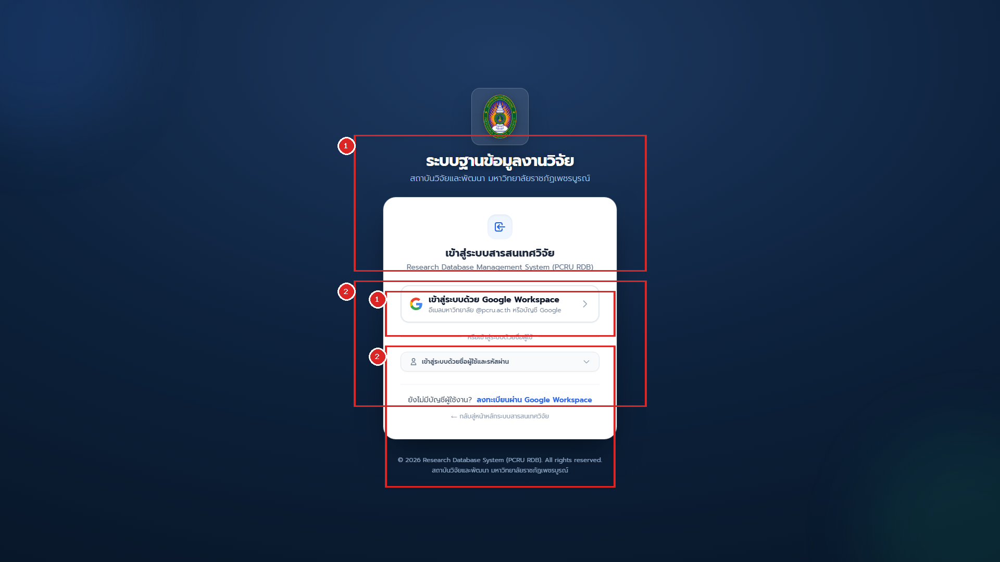

ระบบฐานข้อมูลงานวิจัย มรภ.เพชรบูรณ์ บังคับใช้นโยบายความปลอดภัยขั้นสูงเพื่อป้องกันบัญชีสแปมและบอทโจมตี โดยแบ่งช่องทางการเข้าสู่ระบบออกเป็น 2 ส่วนตามหมายเลขในภาพ:

* **หมายเลข `[1]` ช่องทางหลัก: ปุ่มเข้าสู่ระบบด้วย Google Workspace SSO (@pcru.ac.th)**:
  * **กลุ่มเป้าหมาย**: คณาจารย์, นักวิจัย, ผู้ทรงคุณวุฒิ และเจ้าหน้าที่สังกัด มรภ.เพชรบูรณ์ ทุกท่าน
  * **ขั้นตอนการใช้งาน**:
    1. คลิกปุ่ม **"เข้าสู่ระบบด้วยบัญชี Google (@pcru.ac.th)"** ในกรอบสีแดงหมายเลข `[1]`
    2. หน้าจอจะเปลี่ยนไปยังหน้าลงชื่อเข้าใช้ของ Google อย่างปลอดภัย (OAuth 2.0 OpenID Connect)
    3. เลือกหรือกรอกอีเมลสถาบัน `@pcru.ac.th` พร้อมรหัสผ่านของมหาวิทยาลัย
    4. เมื่อยืนยันตัวตนผ่าน ระบบจะตรวจสอบอีเมลกับฐานข้อมูลทันที:
       * **กรณีบัญชีเดิม**: เข้าสู่แดชบอร์ดจัดการผลงานได้ทันที
       * **กรณีอาจารย์ใหม่**: ระบบสร้างบัญชีสถานะ `รอตรวจสอบ (Pending)` และส่งแจ้งเตือนให้เจ้าหน้าที่ผูกโปรไฟล์นักวิจัย

* **หมายเลข `[2]` ช่องทางเฉพาะ: ฟอร์มเข้าสู่ระบบด้วยบัญชีผู้ใช้และรหัสผ่าน (Username / Password)**:
  * **กลุ่มเป้าหมาย**: สงวนสิทธิ์ไว้เฉพาะผู้ดูแลระบบระดับสูง (Super Admin) และบัญชีเจ้าหน้าที่ระบบฉุกเฉิน
  * **ขั้นตอนการใช้งาน**:
    1. กรอกชื่อบัญชีผู้ใช้ (Username) และรหัสผ่าน (Password ความยาวขั้นต่ำ 8 ตัวอักษร)
    2. คลิกเลือกช่อง "จดจำการเข้าสู่ระบบ" (หากใช้งานบนอุปกรณ์ส่วนตัว)
    3. คลิกปุ่ม **"เข้าสู่ระบบ"** เพื่อเข้าสู่หน้าแดชบอร์ดหลังบ้าน

---

### 1.3 กระบวนการอนุมัติสมาชิกใหม่และการผูกโปรไฟล์นักวิจัยด้วย TomSelect (Onboarding & Profile Linking)
เมื่อมีอาจารย์ล็อกอินด้วยอีเมล `@pcru.ac.th` เข้ามาใหม่เป็นครั้งแรก สถานะของบัญชีจะเป็น `unverified`:

```mermaid
sequenceDiagram
    autonumber
    actor User as อาจารย์ใหม่
    participant System as ระบบฐานข้อมูลวิจัย
    actor Admin as ผู้ดูแลระบบ

    User->>System: ล็อกอินผ่าน Google SSO ครั้งแรก
    System-->>User: สร้างบัญชีชั่วคราว และแสดงหน้ารอยืนยันตัวตน
    Admin->>System: เข้าเมนูจัดการผู้ใช้งาน
    Admin->>System: คลิกปุ่มอนุมัติและผูกโปรไฟล์นักวิจัย
    Admin->>System: ค้นหาชื่ออาจารย์ผ่าน TomSelect Typeahead
    Admin->>System: กดยืนยันการผูกบัญชี Verify and Link
    System-->>User: ปลดล็อกสิทธิ์ Researcher เข้าใช้งานระบบหลังบ้านได้ทันที
```

#### ขั้นตอนสำหรับผู้ดูแลระบบในการอนุมัติผู้ใช้งานใหม่:
1. เข้าเมนู **"จัดการผู้ใช้งาน"** (`/backend/user`)
2. คลิกปุ่มฟิลเตอร์ **"รอยืนยันตัวตน (Pending Onboarding)"**
3. คลิกปุ่มสีเขียว **"อนุมัติและเชื่อมโยงโปรไฟล์"** ที่แถวของผู้ใช้งานใหม่
4. หน้าต่าง Modal จะปรากฏขึ้น พร้อมช่องค้นหาแบบ **TomSelect AJAX Search**:
   * พิมพ์ชื่อหรือนามสกุลของอาจารย์เพื่อค้นหาประวัติเดิมในตารางนักวิจัย
   * ระบบจะแสดงรายชื่อ, คณะที่สังกัด, และรูปถ่ายเพื่อป้องกันการผูกบัญชีผิดคน
5. คลิกปุ่ม **"ยืนยันการอนุมัติและมอบสิทธิ์ Researcher"**
6. บัญชีของอาจารย์จะได้รับสิทธิ์นักวิจัย สามารถเข้าจัดการผลงานตนเองได้ทันที

---

### 1.4 ภาพรวมแดชบอร์ดหลังบ้านและแถบเมนูด้านซ้ายแบบ Accordion (Backend Layout & Left Sidebar Navigation)

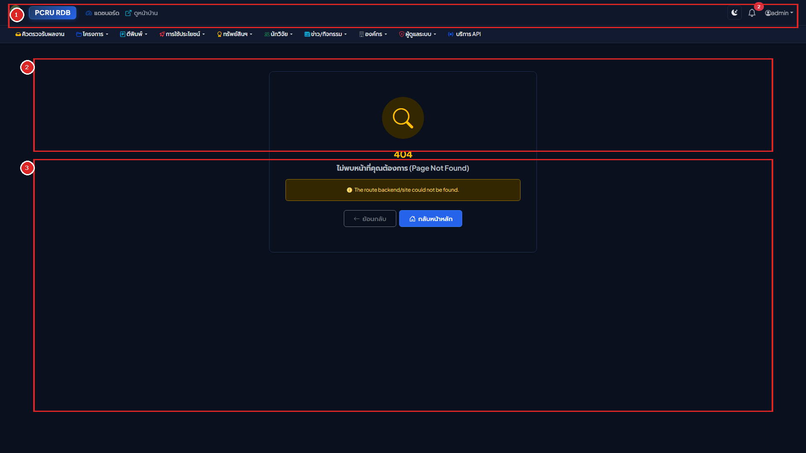

#### คำอธิบายส่วนประกอบแดชบอร์ดหลังบ้านและการนำทาง:
* **แถบเมนูด้านข้างฝั่งซ้ายแบบยืดหยุ่น (Responsive Left Sidebar & Accordion Submenus - `<x-backend-sidebar />`)**:
  * **การจัดหมวดหมู่เมนูหลัก 5 กลุ่ม**: แบ่งเป็น *ภาพรวม & งานด่วน*, *จัดการผลงานวิจัย* (โครงการวิจัย, ผลงานตีพิมพ์, การใช้ประโยชน์, ทรัพย์สินทางปัญญา), *บุคลากร & หน่วยงาน* (นักวิจัย, ข่าว/กิจกรรม, องค์กร/คณะ), *การดูแลระบบ* (Users, RBAC, API, Audit Logs) และ *เอกสารและช่วยเหลือ* (ศูนย์รวมคู่มือการใช้งานระบบทั้งหมด)
  * **ระบบพับเก็บอัตโนมัติ (Single-Open Accordion)**: เมื่อคลิกขยายหมวดเมนูหลักหมวดใด หมวดเมนูอื่นที่กางค้างอยู่จะยุบเก็บลงอัตโนมัติทันที (`data-bs-parent="#rdbSidebarAccordion"`) เพื่อไม่ให้แถบเมนูยาวล้นหน้าจอ
  * **การจัดกลุ่มเมนูย่อยพร้อมสัญลักษณ์ `-`**: ภายในแต่ละโมดูลจะแบ่งโซนย่อยด้วยหัวข้อกลุ่ม (เช่น *ข้อมูลโครงการ*, *ประเมินเล่มรายงาน*, *การส่งออกข้อมูล*) คั่นด้วยเส้นแบ่งโซน และนำหน้ารายการย่อยด้วยเครื่องหมาย `-` พร้อมระยะห่างระหว่างบรรทัดที่อ่านง่าย
  * **กลุ่มตั้งค่าข้อมูลพื้นฐานแบบพับเก็บย่อยได้ (Collapsible Master Data)**: เมนูข้อมูลพื้นฐานของโครงการวิจัย (9 ตาราง) และผลงานตีพิมพ์ (4 ตาราง) ถูกรวมไว้ในปุ่มพับเก็บย่อย (`ตั้งค่าข้อมูลพื้นฐาน`) ที่คลิกกางออกเฉพาะเมื่อต้องการตั้งค่าระบบ
  * **เมนูคู่มือการใช้งานระบบ**: ลิงก์ตรงสู่ศูนย์รวมคู่มือการใช้งานระบบทั้งหมด (`/manuals` หรือ `/backend/manuals`) ในแท็บใหม่ เปิดอ่านได้ตลอดเวลา
  * **รองรับทุกขนาดหน้าจออัตโนมัติ (Adaptive Screen Handling)**:
    * หน้าจอคอมพิวเตอร์ขนาดใหญ่ (`>= 1200px`): แสดงแถบเมนูด้านซ้ายเต็มรูปแบบ (`265px`) และสามารถคลิกปุ่มย่อเป็นโหมดไอคอน (`68px` Mini Sidebar) ได้
    * หน้าจอโน้ตบุ๊กขนาดกลาง (`992px - 1199px`): ย่อแถบเมนูเป็น Mini Sidebar อัตโนมัติ และขยายออกทันทีเมื่อเลื่อนเมาส์วาง (Hover Expand)
    * หน้าจอแท็บเล็ตและสมาร์ตโฟน (`< 992px`): ซ่อนแถบเมนูไว้ด้านซ้ายและเปิดผ่านปุ่มเมนูแฮมเบอร์เกอร์ (Offcanvas Drawer)
* **หมายเลข `[1]` แถบด้านบนสุดและศูนย์การแจ้งเตือน (Top Header Bar & Bell Notification)**:
  * **ปุ่มย่อ/ขยายแถบเมนูด้านซ้าย**, โลโก้ `PCRU RDB` และ **ไอคอนคู่มือการใช้งานระบบทั้งหมด (`📖`)** ข้างโลโก้ คลิกเปิดดูคู่มือทั้งหมดได้ทันที
  * **ปุ่มสลับโหมดมืด/สว่าง (Theme Toggle)**: สลับระหว่างโหมด Daylight Editorial Slate และ Carbon-Navy Night Reading
  * **กระดิ่งแจ้งเตือน (Notification Bell)**: แสดงตัวเลขสีแดงเมื่อมีกิจกรรมใหม่ คลิกเพื่ออ่านและเปิดดูผลงานได้ทันที
  * **ปุ่มสลับบทบาทและโปรไฟล์**: แสดงชื่อและบทบาทปัจจุบัน พร้อมเมนูลัด "คู่มือการใช้งานระบบทั้งหมด", ปุ่มสลับบทบาท (กรณีมีหลาย Role) และปุ่มออกจากระบบ
* **หมายเลข `[2]` การ์ดตัวเลขนับสถิติผลงานภาพรวม (Executive Counter Stat Cards)**:
  * แสดงยอดรวมสะสมของโครงการวิจัย, ผลงานตีพิมพ์, ทรัพย์สินทางปัญญา และการนำไปใช้ประโยชน์ โดยแสดงตัวเลขด้วยรูปแบบ `tabular-nums`
* **หมายเลข `[3]` คิวงานด่วนและทางลัดโมดูลวิจัย (Workflow Shortcuts & Action Centers)**:
  * แสดงรายการงานที่ต้องดำเนินการด่วน เช่น งานที่รอตรวจรับ (`Pending Review`), งานที่ถูกส่งกลับแก้ไข (`Needs Revision`), และคำขอปลดล็อก (`Unlock Requests`)

---

## บทที่ 2: โครงสร้างบทบาท สิทธิ์การใช้งาน และการจำลองสิทธิ์ (RBAC & Impersonation)

### 2.1 ตารางวิเคราะห์ระดับสิทธิ์และขอบเขตข้อมูล (Role Permission Matrix)

| ระดับบทบาท (Role) | ขอบเขตข้อมูล (Scope) | สิทธิ์การดำเนินการหลัก |
| :--- | :--- | :--- |
| **Super Admin / The Creator** | ทั้งมหาวิทยาลัย | สิทธิ์สูงสุดทุกโมดูล, จัดการ RBAC, จำลองสิทธิ์, ดู Audit Logs, ตั้งค่านโยบาย |
| **Admin / Admin Research** | ทั้งมหาวิทยาลัย | ตรวจรับและอนุมัติผลงานทุกโมดูล, มอบหมายผู้ทรงคุณวุฒิ, ส่งออก Excel & DSpace |
| **Domain Admins** (`Admin Project`, `Admin Published`, `Admin Dip`, `Admin Utilize`) | ทั้งมหาวิทยาลัย (เฉพาะโมดูล) | สิทธิ์แก้ไขและอนุมัติข้อมูลในโมดูลที่ตนเองรับผิดชอบได้โดยตรงโดยไม่ต้องรอปลดล็อก |
| **Faculty Coordinator** | เฉพาะคณะตนเอง | ตรวจสอบและกลั่นกรองผลงานของอาจารย์ภายในคณะก่อนส่งสถาบันวิจัยฯ |
| **Researcher (นักวิจัย)** | **เฉพาะผลงานตนเอง** | สร้างฉบับร่าง, ส่งตรวจรับ, อัปโหลดไฟล์, ยื่นขอปลดล็อกแก้ไข, ประเมินรายงานที่ได้รับมอบหมาย |
| **Reviewer (ผู้ทรงคุณวุฒิ)** | เฉพาะโครงการที่ได้รับมอบหมาย | ตอบรับงานประเมิน, เปิดอ่านเล่มรายงาน, บันทึกคะแนนและข้อเสนอแนะ |

---

### 2.2 การจำกัดขอบเขตข้อมูลนักวิจัยอย่างเข้มงวด (Strict Researcher Isolation)
เพื่อความปลอดภัยและความเป็นส่วนตัวของข้อมูลวิชาการ ระบบบังคับใช้ **Eloquent Global Scopes**:
* เมื่ออาจารย์เข้าสู่ระบบในบทบาท `Researcher` ระบบจะดึงและแสดงผล **เฉพาะโครงการและบทความที่มีชื่ออาจารย์เป็นหัวหน้าโครงการหรือผู้แต่งร่วมเท่านั้น**
* อาจารย์ไม่สามารถเปิดดูหน้าแก้ไข หรือพิมพ์ URL ไอดีของโครงการอาจารย์ท่านอื่นได้ หากพยายามเข้าถึง ระบบจะตอบกลับด้วยรหัสปฏิเสธสิทธิ์ `403 Forbidden` ทันที

---

### 2.3 ขั้นตอนการจำลองสิทธิ์ผู้ใช้งาน (User Impersonation)
ฟังก์ชันสำหรับ Super Admin เพื่อใช้ช่วยเหลืออาจารย์ที่มีปัญหาการใช้งาน:

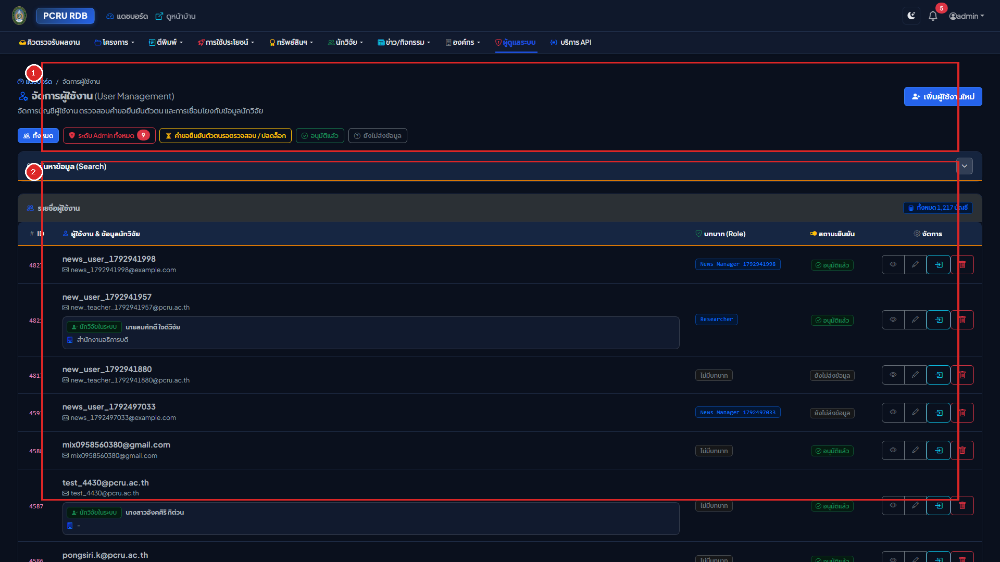

```mermaid
flowchart LR
    Step1["1. ผู้ดูแลระบบเข้าเมนูจัดการผู้ใช้\n(/backend/user)"] --> Step2["2. คลิกปุ่ม 'จำลองสิทธิ์ Impersonate'\nที่แถวของอาจารย์"]
    Step2 --> Step3["3. ระบบเก็บรหัสผู้ดูแลเดิมใน Session\nและสลับมุมมองเป็นนักวิจัยทันที"]
    Step3 --> Step4["4. แถบสีเหลืองแจ้งเตือนปรากฏบนสุด:\n'กำลังจำลองสิทธิ์เป็น... พร้อมปุ่มหยุดจำลองสิทธิ์'"]
    Step4 --> Step5["5. คลิกปุ่ม 'หยุดจำลองสิทธิ์'\n➔ คืนสิทธิ์กลับเป็น Super Admin อัตโนมัติ"]
```

#### คำอธิบายส่วนประกอบตามหมายเลขในภาพ:
* **หมายเลข `[1]` แผงค้นหาและตัวกรองบัญชีผู้ใช้งาน (User Directory Search & Filters)**:
  * **ช่องค้นหาชื่อ-อีเมล**: พิมพ์ชื่ออาจารย์, รหัสผู้ใช้ หรืออีเมล `@pcru.ac.th`
  * **ตัวกรองบทบาท (Roles)**: กรองดูเฉพาะกลุ่ม `Researcher`, `Reviewer`, `Admin`, หรือ `Super Admin`
  * **ตัวกรองสถานะการยืนยัน**: กรองดูเฉพาะบัญชีที่ `รอยืนยันตัวตน (Pending)` เพื่อทำการ Onboarding
* **หมายเลข `[2]` ตารางรายชื่อผู้ใช้งานและปุ่มจำลองสิทธิ์ (Users Table & Actions)**:
  * **ข้อมูลบัญชี**: แสดงชื่อ-นามสกุล, อีเมลสถาบัน, บทบาท, และสถานะการผูกโปรไฟล์นักวิจัย
  * **ปุ่มจำลองสิทธิ์ (Impersonate)**: ปุ่มสีเหลืองไอคอนสลับตัวบุคคล คลิกเพื่อจำลองสิทธิ์เข้าไปมองเห็นหน้าจอเหมือนอาจารย์ท่านนั้นทุกประการ
  * **ปุ่มแก้ไขและจัดการสิทธิ์ (Edit)**: กำหนดบทบาท หรือระงับการใช้งานบัญชี

---

## บทที่ 3: วงจรชีวิตการส่งร่าง ตรวจสอบ และอนุมัติเปิดเผยผลงาน (Workflow Lifecycle: WF-01 ถึง WF-07)

### 3.1 แผนผังวงจรสถานะงานวิจัย (State-Driven Workflow Diagram)

```mermaid
stateDiagram-v2
    [*] --> Draft : WF-01 นักวิจัยสร้างฉบับร่าง
    Draft --> PendingReview : WF-02 นักวิจัยกดส่งตรวจสอบ Submit
    PendingReview --> RevisionRequired : WF-04 เจ้าหน้าที่ส่งกลับแก้ไข Reject
    RevisionRequired --> PendingReview : นักวิจัยแก้ไขและกดส่งใหม่
    PendingReview --> Published : WF-05 เจ้าหน้าที่อนุมัติเผยแพร่
    Published --> UnlockRequested : WF-06 นักวิจัยขอปลดล็อกแก้ไข
    UnlockRequested --> Draft : WF-07 เจ้าหน้าที่อนุมัติปลดล็อก
    UnlockRequested --> Published : เจ้าหน้าที่ปฏิเสธคำขอปลดล็อก
```

---

### 3.2 ขั้นตอนการทำงานสำหรับนักวิจัย (Researcher Workflow Guide)
1. **การสร้างฉบับร่าง (`WF-01 Draft`)**:
   * คลิกปุ่ม **"+ เพิ่มข้อมูล"** กรอกข้อมูลโครงการหรือผลงาน
   * บันทึกข้อมูล รายการจะอยู่ในสถานะ **`ฉบับร่าง (Draft)`** (มีปุ่มแก้ไขและลบได้อิสระ ข้อมูลยังไม่แสดงหน้าบ้าน)
2. **การส่งตรวจสอบ (`WF-02 Submit for Review`)**:
   * เมื่อแนบไฟล์ PDF และกรอกข้อมูลครบแล้ว ให้เข้าหน้ารายละเอียดของผลงาน
   * คลิกปุ่มสีน้ำเงิน **"ส่งตรวจสอบ (Submit for Review)"**
   * สถานะจะเปลี่ยนเป็น **`รอตรวจสอบ (Pending Review)`** และแบบฟอร์มจะถูกล็อก
3. **กรณีได้รับแจ้งให้แก้ไข (`WF-04 Revision Required`)**:
   * หากมีข้อผิดพลาด ระบบจะแจ้งเตือนผ่านกระดิ่ง พร้อมแสดงกล่องข้อความสีแดงระบุ **เหตุผลจากเจ้าหน้าที่**
   * คลิกปุ่ม **"แก้ไขข้อมูล"** ดำเนินการปรับปรุงตามคำแนะนำ แล้วคลิก **"ส่งตรวจสอบ"** ใหม่อีกครั้ง
4. **การขอปลดล็อกแก้ไขหลังเผยแพร่แล้ว (`WF-06 Request Unlock`)**:
   * ผลงานที่มีสถานะ **`เผยแพร่แล้ว (Published)`** จะถูกล็อกห้ามแก้ไข
   * หากต้องการแก้ไข ให้นักวิจัยคลิกปุ่ม **"ขอเปิดสิทธิ์แก้ไข (Request Unlock)"** กรอกเหตุผล แล้วส่งคำขอไปยัง Admin

---

### 3.3 ขั้นตอนการทำงานสำหรับผู้ดูแลระบบในคิวงานตรวจสอบ (Review Queue Management)

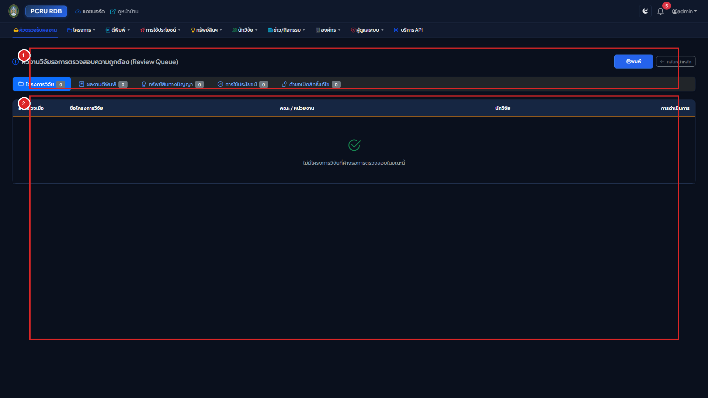

#### คำอธิบายส่วนประกอบตามหมายเลขในภาพ:
* **หมายเลข `[1]` แถบแท็บประเภทผลงานในคิวตรวจสอบ (Queue Category Tabs)**:
  * **แท็บโครงการวิจัย (`Projects Queue`)**: รายการโครงการวิจัยที่นักวิจัยกดส่งตรวจรับ
  * **แท็บผลงานตีพิมพ์ (`Publications Queue`)**: รายการบทความวิจัยที่ส่งตรวจพร้อมไฟล์ PDF
  * **แท็บทรัพย์สินทางปัญญา (`IP Queue`)**: รายการคำขอสิทธิบัตร/อนุสิทธิบัตร/ลิขสิทธิ์
  * **แท็บการนำไปใช้ประโยชน์ (`Utilizations Queue`)**: รายการรายงานการใช้ประโยชน์และหลักฐานรับรอง
  * **แท็บคำขอปลดล็อก (`Unlock Requests`)**: ผลงานที่เผยแพร่แล้ว แต่นักวิจัยขอกลับมาแก้ไข
* **หมายเลข `[2]` ตารางรายการคิวงานและปุ่มดำเนินการ (Review Queue Table & Action Buttons)**:
  * **ข้อมูลผลงาน**: แสดงชื่อผลงาน, ชื่อนักวิจัยผู้ส่ง, วันที่ส่งตรวจรับ (รูปแบบ พ.ศ.), และไฟล์เอกสารแนบ
  * **ปุ่มอนุมัติและเผยแพร่ (Approve - สีเขียว `WF-05`)**: ตรวจสอบเอกสารถูกต้องสมบูรณ์ คลิกอนุมัติ ผลงานจะเผยแพร่ขึ้นหน้าบ้านทันที พร้อมสกัดหน้าแรกสร้างภาพปก `.webp` และส่งกระดิ่งแจ้งเตือนนักวิจัย
  * **ปุ่มส่งกลับแก้ไข (Reject - สีแดง `WF-04`)**: คลิกเพื่อเปิดกล่องข้อความ ระบุจุดที่ต้องแก้ไข และข้อเสนอแนะ ผลงานจะถูกส่งกลับไปให้นักวิจัยแก้ไขในสถานะ `Needs Revision`
  * **ปุ่มดูตัวอย่างฉบับเต็ม (View Details)**: คลิกเพื่อตรวจสอบความสมบูรณ์ของบทคัดย่อ คณะผู้วิจัย และไฟล์ PDF ก่อนตัดสินใจ

---

### 3.4 ระบบแจ้งเตือนทางกระดิ่งและอีเมล (Notification System)
* **กระดิ่งแจ้งเตือน (Notification Bell)**: แสดงตัวเลขสีแดงเมื่อมีกิจกรรมใหม่ (เช่น ส่งงานใหม่, ส่งกลับแก้ไข, อนุมัติเผยแพร่, หรือมอบหมายงานประเมิน)
* เมื่อคลิกที่รายการแจ้งเตือน ระบบจะเปิดไปยังหน้าผลงานนั้นโดยตรง พร้อมทำเครื่องหมายว่าอ่านแล้วอัตโนมัติ

---

## บทที่ 4: การบริหารจัดการโครงการวิจัยขั้นสูง ระบบนับหน้า PDF และปก .webp

### 4.1 พจนานุกรมฟิลด์แบบฟอร์มบันทึกโครงการวิจัย (Project Form Field Dictionary)

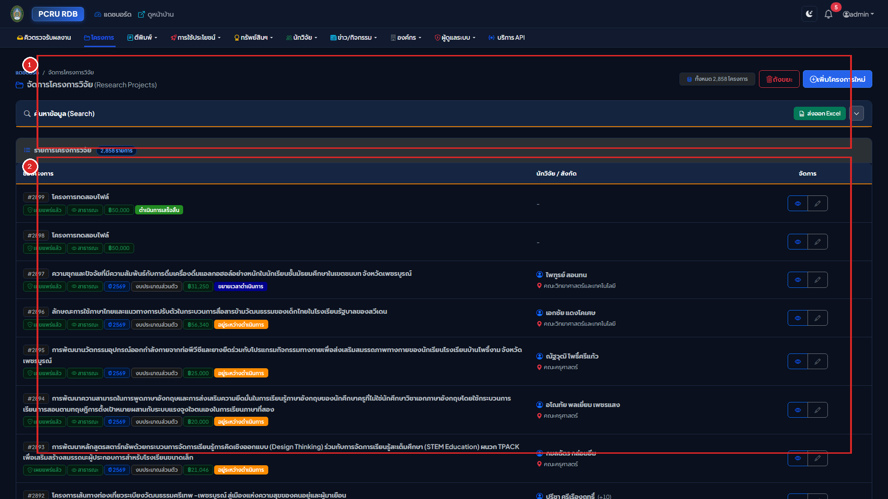

#### คำอธิบายส่วนประกอบตามหมายเลขในภาพ:
* **หมายเลข `[1]` กล่องค้นหาและตัวกรองสถานะโครงการวิจัยหลังบ้าน (Search & Status Filters)**:
  * **ช่องค้นหาชื่อโครงการและนักวิจัย**: พิมพ์คำค้นหาเพื่อค้นหาข้อมูลหลังบ้านอย่างรวดเร็ว
  * **ตัวกรองสถานะโครงการ**: เลือกกรองตามสถานะ `Draft (ฉบับร่าง)`, `Pending Review (รอตรวจสอบ)`, `Published (เผยแพร่แล้ว)`, หรือ `Completed (เสร็จสิ้นโครงการ)`
  * **ปุ่มเพิ่มข้อมูลใหม่**: คลิกปุ่มสีเขียว **"+ เพิ่มโครงการวิจัยใหม่"** เพื่อเปิดแบบฟอร์มบันทึกข้อมูล
* **หมายเลข `[2]` ตารางรายการโครงการวิจัยและปุ่มดำเนินการ (Projects Table & Management Actions)**:
  * **คอลัมน์ชื่อโครงการและงบประมาณ**: แสดงชื่อโครงการวิจัย, แหล่งทุน, ยอดงบประมาณรวม, และปีงบประมาณ พ.ศ.
  * **ป้ายแสดงจำนวนหน้า PDF อัตโนมัติ**: แสดงป้ายระบุจำนวนหน้าเอกสาร เช่น `<i class="bi bi-file-earmark-text"></i> 101 หน้า` ซึ่งระบบตรวจนับให้อัตโนมัติทันทีที่อัปโหลดไฟล์
  * **ปุ่มดำเนินการ (Actions)**:
    * ปุ่มสีฟ้า `ดูข้อมูล (View)`: ตรวจสอบรายละเอียดฉบับเต็ม
    * ปุ่มสีเหลือง `แก้ไข (Edit)`: ปรับปรุงข้อมูล (ใช้ได้เมื่ออยู่ในสถานะ Draft หรือได้รับอนุมัติปลดล็อก)
    * ปุ่มสีน้ำเงิน `ส่งตรวจสอบ (Submit for Review)`: ส่งงานเข้าสู่คิวตรวจสอบของสถาบันวิจัยฯ

| ชื่อฟิลด์ในฟอร์ม | ประเภทข้อมูล | เงื่อนไขความถูกต้อง (Validation) | คำอธิบาย |
| :--- | :--- | :--- | :--- |
| **ปีงบประมาณ (`year_id`)** | Dropdown | จำเป็นต้องกรอก (Required) | ปีงบประมาณ พ.ศ. ที่จัดสรรทุน |
| **ประเภททุนวิจัย (`pt_id`)** | Dropdown | จำเป็นต้องกรอก (Required) | ประเภทแหล่งทุนวิจัยหลัก |
| **ประเภทโครงการย่อย (`pts_id`)** | Dropdown | ไม่บังคับ (Nullable) | แหล่งทุนหรือกลุ่มโครงการย่อย |
| **รหัสโครงการ (`pro_code`)** | Text (50) | ไม่บังคับ (Nullable) | รหัสสัญญาโครงการวิจัย |
| **ชื่อโครงการ (ไทย) (`pro_nameTH`)** | Textarea | จำเป็นต้องกรอก (Required) | ชื่อเต็มโครงการภาษาไทย |
| **ชื่อโครงการ (อังกฤษ) (`pro_nameEN`)** | Textarea | ไม่บังคับ (Nullable) | ชื่อเต็มโครงการภาษาอังกฤษ |
| **งบประมาณรวม (`pro_budget`)** | Decimal | ต้องเป็นตัวเลข $\ge 0$ | จำนวนเงินงบประมาณรวมทั้งโครงการ (บาท) |
| **วันที่เริ่มต้น (`pro_date_start`)** | Buddhist Date | รูปแบบ วว/ดด/ปปปป (พ.ศ.) | วันที่เริ่มต้นสัญญา |
| **วันที่สิ้นสุด (`pro_date_end`)** | Buddhist Date | ต้อง $\ge$ `pro_date_start` | วันที่สิ้นสุดสัญญา |
| **ไฟล์เล่มรายงาน (`pro_file`)** | File Upload | เฉพาะไฟล์ PDF ขนาด $\le 100\text{MB}$ | ไฟล์เล่มรายงานวิจัยฉบับสมบูรณ์ |

---

### 4.2 การจัดการสัดส่วนร้อยละของคณะผู้วิจัย (Research Weighting: รวม 100%)
ในหน้ารายละเอียดโครงการวิจัย ผู้ใช้สามารถเพิ่มรายชื่อคณะผู้วิจัยและกำหนดตำแหน่ง:
* **ตำแหน่งในโครงการ**: หัวหน้าโครงการวิจัย, ผู้ร่วมวิจัย, หรือที่ปรึกษาโครงการ
* **สัดส่วนการทำวิจัย (%)**: ตัวเลขสัดส่วนการมีส่วนร่วมในโครงการ
* **กฎความถูกต้อง**: ผลรวมของสัดส่วนร้อยละของคณะผู้วิจัยทุกคนในโครงการ **จะต้องรวมกันได้ 100% พอดี** เพื่อความถูกต้องในการคิดภาระงานวิชาการและการประกันคุณภาพ

---

### 4.3 สถาปัตยกรรมเครื่องยนต์ PDF อัตโนมัติ (Automated PDF Engine: 4-Tier Counter & 5-Tier WebP)
ทันทีที่มีการอัปโหลดไฟล์ PDF เล่มรายงานวิจัย (`pro_file`) หรือไฟล์บทความ (`pub_file`) ระบบจะประมวลผลอัตโนมัติเบื้องหลัง:

```mermaid
flowchart TD
    PDF["อัปโหลดไฟล์ PDF เข้าสู่ระบบ"] --> Storage["จัดเก็บไฟล์ด้วยรหัสปลอดภัย UUID Safe Storage"]
    Storage --> Counter["1. ตรวจนับจำนวนหน้า (4-Tier Page Counter)"]
    Storage --> Cover["2. สกัดภาพปกหน้าแรก (5-Tier WebP Generator)"]

    Counter --> T1["Tier 1: Poppler pdftotext (แม่นยำ 99.99%)"]
    T1 -->|สำรอง 1| T2["Tier 2: Smalot PdfParser"]
    T2 -->|สำรอง 2| T3["Tier 3: setasign FPDI"]
    T3 -->|สำรอง 3| T4["Tier 4: Fast Regex Stream Scan"]
    Counter --> SavePage["บันทึกจำนวนหน้าลง pro_page_num อัตโนมัติ"]

    Cover --> C1["Tier 1: Poppler pdftoppm CLI"]
    C1 -->|สำรอง 1| C2["Tier 2: MuPDF PyMuPDF Full-Page Rasterizer"]
    C2 -->|สำรอง 2| C3["Tier 3: PHP Imagick"]
    C3 -->|สำรอง 3| C4["Tier 4: Ghostscript gs CLI"]
    C4 -->|สำรอง 4| C5["Tier 5: Academic GD Cover Fallback (ฟอนต์ Leelawadee UI)"]
    Cover --> SaveCover["สร้างภาพปก .webp คุณภาพสูง 85% กะทัดรัด คมชัด"]
```

> [!TIP]
> **ปุ่มดึงภาพหน้าปกไฟล์ใหม่ อีกครั้ง (Regenerate PDF Cover)**:
> ในกรณีที่ไฟล์เอกสาร PDF มีการเปลี่ยนแปลง หรือต้องการประมวลผลสกัดภาพหน้าปกใหม่โดยไม่ต้องอัปโหลดไฟล์ซ้ำ ผู้ใช้งานสามารถกดปุ่ม **"ดึงภาพหน้าปกไฟล์ใหม่ อีกครั้ง"** (`<button class="btn btn-outline-secondary">`) ในกล่องไฟล์เอกสารของหน้าดูรายละเอียดโครงการวิจัย (`/backend/rdb_project/{id}`) หรือผลงานตีพิมพ์ (`/backend/rdb_published/{id}`) ระบบจะรันการสกัดหน้าปกและส่งพารามิเตอร์ Cache-Busting `?v=` เพื่อให้เบราว์เซอร์แสดงภาพหน้าปกที่อัปเดตใหม่ทันที

---

### 4.4 การสลับระดับสิทธิ์เปิดเผยเล่มรายงานวิจัย 3 สถานะ (`pro_file_show` Toggle)
ในหน้ารายละเอียดโครงการวิจัย ผู้ดูแลระบบสามารถคลิกสลับสถานะการเปิดเผยไฟล์เล่มสมบูรณ์ได้ 3 สถานะ:
* **`เปิด (Public - ค่า 0)`**: ประชาชนทั่วไปสามารถดาวน์โหลดไฟล์เล่มสมบูรณ์ได้
* **`ปิด (Concealed - ค่า 1)`**: ปกปิดเล่มรายงานไม่ให้ดาวน์โหลดภายนอก (ใช้คุ้มครองสิทธิ์การจดสิทธิบัตร)
* **`ร่าง (Draft - ค่า 2)`**: เอกสารอยู่ระหว่างตรวจรับ ยังไม่พร้อมเผยแพร่

---

## บทที่ 5: ระบบตรวจประเมินเล่มรายงานวิจัยฉบับสมบูรณ์ (Peer Review Subsystem)

### 5.1 สถาปัตยกรรมการประเมินแบบ Single-Blind Peer Review

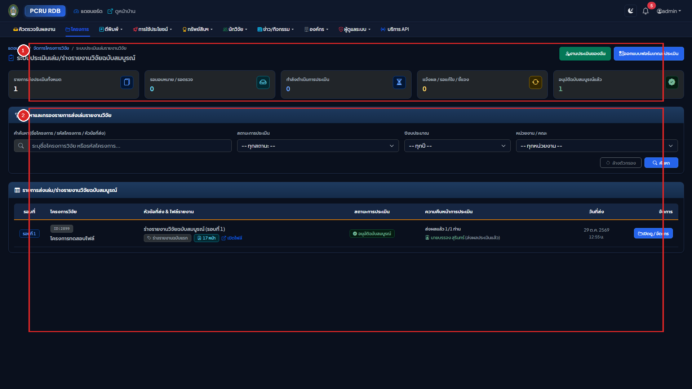

#### คำอธิบายส่วนประกอบตามหมายเลขในภาพ:
* **หมายเลข `[1]` แถบแท็บสถานะการประเมินและเกณฑ์แบบประเมิน (Review Tabs & Rubrics Controls)**:
  * **แท็บรอบการประเมิน**: สลับดูรายการเล่มรายงานที่ `รอมอบหมายผู้ทรงฯ`, `อยู่ระหว่างประเมิน`, `ส่งเล่มแก้ไขรอบที่ 2`, หรือ `ประเมินเสร็จสิ้น`
  * **ปุ่มจัดการเกณฑ์แบบประเมิน (Rubrics Templates)**: สร้างและกำหนดชุดคำถามการประเมินและสเกลคะแนน
* **หมายเลข `[2]` ตารางรายการเล่มรายงานวิจัยในกระบวนการประเมิน (Peer Review Submissions Table)**:
  * **ข้อมูลโครงการวิจัย**: แสดงชื่อโครงการ, คณะผู้วิจัย, แหล่งทุน, และไฟล์เล่มร่างรายงานวิจัย
  * **สถานะผู้ทรงคุณวุฒิ (Reviewer Status)**: แสดงจำนวนผู้ทรงคุณวุฒิที่ตอบรับการประเมิน (เช่น ตอบรับ 2/3 ท่าน)
  * **ปุ่มมอบหมายผู้ทรงคุณวุฒิ (Assign Reviewers)**: คลิกเพื่อเปิด Modal ค้นหาผู้ทรงคุณวุฒิตามความเชี่ยวชาญ
  * **ปุ่มดูผลการประเมินและข้อเสนอแนะ**: แสดงคะแนนเฉลี่ยและคอมเมนต์เชิงวิชาการ

```mermaid
flowchart TD
    S1["1. นักวิจัยส่งร่างเล่มรายงานสมบูรณ์\n(Initial Report Submission)"] --> S2["2. แอดมินคัดเลือกและมอบหมายผู้ทรงฯ\n(Assign Single-Blind Reviewers)"]
    S2 --> S3["3. ผู้ทรงฯ รับการแจ้งเตือนและประเมินเกณฑ์รูบริก\n(Rubric Scoring & Academic Comments)"]
    S3 --> S4{"4. ผลการประเมินของผู้ทรงฯ"}
    S4 -->|ผ่านโดยไม่มีเงื่อนไข| S7["7. แอดมินอนุมัติปิดโครงการ\n(Final Approval)"]
    S4 -->|มีข้อเสนอแนะให้ปรับปรุง| S5["5. ส่งคอมเมนต์ให้นักวิจัยแก้ไข\n(Revision Required)"]
    S5 --> S6["6. นักวิจัยอัปโหลดเล่มแก้ไข หรือยื่นข้อโต้แย้ง\n(Revised Draft / Dispute)"]
    S6 --> S7
    S7 --> S8["8. ระบบอัตโนมัติ:\n• บันทึกไฟล์ลง pro_file\n• ตรวจนับหน้า pro_page_num\n• สกัดภาพปก .webp\n• เปิดเผยแพร่สู่หน้าบ้านทันที"]
```

ระบบประเมินรายงานวิจัยฉบับสมบูรณ์ของ มรภ.เพชรบูรณ์ ทำงานแบบ **Single-Blind Peer Review**:
* **ผู้ทรงคุณวุฒิ (Reviewer)**: จะทราบชื่อโครงการและชื่อคณะผู้วิจัย เพื่อประเมินความสอดคล้องกับความเชี่ยวชาญ
* **นักวิจัย (Researcher)**: จะ **ไม่ทราบ** ชื่อ นามสกุล หรือสังกัดของผู้ทรงคุณวุฒิที่ประเมินผลงานตนเอง เพื่อความเป็นกลางทางวิชาการ

---

### 5.2 การออกแบบเกณฑ์และสเกลคะแนนแบบประเมิน (Rubric Form Designer)
ผู้ดูแลระบบสามารถสร้างและกำหนดหัวข้อแบบประเมินได้ที่เมนู **"เกณฑ์แบบประเมิน"** (`/backend/project-reviews/templates`):
1. **การสร้างชุดแบบประเมิน (Template)**: เช่น "แบบประเมินโครงการวิจัยทุนงบประมาณแผ่นดิน" หรือ "แบบประเมินงานวิจัยเชิงพื้นที่"
2. **การเพิ่มหัวข้อเกณฑ์ (Criteria)**:
   * ระบุหัวข้อการประเมิน (เช่น ความสมบูรณ์ของระเบียบวิธีวิจัย, ความคุ้มค่าทางวิชาการ, การอภิปรายผล)
   * กำหนดคะแนนเต็มของแต่ละข้อ
   * กำหนดสเกลการให้คะแนน (เช่น สเกล 1-5 หรือใส่คะแนนดิบ)

---

### 5.3 วงจรสถานะการส่งเล่มรายงาน 8 ขั้นตอน (Submission States Lifecycle)
การประเมินรายงานวิจัยดำเนินไปตาม 8 สถานะมาตรฐาน:

| สถานะ (Status) | ชื่อสถานะภาษาไทย | คำอธิบายบทบาทการทำงาน |
| :--- | :--- | :--- |
| `submitted` | ส่งเล่มประเมินแล้ว | นักวิจัยส่งไฟล์ PDF เล่มรายงาน อยู่ในคิวรอ Admin มอบหมายผู้ทรงคุณวุฒิ |
| `under_review` | กำลังประเมิน | ผู้ทรงคุณวุฒิตอบรับงานประเมินและอยู่ระหว่างตรวจอ่านและให้คะแนน |
| `round_closed` | แจ้งผลการประเมินแล้ว | ผู้ทรงคุณวุฒิส่งผลประเมินครบทุกท่าน และ Admin ปิดรอบแจ้งผล |
| `revision_required` | รอการแก้ไขปรับปรุง | ผลการประเมินมีข้อเสนอแนะให้นักวิจัยนำกลับไปแก้ไขปรับปรุงรูปเล่ม |
| `disputed` | ยื่นคำชี้แจง/โต้แย้ง | นักวิจัยส่งคำชี้แจงทางวิชาการกรณีมีความเห็นต่างจากข้อเสนอแนะ |
| `final_submitted` | ส่งฉบับแก้ไขสมบูรณ์แล้ว | นักวิจัยส่งเล่มรายงานฉบับแก้ไขสมบูรณ์ตามข้อเสนอแนะครบถ้วนแล้ว |
| `approved` | อนุมัติฉบับสมบูรณ์ | Admin ตรวจรับและอนุมัติเล่มสมบูรณ์ ปิดโครงการวิจัยอย่างเป็นทางการ |
| `rejected` | ไม่ผ่านการประเมิน | เล่มรายงานไม่ผ่านเกณฑ์มาตรฐานทางวิชาการขั้นต่ำ |

---

### 5.4 การมอบหมายผู้ทรงคุณวุฒิ และการบันทึกผลการประเมินของผู้ทรงคุณวุฒิ
1. **การมอบหมายผู้ทรงคุณวุฒิ (Admin Action)**:
   * ในหน้าโครงการ คลิกปุ่ม **"มอบหมายผู้ทรงคุณวุฒิ"**
   * เลือกผู้ทรงคุณวุฒิ 2-3 ท่านจากฐานข้อมูล และกำหนดวันที่ครบกำหนดส่งผลประเมิน (Deadline)
2. **การประเมินผล (Reviewer Action)**:
   * ผู้ทรงคุณวุฒิเข้าเมนู **"งานประเมินของฉัน (My Reviews)"** (`/backend/project-reviews/my-reviews`)
   * คลิก **"ตอบรับการประเมิน"** ดาวน์โหลดไฟล์เล่มรายงานไปตรวจอ่าน
   * กรอกคะแนนรายข้อตามแบบฟอร์มรูบริก พร้อมพิมพ์ความเห็นเชิงวิชาการ และสามารถแนบไฟล์เล่มรายงานที่คอมเมนต์ข้อความกลับเข้าระบบได้

---

### 5.5 กระบวนการส่งเล่มแก้ไขรอบที่ 2 และการยื่นคำชี้แจงโต้แย้ง (Dispute Workflow)
* **กรณีแก้ไขตามข้อเสนอแนะ**: นักวิจัยปรับปรุงเนื้อหาตามคอมเมนต์ แล้วอัปโหลดไฟล์เล่มแก้ไขในหมวด `Revised Draft`
* **กรณียื่นคำชี้แจงทางวิชาการ (Dispute)**: หากนักวิจัยมีความเห็นต่างในบางประเด็น สามารถคลิกปุ่ม **"ยื่นคำชี้แจง/ข้อโต้แย้ง"** พิมพ์เหตุผลและแนบเอกสารอ้างอิงทางวิชาการ เพื่อให้ผู้ทรงคุณวุฒิหรือคณะกรรมการพิจารณาประกอบ

---

### 5.6 การสรุปผลคะแนนและการอนุมัติปิดโครงการเล่มสมบูรณ์ (Final Approval)
* เมื่อผู้ทรงคุณวุฒิประเมินครบและนักวิจัยส่งเล่มฉบับสมบูรณ์แล้ว
* ผู้ดูแลระบบกดปุ่ม **"อนุมัติเล่มรายงานฉบับสมบูรณ์ (Approve Final Report)"**
* **ระบบจะดำเนินการอัตโนมัติ:** คัดลอกไฟล์ไปยัง `pro_file`, บันทึกจำนวนหน้าลง `pro_page_num`, สกัดหน้าแรกสร้างภาพปก `.webp`, ปรับสถานะโครงการเป็นเสร็จสิ้น และเปิดเผยแพร่สู่หน้าบ้านทันที

---

## บทที่ 6: การบริหารจัดการผลงานตีพิมพ์ ทรัพย์สินทางปัญญา และการใช้ประโยชน์

### 6.1 การจัดการผลงานตีพิมพ์ (`/backend/rdb_published`)

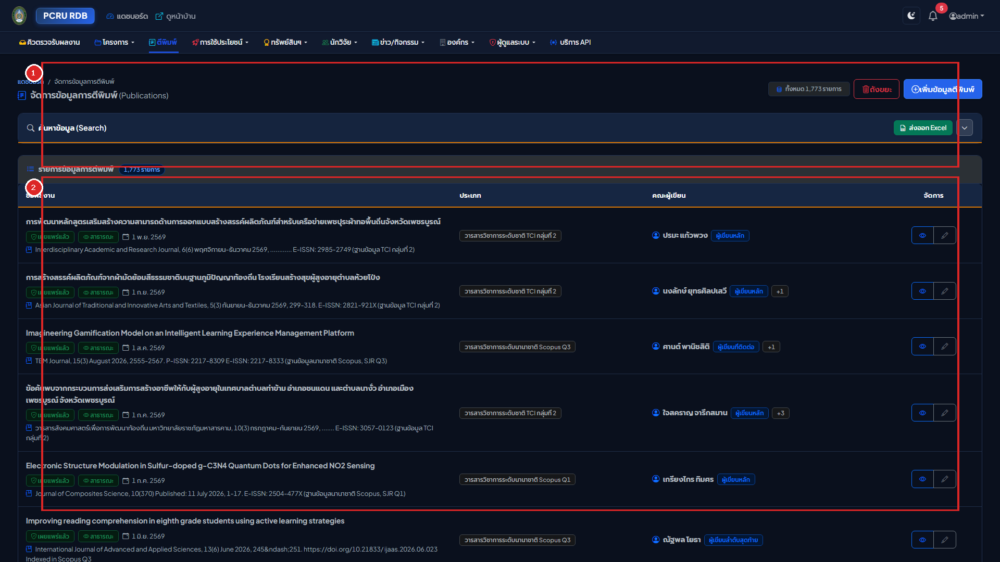

#### คำอธิบายส่วนประกอบตามหมายเลขในภาพ:
* **หมายเลข `[1]` แผงค้นหาและตัวกรองผลงานตีพิมพ์หลังบ้าน (Published Filter Bar)**:
  * **ช่องค้นหาชื่อบทความและวารสาร**: ค้นหาบทความตามชื่อเรื่อง, DOI หรือชื่อวารสาร
  * **ตัวกรองระดับฐานข้อมูล (Scopus / TCI)**: กรองดูเฉพาะผลงานในระดับฐานข้อมูลที่ต้องการตรวจสอบ
  * **ตัวกรองสถานะงาน**: กรองดูเฉพาะ `Draft`, `Pending Review`, หรือ `Published`
  * **ปุ่มเพิ่มผลงานใหม่**: คลิกปุ่มสีเขียว **"+ เพิ่มผลงานตีพิมพ์ใหม่"**
* **หมายเลข `[2]` ตารางจัดการบทความตีพิมพ์และปุ่มดำเนินการ (Publications Table & Actions)**:
  * **ข้อมูลบทความและผู้แต่ง**: แสดงชื่อบทความ, ชื่อวารสาร, ปี พ.ศ. และป้ายระดับฐานข้อมูล
  * **ป้ายตรวจนับหน้าอัตโนมัติ**: แสดงจำนวนหน้าของไฟล์ PDF ที่ระบบตรวจนับให้
  * **ปุ่มดำเนินการ (Actions)**:
    * ปุ่ม `ดูข้อมูล (View)`: ตรวจสอบรายละเอียดและรายชื่อผู้แต่ง
    * ปุ่ม `แก้ไข (Edit)`: บันทึกข้อมูลวารสารและอัปโหลดไฟล์ Full Paper
    * ปุ่ม `จัดการผู้แต่ง (Authors)`: ระบุสัดส่วนการมีส่วนร่วม (%) และกำหนด First/Corresponding Author

---

### 6.2 การจัดการทรัพย์สินทางปัญญา (`/backend/rdb_dip`)

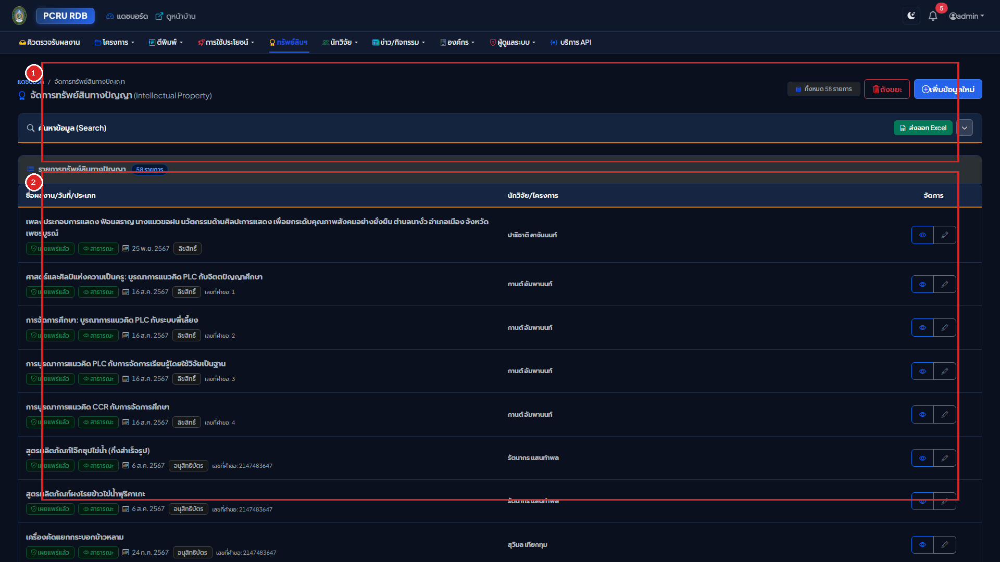

#### คำอธิบายส่วนประกอบตามหมายเลขในภาพ:
* **หมายเลข `[1]` แผงค้นหาและตัวกรองทรัพย์สินทางปัญญาหลังบ้าน (IP Filter Bar)**:
  * **ช่องค้นหาชื่อนวัตกรรม**: พิมพ์ชื่อผลงาน หรือชื่อสิ่งประดิษฐ์
  * **ตัวกรองประเภท DIP**: สิทธิบัตรการประดิษฐ์, อนุสิทธิบัตร, สิทธิบัตรการออกแบบ หรือลิขสิทธิ์
  * **ปุ่มเพิ่มข้อมูลใหม่**: คลิกปุ่มสีเขียว **"+ เพิ่มทรัพย์สินทางปัญญาใหม่"**
* **หมายเลข `[2]` ตารางจัดการข้อมูลสิทธิบัตรและลิขสิทธิ์ (IP Management Table & Actions)**:
  * **ข้อมูลสิ่งประดิษฐ์และเลขที่คำขอ**: แสดงชื่อนวัตกรรม, เลขที่คำขอรับความคุ้มครอง และวันที่ยื่นขอ (พ.ศ.)
  * **คณะผู้ประดิษฐ์และสัดส่วน**: แสดงรายชื่ออาจารย์ผู้ประดิษฐ์คิดค้นและสัดส่วนการมีส่วนร่วม
  * **ปุ่มเปิดดูและแก้ไข**: ตรวจสอบเอกสารหนังสือสำคัญการจดทะเบียน หรือปรับปรุงข้อมูลสถานะ

---

### 6.3 การจัดการการนำงานวิจัยไปใช้ประโยชน์ (`/backend/rdb_projectutilize`)

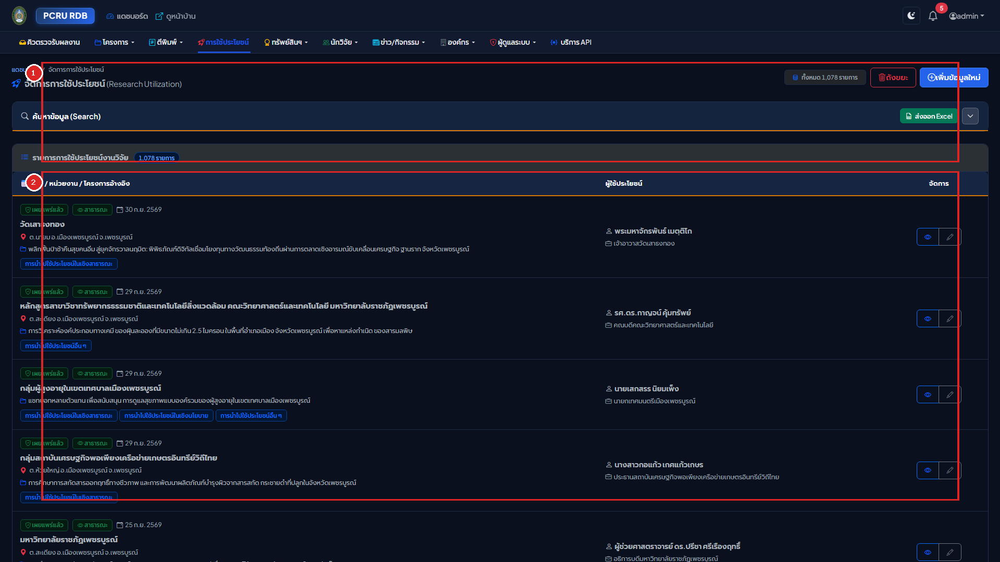

#### คำอธิบายส่วนประกอบตามหมายเลขในภาพ:
* **หมายเลข `[1]` แผงค้นหาและตัวกรองการใช้ประโยชน์หลังบ้าน (Utilize Filter Bar)**:
  * **ช่องค้นหาชื่อโครงการและหน่วยงาน**: พิมพ์ชื่อผลงาน หรือชื่อองค์กรผู้รับการถ่ายทอดเทคโนโลยี
  * **ตัวกรองมิติ 4 ด้าน**: เชิงพาณิชย์, เชิงนโยบาย, เชิงชุมชนและสังคม, หรือเชิงวิชาการ
  * **ปุ่มเพิ่มข้อมูลใหม่**: คลิกปุ่มสีเขียว **"+ เพิ่มการนำไปใช้ประโยชน์ใหม่"**
* **หมายเลข `[2]` ตารางจัดการข้อมูลการใช้ประโยชน์และพิกัดพื้นที่ (Utilize Records Table & Actions)**:
  * **ชื่อโครงการวิจัยต้นทาง**: ลิงก์เชื่อมโยงไปยังโครงการวิจัยที่เป็นฐานความรู้
  * **พิกัดพื้นที่ภูมิศาสตร์**: แสดงข้อมูล จังหวัด, อำเภอ และตำบล ที่เกิดการนำผลงานไปประยุกต์ใช้จริง
  * **หลักฐานรับรองผลกระทบ**: ตรวจสอบไฟล์หนังสือรับรองการใช้ประโยชน์ที่ลงนามโดยหน่วยงานภายนอก

---

## บทที่ 7: การบริหารข้อมูลพื้นฐานของระบบ (Master Data Management: 17 โมดูล)

### 7.1 ภาพรวมโมดูลข้อมูลหลัก 17 รายการ
ระบบฐานข้อมูลงานวิจัยมีตารางข้อมูลพื้นฐาน (Master Data) ทั้งหมด 17 โมดูล เพื่อควบคุมมาตรฐานข้อมูลทั้งระบบ:

```
┌────────────────────────────────────────────────────────────────────────────────────────┐
│                        ตารางข้อมูลพื้นฐานระบบ (Master Data 17 โมดูล)                      │
├──────────────────────────┬──────────────────────────┬──────────────────────────────────┤
│ 1. ปีงบประมาณ (rdbyear)  │ 2. คณะ (rdbdepartment)   │ 3. ประเภทคณะ (departmenttype)    │
│ 4. สาขาวิชา (depmajor)   │ 5. หมวดสาขา (depcat)     │ 6. สาขาเฉพาะ (rdbbranch)         │
│ 7. ประเภททุน (projtype)  │ 8. กลุ่มทุน (projtypegrp)│ 9. ทุนย่อย (projtypesub)         │
│ 10. ยุทธศาสตร์ (strategic)│ 11. กลุ่มงาน (groupproj) │ 12. ตำแหน่งโครงการ (projposition)│
│ 13. ลักษณะงาน (projwork) │ 14. คำนำหน้าชื่อ (prefix)│ 15. ประเภท DIP (rdbdiptype)      │
│ 16. ประเภทตีพิมพ์ (pubtype)│ 17. ประเภทใช้ประโยชน์ (utilizetype)                                │
└──────────────────────────┴──────────────────────────┴──────────────────────────────────┘
```

---

### 7.2 ขั้นตอนการบริหารจัดการ Master Data แต่ละตาราง
ทุกโมดูลในระบบ Master Data มีฟังก์ชันการทำงานมาตรฐาน 4 รูปแบบ:
1. **การค้นหาและกรองข้อมูล**: มีกล่องค้นหาแบบพับเก็บได้ (`<x-search-bar>`) ด้านบนทุกหน้า
2. **การเพิ่มรายการใหม่**: คลิกปุ่มสีเขียว **"+ เพิ่มรายการใหม่"** กรอกชื่อภาษาไทย, ภาษาอังกฤษ และรหัสอ้างอิง
3. **การแก้ไขรายการ**: คลิกปุ่มสีเหลืองรูปดินสอในแถวที่ต้องการแก้ไข ปรับปรุงข้อความ แล้วกดบันทึก
4. **การลบและการป้องกันข้อมูลผูกพัน**: ระบบมีกลไก Foreign Key Protection หากข้อมูลรายการนั้นถูกนำไปผูกโยงกับโครงการวิจัยหรือบทความตีพิมพ์แล้ว ระบบจะปฏิเสธการลบ เพื่อป้องกันข้อมูลเสียหาย

---

## บทที่ 8: การบริหารข้อมูลนักวิจัยและการเชื่อมโยงฐานข้อมูลสากล (Scopus & ORCID)

### 8.1 การตรวจสอบความถูกต้องของรหัสบัตรประชาชน 13 หลัก (Modulo 11 Algorithm)

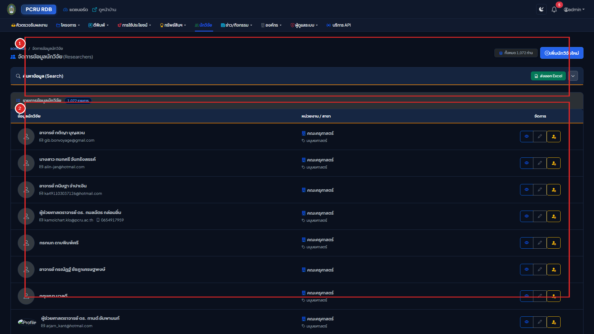

#### คำอธิบายส่วนประกอบตามหมายเลขในภาพ:
* **หมายเลข `[1]` แผงค้นหาและตัวกรองคณะ/สังกัดนักวิจัยหลังบ้าน (Researcher Filter Bar)**:
  * **ช่องค้นหาชื่อนักวิจัย**: พิมพ์ชื่อหรือนามสกุล (ระบบตัดคำนำหน้า ศ./รศ./ผศ./ดร./นาย/นาง อัตโนมัติ)
  * **ตัวกรองคณะและสถานะข้อมูล**: กรองดูเฉพาะคณะที่ต้องการ หรือกรองเฉพาะผู้ที่มีรหัสบัตรประชาชนถูกต้อง
  * **ปุ่มเพิ่มนักวิจัยใหม่**: คลิกปุ่มสีเขียว **"+ เพิ่มนักวิจัยใหม่"**
* **หมายเลข `[2]` ตารางทำเนียบนักวิจัย การตรวจสอบบัตรประชาชน และการซิงก์ Scopus (Researchers Table)**:
  * **ข้อมูลนักวิจัย**: รูปถ่าย, ชื่อ-นามสกุล, ตำแหน่งทางวิชาการ, คุณวุฒิ และสังกัดภาควิชา/คณะ
  * **สถานะความถูกต้องของเลขบัตรประชาชน 13 หลัก**: แสดงไอคอนสีเขียวเมื่อผ่านอัลกอริทึม Modulo 11
  * **การซิงก์ดัชนีทางวิชาการ (Scopus / ORCID)**: แสดงค่า **h-index**, จำนวนเอกสารสะสม และปุ่มซิงก์ข้อมูล API
  * **ปุ่มจำลองสิทธิ์และแก้ไข**: ผู้ดูแลระบบสามารถคลิกปุ่มสีเหลืองเพื่อจำลองสิทธิ์ หรือคลิกแก้ไขข้อมูลประวัติ

```mermaid
flowchart LR
    ID["1. กรอกเลขบัตรประชาชน 13 หลัก"] --> Modulo["2. อัลกอริทึม Modulo 11 ตรวจสอบความถูกต้อง"]
    Modulo -->|ผ่านเกณฑ์| Valid["แสดงเครื่องหมายถูกต้องสีเขียว ผ่านมาตรฐาน สกสว./วช."]
    Modulo -->|ไม่ผ่าน| Invalid["แสดงกรอบสีแดง แจ้งเตือนเลขบัตรไม่ถูกต้อง ป้องกันข้อมูลผิดพลาด"]

    ScopusInput["3. ระบุ Scopus Author ID / ORCID"] --> API["4. ระบบเชื่อมต่อ Scopus Author API อัตโนมัติ"]
    API --> Sync["5. ดึงค่า h-index, จำนวนเอกสาร, และยอด Citations มาอัปเดตลงฐานข้อมูล"]
```

เพื่อป้องกันความผิดพลาดในการรายงานข้อมูลต่อ สกสว. และ วช. ระบบได้ติดตั้งอัลกอริทึมตรวจสอบเลขบัตรประจำตัวประชาชน 13 หลัก ตามมาตรฐานกรมการปกครอง:
$$\sum_{i=1}^{12} (d_i \times (14 - i)) \pmod{11}$$
หากผู้ใช้กรอกเลขบัตรประชาชนผิดหลักหรือหลักตรวจสอบไม่ถูกต้อง ระบบจะแสดงกรอบสีแดงแจ้งเตือนทันที

---

### 8.2 การซิงก์ดัชนีทางวิชาการ Scopus Author ID และ h-index
* ผู้ดูแลระบบสามารถระบุ **Scopus Author ID** ของนักวิจัย
* ระบบเชื่อมโยงผ่าน Elsevier Scopus Author Retrieval API เพื่อดึงค่า **h-index**, จำนวนเอกสารตีพิมพ์สะสม (Documents), และจำนวนการอ้างอิงสะสม (Citations) มาบันทึกในฐานข้อมูลอัตโนมัติ

---

### 8.3 การตรวจสอบและเชื่อมโยงรหัสสากล ORCID iD
* ระบุรหัส ORCID ในรูปแบบสากล 16 หลัก (`0000-0002-1825-0097`)
* ระบบมี Regular Expression ตรวจสอบรูปแบบ เพื่อให้ลิงก์ไปยังหน้าโปรไฟล์ ORCID ได้อย่างถูกต้อง

---

## บทที่ 9: การส่งออกรายงาน UTF-8 BOM Excel และคลังปัญญา DSpace SAF

### 9.1 การสตรีมไฟล์ CSV ขนาดใหญ่พร้อมฝังรหัส UTF-8 BOM
ในทุกหน้ารายการ ผู้ใช้สามารถคลิกปุ่ม **"Export CSV"** เพื่อดาวน์โหลดรายงาน:
* **UTF-8 BOM Header (`\xEF\xBB\xBF`)**: ระบบฝังรหัส Byte Order Mark ลงในส่วนหัวของไฟล์ ทำให้โปรแกรม **Microsoft Excel** บนระบบปฏิบัติการ Windows และ Mac เปิดไฟล์อ่านภาษาไทยได้ถูกต้อง 100% โดยไม่มีปัญหาตัวอักษรต่างดาว
* **CSV Formula Injection Prevention**: ระบบทำการตรวจสอบและล้างอักขระเสี่ยง (`=`, `+`, `-`, `@`) ในฟิลด์ข้อความ เพื่อป้องกันการฝังคำสั่งอันตรายในสเปรดชีต

---

### 9.2 การส่งออกแพ็กเกจคลังปัญญา DSpace SAF แบบกลุ่ม (Batch Mode)

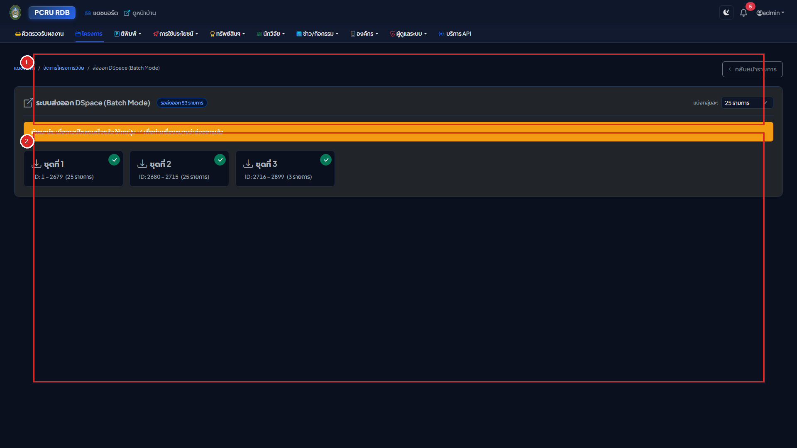

สำหรับส่งออกข้อมูลเข้าสู่ระบบคลังปัญญาสถาบัน (Institutional Repository - DSpace):
1. เข้าเมนู **"ส่งออก DSpace (Batch Mode)"** ในโครงการวิจัยหรือผลงานตีพิมพ์
2. เลือกรอบชุดข้อมูล (เช่น Batch ละ 20 รายการ)
3. คลิกปุ่ม **"ดาวน์โหลดแพ็กเกจ ZIP"** ➔ ระบบจะสร้างไฟล์ `.zip` ตามมาตรฐาน **DSpace Simple Archive Format (SAF)** ประกอบด้วย:
   * `dublin_core.xml`: ข้อมูลเมทาดาทาครบถ้วนตามมาตรฐาน Dublin Core (พร้อมระบุจำนวนหน้าเอกสารในแท็ก `dc.format.extent`)
   * `contents`: รายการระบุชื่อไฟล์แนบ
   * ไฟล์ PDF เล่มรายงานหรือบทความฉบับเต็ม

---

### 9.3 เครื่องมือตรวจสอบความสมบูรณ์ของไฟล์ PDF ก่อนส่งออก (DSpace Check Mode)
* เข้าที่เมนู **"ตรวจสอบจำนวนหน้า & สถานะ DSpace"** (`/backend/rdb_published/dspace_check`)
* เครื่องมือจะตรวจสอบความพร้อมของไฟล์ PDF, จำนวนหน้า, และสถานะการเปิดเผย เพื่อยืนยันความสมบูรณ์ก่อนสร้างแพ็กเกจส่งออก DSpace

---

### 9.4 คำสั่งดูแลรักษาระบบผ่าน Artisan CLI
ผู้ดูแลระบบเซิร์ฟเวอร์สามารถรันคำสั่งบำรุงรักษาผ่าน Terminal ได้ตลอดเวลา:

```powershell
# 1. รันระบบตรวจนับจำนวนหน้า PDF ย้อนหลังทั้งระบบ
php artisan rdb:count-pdf-pages --module=all

# 2. รันระบบสกัดภาพปกหน้าแรก .webp ย้อนหลังทั้งระบบ
php artisan rdb:generate-pdf-covers --module=all
```

---

## บทที่ 10: ประวัติการใช้งาน (Audit Logs) และการตั้งค่านโยบายความปลอดภัย

### 10.1 การตรวจสอบประวัติการทำรายการ (Audit Trail) และเครื่องมือเปรียบเทียบค่าเดิม-ใหม่ (Diff Viewer)

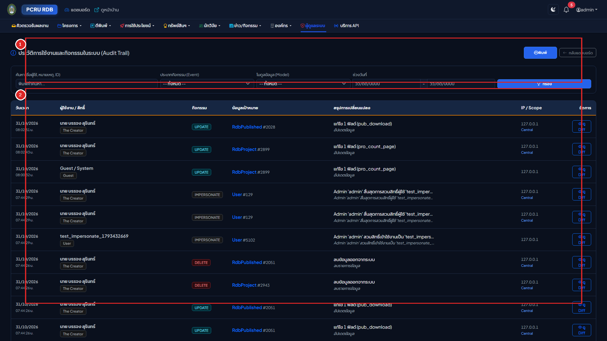

1. เข้าเมนู **"ประวัติการใช้งาน (Audit Trail)"** (`/backend/audit-logs`)
2. กรองดูประวัติตามชื่อผู้ใช้งาน, ประเภทเหตุการณ์ (`created`, `updated`, `deleted`, `submit`, `approve`, `reject`), หรือโมดูลข้อมูล
3. คลิกปุ่ม **"ดูรายละเอียดการเปลี่ยนแปลง (Diff Viewer)"** เพื่อเปิดดูตารางเปรียบเทียบ:
   * **ค่าข้อมูลเดิม (Old Values)**: แสดงข้อความเดิมก่อนการแก้ไข
   * **ค่าข้อมูลใหม่ (New Values)**: แสดงข้อความใหม่ที่มีการเปลี่ยนแปลง (พร้อมเน้นสี)
   * แสดงหมายเลข IP Address, ชนิดเบราว์เซอร์ และเวลาที่บันทึกข้อมูลอย่างละเอียด

---

### 10.2 การตั้งค่านโยบายความปลอดภัยการดาวน์โหลดเอกสาร (Document Access Policy)

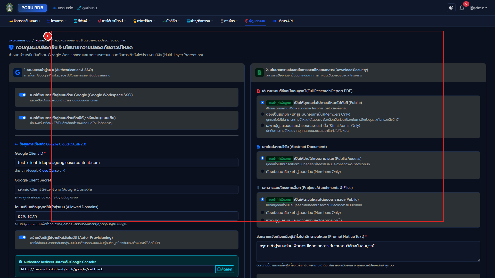

1. เข้าเมนู **"ตั้งค่าการควบคุมการเข้าถึง"** (`/backend/settings/access-control`)
2. ผู้ดูแลระบบสามารถกำหนดนโยบายการดาวน์โหลดเอกสารระดับมหาวิทยาลัย:
   * **สาธารณะ (Public Access - แนะนำ)**: ประชาชนทั่วไปสามารถดาวน์โหลดไฟล์เล่มรายงานและบทความที่ตั้งค่าเปิดเผยได้โดยไม่ต้องเข้าสู่ระบบ
   * **ต้องเข้าสู่ระบบก่อนดาวน์โหลด (Authenticated Users Only)**: บังคับให้ผู้ใช้งานต้องล็อกอินก่อน จึงจะสามารถดาวน์โหลดไฟล์เอกสารฉบับเต็มได้
3. คลิกปุ่ม **"บันทึกการตั้งค่า"** นโยบายจะมีผลบังคับใช้ทั่วทั้งระบบทันที

---

### 10.3 การตรวจสอบประวัติกิจกรรมและการแก้ไขรายรายการ (Record-Level Audit Trail)

ระบบได้ติดตั้งการ์ดประวัติกิจกรรมและการแก้ไขงาน (`<x-audit-trail>`) ฝังไว้ที่ส่วนล่างของหน้ารายละเอียด (`show.blade.php`) ในทุกโมดูลหลักของระบบหลังบ้าน ได้แก่:
1. **ผลงานวิชาการ**: โครงการวิจัย (`/backend/rdb_project/{id}`), ผลงานตีพิมพ์ (`/backend/rdb_published/{id}`), ทรัพย์สินทางปัญญา (`/backend/rdb_dip/{id}`), การนำผลงานไปใช้ประโยชน์ (`/backend/rdb_projectutilize/{id}`)
2. **บัญชีและข้อมูลบุคลากร**: บัญชีผู้ใช้งาน (`/backend/user/{id}`), ข้อมูลประวัตินักวิจัย (`/backend/rdb_researcher/{id}`)
3. **โมดูลย่อยวิชาการ**: ข่าวสารประชาสัมพันธ์/ทุนวิจัย (`/backend/research_news/{id}`), งานประชุมวิชาการ (`/backend/research_conference/{id}`)

#### สิทธิ์ในการเข้าถึงและมาตรการความปลอดภัย
* **ผู้ดูแลระบบส่วนกลาง (The Creator / Admin / Admin Research)**: สามารถตรวจสอบประวัติกิจกรรมของทุกรายการ พร้อมดูข้อมูลเชิงเทคนิค เช่น IP Address, User Agent และ URL Endpoint เพื่อความปลอดภัย
* **นักวิจัยเจ้าของผลงาน (Owner / Co-researcher)**: สามารถเข้าดูประวัติกิจกรรมและการแก้ไขเฉพาะผลงานของตนเอง และประวัติบัญชีผู้ใช้ของตนเองได้ โดยระบบจะซ่อนข้อมูลเชิงเทคนิค (IP / User Agent) เพื่อความปลอดภัยและความเป็นส่วนตัว
* **ผู้ใช้งานอื่นที่ไม่เกี่ยวข้อง**: ถูกปฏิเสธการเข้าถึง (403 Forbidden) ไม่สามารถส่องดูประวัติผลงานหรือบัญชีของผู้อื่นได้
* **ระบบหน้าบ้าน (Public Portal)**: ปิดกั้นการมองเห็นและไม่ส่งข้อมูล Audit Log ออกสู่หน้าบ้าน 100%

#### ฟังก์ชันการใช้งาน
* **ไทม์ไลน์กิจกรรม (Editorial Timeline)**: แสดงลำดับเหตุการณ์จากล่าสุด วันที่และเวลา พ.ศ. พร้อมระยะเวลาสัมพัทธ์ (เช่น "2 ชั่วโมงที่แล้ว")
* **ป้ายประเภทกิจกรรม**: แยกสีชัดเจน เช่น สร้างรายการใหม่ (สีเขียว), อัปเดตข้อมูล (สีน้ำเงิน), ปรับเปลี่ยนสถานะ (สีเหลือง), ลบข้อมูล (สีแดง)
* **เครื่องมือตรวจสอบความเปลี่ยนแปลง (Field-by-Field Diff Viewer)**: คลิกปุ่ม **"ดูรายละเอียดที่เปลี่ยน"** เพื่อเปิดตารางเปรียบเทียบค่าเดิม (Old Value) และค่าใหม่ (New Value) แบบเรียลไทม์
* **ระบบแบ่งหน้าอัจฉริยะ (Instant Client-Side Pagination)**: จัดกลุ่มประวัติกิจกรรมเป็นหน้าละ **10 รายการ** อย่างเป็นระเบียบ พร้อมปุ่ม **"ก่อนหน้า"**, **"ถัดไป"**, และหมายเลขหน้า ช่วยลดความยาวของหน้าจอและโหลดข้อมูลได้ทันทีโดยไม่ต้อง Refresh หน้าเว็บ
* **การบันทึกประวัติความสัมพันธ์ย่อย (Sub-Resource Audit Tracking)**:
  - **นักวิจัยร่วมโครงการ (`rdb_project_work`)**: เมื่อมีการเพิ่ม แก้ไขสัดส่วน (%) หรือลบนักวิจัยร่วม ระบบจะบันทึกประวัติลงในการ์ดโครงการวิจัยนั้นทันที ระบุชื่อนักวิจัย ตำแหน่ง และสัดส่วนที่เปลี่ยนแปลง
  - **ผู้เขียนผลงานตีพิมพ์ (`rdb_published_work`)**: บันทึกการเพิ่ม/เปลี่ยนประเภทผู้แต่ง (เช่น ผู้ประพันธ์อันดับแรก, Corresponding Author)
  - **ไฟล์แนบเพิ่มเติม (`rdb_project_files`)**: บันทึกการอัปโหลดไฟล์ การแก้ไขชื่อไฟล์ หรือการลบไฟล์แนบ
* **นโยบายการคัดแยก Log ขยะ (Log Hygiene & Noise Reduction Policy)**:
  - ระบบ**ยกเว้นการบันทึกการนับสถิติการเข้าดู (View Counts) และการดาวน์โหลดไฟล์ (Download Counts)** ออกจากตาราง Audit Log เพื่อป้องกันการสะสมของ Event ขยะนับแสนรายการ
  - มุ่งเน้นการจัดเก็บเฉพาะกิจกรรมที่มีนัยสำคัญต่อความโปร่งใสและตรวจสอบได้ (Data Governance) ได้แก่ การสร้าง, การแก้ไขฟิลด์ข้อมูล, การเปลี่ยนสถานะโครงการ, การส่งประเมินเล่มรายงาน, การนำเข้าคลัง DSpace, และการจัดการผู้ร่วมวิจัย/ไฟล์แนบ

---

## บทที่ 11: ศูนย์จัดการคำสั่งระบบและการบำรุงรักษา (System Commands & Maintenance Dashboard)

> [!IMPORTANT]
> **การจำกัดสิทธิ์ระดับสูง (Super Admin Only)**:
> หน้านี้สงวนสิทธิ์เฉพาะผู้ดูแลระบบที่มีบทบาท `The Creator`, `Admin`, หรือ `Admin Research` เท่านั้น การสั่งรันคำสั่งจะส่งผลกระทบต่อแคชและไฟล์ภาพพรีวิวของระบบทั้งมหาวิทยาลัย ทุกการดำเนินการจะถูกบันทึกประวัติลงใน Audit Trail โดยอัตโนมัติ

### 11.1 ภาพรวมหน้าจอศูนย์คำสั่งระบบ (`/backend/system-commands`)
เข้าใช้งานผ่านเมนูแถบซ้าย: **การดูแลระบบ ➔ คำสั่งและบำรุงรักษาระบบ** หรือพิมพ์ URL: `http://laravel_rdb.test/backend/system-commands`

หน้าจอประกอบด้วย 5 ส่วนสำคัญ:
1. **แถบสถานะเอนจินและเซิร์ฟเวอร์ (System Health & Engine Strip)**: แสดงสถานะความพร้อมของเครื่องมือใน Laragon/เซิร์ฟเวอร์ ได้แก่ MuPDF (PyMuPDF), Poppler pdftotext/pdftoppm, PHP GD WebP, พื้นที่ว่างบนดิสก์, MariaDB Latency, คิวงานประมวลผล (Queue) และจำนวนงานใน Cron Scheduler
2. **แผงทางลัดเครื่องมือเชื่อมโยง (Quick Action Shortcuts)**: ปุ่มทางลัดเข้าสู่ระบบจัดการ API (API Management), เครื่องมือทดสอบดึงข่าว NRIIS (Dry-Run), เครื่องมือทดสอบดึงงานประชุม Facebook (Dry-Run), และระบบตั้งเวลาอัตโนมัติ (Scheduler)
3. **การ์ดสถิติความครอบคลุม (Coverage Analytics Strip — 3 คอลัมน์)**:
   - *โครงการวิจัย*: ภาพหน้าปก PDF (.webp) และจำนวนหน้าที่ตรวจนับแล้ว
   - *ผลงานตีพิมพ์*: ภาพหน้าปก PDF (.webp) และจำนวนหน้าที่ตรวจนับแล้ว
   - *ภาพระบบ WebP (&le;1024px)*: สถิติ % ภาพที่แปลงเป็น `.webp` แล้ว แยกตาม 3 โมดูล (รูปโปรไฟล์นักวิจัย, ภาพข่าวทุนวิจัย NRIIS, และภาพงานประชุมวิชาการ)
4. **กล่อง Terminal Output Log**: แสดงผลลัพธ์คำสั่ง CLI แบบเรียลไทม์บนพื้นหลังสีดำ พร้อมปุ่มคัดลอก Log
5. **การ์ดสั่งรันคำสั่งระบบ (Interactive Command Runners — 5 หมวดการทำงาน)**: รันผ่านหน้าเว็บได้โดยตรงไม่ต้องเปิด Terminal

---

### 11.2 คำสั่งสร้างภาพหน้าแรก PDF (.webp) ทั้งระบบด้วย MuPDF & GD
* **วัตถุประสงค์**: เรนเดอร์หน้าแรกของไฟล์ PDF ฉบับเต็มทั้งหน้าออกมาเป็นภาพ `.webp` (ความกว้างสูงสุด 800px คุณภาพ 85%) แทนการใช้ไฟล์ PDF ขนาดใหญ่ในการแสดงผล ช่วยให้หน้าเว็บโหลดเร็วขึ้น 10 เท่า
* **ขั้นตอนการรันผ่านหน้าเว็บ**:
  1. เลือก **โมดูล**: ทั้งหมด (`all`), โครงการวิจัย (`project`), หรือผลงานตีพิมพ์ (`published`)
  2. เลือก **จำนวนรายการ (Limit)**: เช่น ทดสอบ 10 รายการแรก หรือทั้งหมดในระบบ
  3. สวิตช์ **บังคับสร้างใหม่ทับของเดิม (`--force`)**: เปิดใช้เมื่อต้องการอัปเดตภาพหน้าปกทั้งหมดใหม่
  4. คลิกปุ่ม **"รันคำสั่งสร้างภาพหน้าปก"** ➔ ระบบจะเริ่มประมวลผลและแสดงรายงานสรุปจำนวนที่สำเร็จและล้มเหลว
* **คำสั่งเทียบเท่าผ่าน Terminal / Shell**:
  ```powershell
  php artisan rdb:generate-pdf-covers --module=all --force
  ```

---

### 11.3 คำสั่งตรวจนับจำนวนหน้าไฟล์ PDF ย้อนหลัง (Page Count Engine)
* **วัตถุประสงค์**: สแกนจำนวนหน้าจริงของเล่มรายงานวิจัยและบทความตีพิมพ์ด้วยสถาปัตยกรรม 4-Tier Engine (Poppler pdftotext ➔ Smalot ➔ Fpdi ➔ Fast Regex) และบันทึกลงฟิลด์ `pro_page_num` และ `pub_numfile`
* **ขั้นตอนการรันผ่านหน้าเว็บ**:
  1. เลือกโมดูลและจำนวนรายการที่ต้องการนับ
  2. สวิตช์บังคับนับใหม่ (`--force`): สแกนนับใหม่ทุกไฟล์แม้จะมีตัวเลขเดิมอยู่แล้ว
  3. คลิกปุ่ม **"รันคำสั่งนับจำนวนหน้า"**
* **คำสั่งเทียบเท่าผ่าน Terminal / Shell**:
  ```powershell
  php artisan rdb:count-pdf-pages --module=all --force
  ```

---

### 11.4 คำสั่งแปลงรูปภาพทั้งระบบเป็น WebP (Universal WebP Image Converter)
* **วัตถุประสงค์**: แปลงรูปภาพทั้งหมดในระบบ (รูปโปรไฟล์นักวิจัย `rdb_researcher`, ภาพข่าวทุนวิจัย NRIIS `research_news`, ภาพงานประชุมวิชาการ `research_coferenceinthai`) ให้เป็นฟอร์แมต `.webp` คุณภาพ 85 พร้อมปรับลดขนาดความกว้าง/สูงสูงสุดไม่เกิน 1,024 พิกเซลอัตโนมัติ (รักษา Aspect Ratio เดิม) ช่วยเพิ่มความเร็วโหลดหน้าเว็บและลดขนาดพื้นที่จัดเก็บลงกว่า 70-85%
* **ขั้นตอนการรันผ่านหน้าเว็บ (`/backend/system-commands`)**:
  1. เลือก **โมดูลรูปภาพ**: ทั้งหมด (`all`), เฉพาะรูปโปรไฟล์นักวิจัย (`researcher`), เฉพาะข่าวทุนวิจัย (`news`), หรือเฉพาะงานประชุมวิชาการ (`conference`)
  2. เลือก **จำนวนรายการ (Limit)**: 10, 50, 100 รายการ หรือทั้งหมดในระบบ (Full System)
  3. กำหนด **ขนาดภาพสูงสุด (Max Dimension)**: ค่ามาตรฐานแนะนำ `1024` พิกเซล (px)
  4. สวิตช์ **บังคับแปลงใหม่ทับของเดิม (`--force`)**: สำหรับสั่งประมวลผลซ้ำทุกภาพแม้เป็น `.webp` อยู่แล้ว
  5. คลิกปุ่ม **"รันคำสั่งแปลงรูปภาพ WebP"** ➔ ผลลัพธ์และสถิติจะแสดงลงในกล่อง Terminal Output ด้านบนทันที
* **คำสั่งเทียบเท่าผ่าน Terminal / Shell**:
  ```powershell
  php artisan rdb:convert-images-webp --module=all --force --max-dimension=1024
  ```

---

### 11.5 คำสั่งล้างแคชและรีเซ็ตระบบ (Clear Application, Route, View, Config Cache)
* **วัตถุประสงค์**: ล้างแคชการประมวลผลสถิติ, แคชเส้นทาง URL, แคชหน้าจอ Blade Template, และแคชการตั้งค่า เพื่อให้ระบบแสดงผลข้อมูลและโครงสร้างล่าสุดทันที
* **ขั้นตอนการรันผ่านหน้าเว็บ**:
  1. คลิกปุ่ม **"ล้างแคชระบบทันที"** (`<button class="btn btn-warning">`)
  2. ยืนยันในกล่องข้อความ Alert
  3. ระบบจะสั่งรันคำสั่ง 4 ชุดพร้อมกัน:
     - `php artisan cache:clear` (ล้างแคชดาต้าเบสและสถิติ)
     - `php artisan view:clear` (ล้างแคชคอมไพล์ Blade Views)
     - `php artisan route:clear` (ล้างแคช Route)
     - `php artisan config:clear` (ล้างแคช Environment)

---

### 11.6 การตรวจสอบความพร้อมของเซิร์ฟเวอร์และเอนจิน (Server Engine Health Check)
ตารางความต้องการเครื่องมือของระบบ (SysAdmin Requirements):

| เครื่องมือ / ส่วนประกอบ | หน้าที่ในระบบ | สถานะที่ต้องการ | การติดตั้งบน Ubuntu Production |
| :--- | :--- | :--- | :--- |
| **MuPDF (`fitz`) / PyMuPDF** | เรนเดอร์หน้าแรกของ PDF ทั้งหน้าเป็นภาพ WebP | แนะนำสูงสุด (Tier 2) | `pip install pymupdf Pillow` |
| **Poppler pdftotext** | นับจำนวนหน้า PDF แม่นยำ 99.99% | แนะนำสูงสุด (Tier 1) | `sudo apt install poppler-utils` |
| **Poppler pdftoppm** | สกัดภาพหน้าแรก PDF ความเร็วสูง | แนะนำ (Tier 1) | `sudo apt install poppler-utils` |
| **PHP GD Extension** | วาดปกสำรองภาษาไทย & ประมวลผลภาพ WebP | จำเป็น (Mandatory) | `sudo apt install php8.x-gd` |
| **ฟอนต์ Leelawadee UI / Sarabun** | ฟอนต์ TrueType สำหรับเรนเดอร์ภาษาไทย | จำเป็นบน GD | `sudo apt install fonts-thai-tlwg` |
| **Storage Symlink** | เชื่อมต่อ URL สาธารณะกับพื้นที่จัดเก็บ | จำเป็น (Mandatory) | `php artisan storage:link` |

---

### 11.7 คู่มือขั้นตอนการติดตั้งเอนจินประมวลผล PDF และฟอนต์ภาษาไทย (SysAdmin Engine Installation Guide)

กรณีที่ระบบแสดงสถานะว่าเครื่องมือใดเครื่องมือหนึ่งยังไม่พร้อมใช้งาน ผู้ดูแลระบบสามารถติดตั้งและกำหนดค่าได้ตามขั้นตอนดังนี้:

#### 1. การติดตั้ง MuPDF (PyMuPDF - Python `fitz` + `Pillow`)
* **บน Windows / Laragon**:
  1. ตรวจสอบเวอร์ชันของ Python ในเครื่อง: `python --version` (แนะนำ Python 3.9 ขึ้นไป) หากยังไม่มีให้ติดตั้งจาก [python.org](https://www.python.org/) โดยติ๊กเลือก **"Add python.exe to PATH"**
  2. รันคำสั่งติดตั้งผ่าน Terminal:
     ```cmd
     pip install --upgrade pymupdf pillow
     ```
  3. หากระบบตรวจไม่พบ ให้กำหนดพาธตรงในไฟล์ `.env`:
     ```env
     PYTHON_PATH="C:\Users\YourUser\AppData\Local\Programs\Python\Python312\python.exe"
     ```
* **บน Linux (Ubuntu / Debian Production)**:
  ```bash
  sudo apt update && sudo apt install -y python3 python3-pip
  pip3 install --upgrade pymupdf pillow
  ```
* **บน Linux (CentOS / RHEL / AlmaLinux)**:
  ```bash
  sudo dnf install -y python3 python3-pip
  pip3 install --upgrade pymupdf pillow
  ```

#### 2. การติดตั้ง Poppler CLI (`pdftotext` & `pdftoppm`)
* **บน Windows / Laragon**:
  * **วิธีที่ 1 (ตรวจพบอัตโนมัติผ่าน Git)**: หากติดตั้ง Git for Windows ใน Laragon ไบนารี `pdftotext.exe` จะอยู่ที่ `laragon\bin\git\mingw64\bin\pdftotext.exe` ซึ่งระบบตรวจจับให้อัตโนมัติ
  * **วิธีที่ 2 (ติดตั้ง Poppler Windows แยก)**: ดาวน์โหลดแพ็กเกจ Binary จาก [poppler-windows releases](https://github.com/oschwartz10612/poppler-windows/releases/) แตกไฟล์ไว้ที่ `C:\laragon\bin\poppler\bin` แล้วระบุใน `.env`:
    ```env
    PDFTOTEXT_PATH="C:/laragon/bin/poppler/bin/pdftotext.exe"
    PDFTOPPM_PATH="C:/laragon/bin/poppler/bin/pdftoppm.exe"
    ```
* **บน Linux (Ubuntu / Debian Production)**:
  ```bash
  sudo apt update && sudo apt install -y poppler-utils
  ```
* **บน Linux (CentOS / RHEL / AlmaLinux)**:
  ```bash
  sudo dnf install -y poppler-utils
  ```

#### 3. การเปิดใช้งาน PHP GD Extension & FreeType
* **บน Windows / Laragon**:
  1. คลิกขวาที่หน้าต่าง Laragon ➔ เลือกเมนู **PHP** ➔ **Extensions** ➔ ติ๊กเลือก **`gd`**
  2. หรือเปิดไฟล์ `php.ini` ลบเครื่องหมาย `;` หน้า `;extension=gd` เป็น `extension=gd`
  3. กดปุ่ม **Stop** และกด **Start All** เพื่อรีสตาร์ท Apache
* **บน Linux (Ubuntu / Debian Production)**:
  ```bash
  sudo apt update && sudo apt install -y php8.2-gd
  sudo systemctl restart apache2 # หรือ sudo systemctl restart php8.2-fpm
  ```
* **บน Linux (CentOS / RHEL / AlmaLinux)**:
  ```bash
  sudo dnf install -y php-gd
  sudo systemctl restart httpd   # หรือ sudo systemctl restart php-fpm
  ```

#### 4. การติดตั้งฟอนต์ภาษาไทยสำหรับสร้างภาพหน้าปกสำรอง (TrueType Fonts)
* **Windows**: ระบบดึงฟอนต์ระบบภาษาไทย `C:/Windows/Fonts/leelawb.ttf` (Leelawadee UI Bold) อัตโนมัติ
* **Linux Server**: ให้ติดตั้งแพ็กเกจฟอนต์ภาษาไทยของระบบ:
  ```bash
  sudo apt install -y fonts-thai-tlwg fonts-noto-cjk
  ```
  หรือคัดลอกไฟล์ฟอนต์ TrueType เช่น `Sarabun-Bold.ttf` ไปวางไว้ในโฟลเดอร์ `storage/fonts/` ภายในโปรเจกต์ Laravel

#### 5. คำสั่งทดสอบความพร้อมของเอนจินทั้งหมดผ่าน Shell
```bash
# 1. ทดสอบ PyMuPDF (MuPDF Python)
python -c "import fitz, PIL; print('PyMuPDF Ready')"

# 2. ทดสอบ Poppler pdftotext
pdftotext -v

# 3. ทดสอบ PHP GD Extension และการรองรับ WebP
php -r "echo extension_loaded('gd') && function_exists('imagewebp') ? 'GD WebP OK' : 'GD Missing';"
```

---

### 11.8 ศูนย์สำรองและกู้คืนข้อมูลระบบ (Dedicated System Backup & Disaster Recovery Hub)

> [!CAUTION]
> **การสงวนสิทธิ์ขั้นเด็ดขาด (The Creator Only)**:
> ฟังก์ชันการสำรอง กู้คืน และดาวน์โหลดไฟล์สำรองฐานข้อมูลระบบ **สงวนสิทธิ์เฉพาะผู้ใช้บทบาท The Creator (ผู้ดูแลระบบสูงสุด) เพียงผู้เดียวเท่านั้น** โดยระบบได้แยกออกเป็นเมนูเฉพาะที่ **การดูแลระบบ ➔ สำรองและกู้คืนระบบ (Disaster Recovery)** หรือ URL: `http://laravel_rdb.test/backend/system-backup` ระบบจะทำการปฏิเสธการเข้าถึง (HTTP 403 Forbidden) โดยอัตโนมัติหากเป็นผู้ใช้บทบาทอื่น

#### 1. รูปแบบการสำรองข้อมูล 3 ระดับ
1. **สำรองเฉพาะฐานข้อมูล (Database Only: `.sql.gz`)**: ส่งออกข้อมูลทั้งหมดของ MariaDB พร้อมบีบอัด Gzip ระดับ 9 (ลดขนาดลง ~80%) ใช้เวลาประมวลผล ~5–10 วินาที
2. **สำรองเฉพาะไฟล์ Storage (`.zip`)**: รวบรวมไฟล์เล่มรายงาน PDF, ปก WebP, ภาพนักวิจัย และไฟล์แนบทั้งหมดใน `storage/app/public/`
3. **สำรองข้อมูลทั้งระบบ (Full System Archive: `.zip`)**: รวมไฟล์ฐานข้อมูล SQL.gz + ไฟล์ Storage + ไฟล์การตั้งค่า `.env` และ Manifest สรุประบบไว้ในแพ็กเกจเดียว

#### 2. ขั้นตอนการกู้คืนระบบแบบปลอดภัยสูงสุด (Safe Web Restore with Email OTP)
เพื่อป้องกันข้อผิดพลาดจากการเขียนทับฐานข้อมูลจริง ระบบบังคับใช้กระบวนการยืนยัน 4 ชั้น:
1. คลิกปุ่ม **"กู้คืน (Restore)"** ที่ไฟล์สำรองเป้าหมายในตาราง
2. คลิกปุ่ม **"กดส่งรหัส OTP ไปยังอีเมลของฉัน"** ➔ ระบบจะสร้างรหัสความปลอดภัย OTP 6 หลัก และส่งเข้าอีเมลของ The Creator ทันที (อายุ 10 นาที)
3. กรอกรหัส OTP 6 หลัก พร้อมพิมพ์ข้อความยืนยัน: `CONFIRM RESTORE`
4. เมื่อกดยืนยัน:
   * **ระบบจะสร้าง Safety Snapshot** สำรองฐานข้อมูลปัจจุบันไว้ให้อัตโนมัติก่อนเริ่มกู้คืนเสมอ (ชื่อไฟล์ `backup_pre_restore_safety_snapshot_*.sql.gz`)
   * ระบบทำการคลายบีบอัดและกู้คืนข้อมูลเข้า MariaDB
   * ระบบทำการล้างแคชระบบอัตโนมัติ (`cache:clear`, `route:clear`, `view:clear`)

#### 3. คำสั่งผ่าน Terminal / Shell (Artisan CLI & Cron Schedule)
```bash
# สำรองเฉพาะฐานข้อมูล
php artisan rdb:backup --type=db

# สำรองเฉพาะไฟล์เอกสาร
php artisan rdb:backup --type=files

# สำรองทั้งระบบ พร้อมลบไฟล์สำรองเก่ากว่า 30 วันอัตโนมัติ
php artisan rdb:backup --type=all --clean-older-than-days=30

# คำสั่งกู้คืนฉุกเฉินผ่าน Shell
php artisan rdb:restore backup_db_20261103_151323.sql.gz --force
```

#### 4. การเชื่อมต่อสำรองข้อมูลขึ้น Google Drive อัตโนมัติด้วย Rclone
แนะนำให้ตั้งเวลาซิงค์โฟลเดอร์สำรองไปยัง Google Drive อัตโนมัติผ่าน Rclone:
```bash
# 1. เชื่อมต่อ Google Drive (ฟรี ไม่จำกัดอายุ Token)
rclone config

# 2. คำสั่งซิงค์ขึ้น Google Drive
rclone sync storage/app/backups/ gdrive:PCRU_Research_Backups/ -v
```

---

### 11.9 การตั้งค่าระบบการส่งอีเมลของมหาวิทยาลัย (Mail & SMTP Configuration)

> [!NOTE]
> **ความสำคัญของระบบ Mail ในระบบฐานข้อมูลงานวิจัย**:
> 1. **ความปลอดภัย**: จัดส่งรหัสความปลอดภัย OTP 6 หลักสำหรับยืนยันการกู้คืนฐานข้อมูล (Restore Verification) ไปยังอีเมลของ The Creator
> 2. **วงจรงานวิจัย (Workflow Notifications)**: แจ้งเตือนนักวิจัยเมื่อโครงการวิจัยหรือผลงานตีพิมพ์ได้รับการอนุมัติ หรือมีข้อเสนอแนะให้แก้ไข
> 3. **ระบบผู้ทรงคุณวุฒิ (Peer Review)**: แจ้งเตือนผู้ทรงคุณวุฒิเมื่อได้รับมอบหมายให้เข้าตรวจประเมินเล่มรายงานวิจัยฉบับสมบูรณ์

#### 1. ตำแหน่งไฟล์การตั้งค่า
การตั้งค่าระบบ Mail ของ Laravel ทั้งหมดจะถูกเก็บไว้ที่ **ไฟล์ `.env`** บริเวณโฟลเดอร์หลักของโปรเจกต์ (`/laravel_rdb/.env`) โดยสามารถเปิดแก้ไขด้วย Text Editor หรือ VS Code

#### 2. ตารางพารามิเตอร์การตั้งค่าในไฟล์ `.env`

| ตัวแปรใน `.env` | หน้าที่และความหมาย | ค่าตัวอย่างที่แนะนำ |
| :--- | :--- | :--- |
| `MAIL_MAILER` | ไดรเวอร์การส่งอีเมล | `smtp` (ใช้งานจริง) หรือ `log` (ทดสอบในเครื่อง) |
| `MAIL_HOST` | ที่อยู่โฮสต์ของ Mail Server | `smtp.gmail.com` หรือ `mail.pcru.ac.th` |
| `MAIL_PORT` | พอร์ตเชื่อมต่อ SMTP | `587` (TLS), `465` (SSL) หรือ `25` (Internal) |
| `MAIL_USERNAME` | บัญชีผู้ใช้อีเมลผู้ส่ง | `research_admin@pcru.ac.th` |
| `MAIL_PASSWORD` | รหัสผ่าน หรือ App Password 16 หลัก | รหัสผ่านแอปที่สร้างจาก Google Account |
| `MAIL_ENCRYPTION` | โปรโตคอลเข้ารหัสความปลอดภัย | `tls` หรือ `ssl` |
| `MAIL_FROM_ADDRESS` | ที่อยู่อีเมลที่จะแสดงในช่องผู้ส่ง | `research@pcru.ac.th` |
| `MAIL_FROM_NAME` | ชื่อหน่วยงานที่จะแสดงเป็นผู้ส่ง | `สถาบันวิจัยและพัฒนา มรภ.เพชรบูรณ์` |

---

#### 3. รูปแบบการตั้งค่าตามสภาวะแวดล้อม (Configuration Presets)

##### แบบที่ 1: การใช้ Google Workspace / Gmail ของมหาวิทยาลัย (@pcru.ac.th)
เป็นแนวทางที่แนะนำสูงสุดสำหรับความเสถียรและอีเมลไม่ตกไปอยู่ในโฟลเดอร์ขยะ (Spam):
1. เข้าสู่ระบบบัญชี Google ของมหาวิทยาลัย ➔ ไปที่ **จัดการบัญชี Google (Google Account)** ➔ เมนู **ความปลอดภัย (Security)**
2. เปิดใช้งาน **การยืนยันแบบ 2 ขั้นตอน (2-Step Verification)**
3. ค้นหาเมนู **รหัสผ่านสำหรับแอป (App Passwords)** ➔ ตั้งชื่อแอป เช่น `PCRU-RDB-System` ➔ คลิก **สร้าง (Create)**
4. ระบบจะแสดงรหัสผ่าน 16 ตัวอักษร (เช่น `abcd efgh ijkl mnop`) นำมากรอกลงในไฟล์ `.env`:
```env
MAIL_MAILER=smtp
MAIL_HOST=smtp.gmail.com
MAIL_PORT=587
MAIL_USERNAME=research_admin@pcru.ac.th
MAIL_PASSWORD=abcdefghijklmnop
MAIL_ENCRYPTION=tls
MAIL_FROM_ADDRESS="research_admin@pcru.ac.th"
MAIL_FROM_NAME="สถาบันวิจัยและพัฒนา มรภ.เพชรบูรณ์"
```

##### แบบที่ 2: การใช้ Mail Gateway / SMTP ภายในมหาวิทยาลัย
กรณีใช้ Mail Server ภายในเครือข่ายของมหาวิทยาลัยราชภัฏเพชรบูรณ์:
```env
MAIL_MAILER=smtp
MAIL_HOST=mail.pcru.ac.th
MAIL_PORT=25
MAIL_USERNAME=your_username
MAIL_PASSWORD=your_password
MAIL_ENCRYPTION=tls
MAIL_FROM_ADDRESS="no-reply@pcru.ac.th"
MAIL_FROM_NAME="PCRU Research Database"
```

##### แบบที่ 3: โหมดพัฒนาและทดสอบบนเครื่อง Local (Local Log Mode)
กรณีที่ยังไม่มีการต่ออินเทอร์เน็ตหรือต้องการทดสอบโดยไม่ส่งอีเมลออกจริง:
```env
MAIL_MAILER=log
```
* ในโหมดนี้ เนื้อหาอีเมลทั้งหมดรวมถึงรหัส OTP 6 หลัก จะถูกบันทึกลงในไฟล์ `storage/logs/laravel.log` โดยอัตโนมัติ

---

#### 4. ขั้นตอนการล้างแคชหลังแก้ไขไฟล์ `.env`
ทุกครั้งที่มีการแก้ไขค่าตัวแปรในไฟล์ `.env` ผู้ดูแลระบบต้องรันคำสั่งล้างแคชการตั้งค่า เพื่อให้ระบบอ่านค่าใหม่ทันที:
```bash
php artisan config:clear
```

---

#### 5. คำสั่งทดสอบการส่งอีเมลจริงผ่าน Terminal
สามารถทดสอบส่งอีเมล 1 ฉบับผ่านคำสั่ง Artisan Tinker เพื่อตรวจสอบว่าเชื่อมต่อสำเร็จหรือไม่:
```bash
php artisan tinker --execute="Mail::raw('ทดสอบการเชื่อมต่อระบบอีเมล PCRU Research Database', function(\$m) { \$m->to('อีเมลของผู้ดูแลระบบ@pcru.ac.th')->subject('ทดสอบระบบส่งอีเมล'); }); echo 'ส่งอีเมลสำเร็จ!';"
```
* **หากสำเร็จ**: จะแสดงข้อความ `ส่งอีเมลสำเร็จ!` และมีอีเมลเข้า Inbox
* **หากล้มเหลว**: ระบบจะแสดงข้อความแจ้งเตือนข้อผิดพลาดทันที (เช่น รหัสผ่าน App Password ผิดพลาด หรือพอร์ต SMTP 587 ถูกบล็อกโดยไฟร์วอลล์)

---

### 11.10 การตั้งเวลาทำงานอัตโนมัติและการตรวจสุขภาพระบบ (Task Scheduling & Live Diagnostics)

#### 1. สถาปัตยกรรมการตั้งเวลาทำงานอัตโนมัติ (Cron Job Scheduler)
ระบบฐานข้อมูลงานวิจัยได้รวมคำสั่งบำรุงรักษาและการสำรองข้อมูลทั้งหมดเข้าสู่ตัวตั้งเวลาอัตโนมัติของ Laravel (`routes/console.php`) โดยผู้ดูแลระบบแม่ข่าย (SysAdmin) เพียงกำหนดให้ Linux Crontab รันคำสั่งตรวจสอบทุก 1 นาที:

```bash
# แก้ไขไฟล์ Crontab ของเซิร์ฟเวอร์
crontab -e

# เพิ่มบรรทัดคำสั่งตั้งเวลา (ชี้ไปยังไดเรกทอรีของระบบ)
* * * * * cd /laragon/www/laravel_rdb && php artisan schedule:run >> /dev/null 2>&1
```

#### 2. ตารางเวลาการทำงานอัตโนมัติในระบบ (System Cron Schedule)
| เวลาที่กำหนด (Time) | คำสั่งที่ระบบรันอัตโนมัติ (Artisan Command) | หน้าที่และผลลัพธ์ |
| :--- | :--- | :--- |
| **02:00 น. ทุกวัน** | `php artisan rdb:backup --type=db` | สำรองฐานข้อมูล MariaDB ทั้งหมดเป็นไฟล์บีบอัด `.sql.gz` อัตโนมัติ |
| **03:00 น. ทุกคืนวันอาทิตย์** | `php artisan rdb:backup --type=all` | สำรองระบบเต็มรูปแบบ (ฐานข้อมูล + ไฟล์เอกสารงานวิจัยทั้งหมดใน Storage) |
| **06:00 น. ทุกวัน** | `php artisan rdb:sync-nriis-news` | ซิงค์ข่าวประกาศทุนวิจัยใหม่จากระบบ NRIIS เข้าสู่ฐานข้อมูลอัตโนมัติ |
| **06:30 น. ทุกวัน** | `php artisan rdb:sync-facebook-conferences` | ซิงค์ข่าวงานประชุมวิชาการจากเพจ Facebook สถาบันวิจัยฯ อัตโนมัติ |

> [!NOTE]
> *งานนับจำนวนหน้า PDF และสร้างภาพปก WebP ไม่จำเป็นต้องตั้งเวลาอัตโนมัติ เนื่องจากระบบทำงานแบบเรียลไทม์ทันทีทุกครั้งที่มีการอัปโหลดหรือแก้ไขไฟล์ PDF ในแต่ละโมดูลอยู่แล้ว*

#### 3. การตรวจสอบตารางเวลาทำงานด้วย Artisan CLI
ผู้ดูแลระบบสามารถตรวจสอบตารางเวลาและรอบการรันครั้งถัดไปได้ทันทีผ่าน Terminal:
```bash
php artisan schedule:list
```

#### 4. แถบตรวจสุขภาพเซิร์ฟเวอร์แบบเรียลไทม์ (Live Diagnostics Strip)
บนหน้าจอศูนย์จัดการคำสั่งระบบ (`/backend/system-commands`) มีการ์ดตรวจสุขภาพเซิร์ฟเวอร์ 4 ด้าน:
1. **ระบบฐานข้อมูล (Database)**: แสดงสถานะการเชื่อมต่อ ชื่อฐานข้อมูล เวอร์ชันของเอนจิน (MariaDB/MySQL) และการเข้ารหัส UTF-8
2. **คิวงานประมวลผล (Queue)**: แสดงไดรเวอร์คิวงาน จำนวนงานที่กำลังรอดำเนินการ และจำนวนงานที่ผิดพลาด (`failed_jobs`)
3. **ระบบตั้งเวลา (Scheduler)**: แสดงจำนวนงานตั้งเวลาที่พร้อมรัน (4 งาน) และรอบเวลาการสำรองข้อมูลอัตโนมัติ
4. **ความพร้อมใช้งานจริง (Production Readiness)**: แสดงเวอร์ชัน PHP, ขีดจำกัดหน่วยความจำ RAM, สภาพแวดล้อม (`APP_ENV`) และป้ายเตือนความปลอดภัยของโหมด Debug (`APP_DEBUG=false`)

---

### 11.10 ศูนย์จัดการระบบตั้งเวลาทำงานอัตโนมัติ (Automated Task Scheduler Hub) และการปรับเปลี่ยนช่วงเวลา

> [!NOTE]
> **การเข้าใช้งานหน้าจอ**:
> เข้าใช้งานผ่านเมนูแถบซ้าย: **การดูแลระบบ ➔ ระบบตั้งเวลาอัตโนมัติ (Scheduler)** หรือ URL: `http://laravel_rdb.test/backend/system-scheduler` สงวนสิทธิ์สำหรับ Super Admin

#### 1. ความสามารถหลักของหน้าจอ Task Scheduler Hub
1. **จัดการช่วงเวลาการทำงานแบบไดนามิก (Interactive Schedule Timing Modal)**:
   * ผู้ดูแลระบบสามารถคลิกปุ่ม **"⚙️ แก้ไขเวลา"** ในแถวของงานแต่ละงาน เพื่อเปิดหน้าต่างปรับเปลี่ยนช่วงเวลาได้ทันทีโดยไม่ต้องแก้โค้ด:
     - **สวิตช์เปิด/ปิด**: เลือกระงับหรือเปิดใช้งานการรันอัตโนมัติของงานแต่ละตัวได้อิสระ
     - **ทุกวัน (Daily)**: กำหนดเวลาที่ต้องการให้รัน (เช่น `02:00`, `04:15` น.)
     - **ทุกสัปดาห์ (Weekly)**: เลือกวันในสัปดาห์ (อาทิตย์ - เสาร์) พร้อมเวลา
     - **กำหนดเอง (Custom Cron Expression)**: รองรับการกรอกไวยากรณ์ Cron 5 ส่วน (เช่น `*/30 * * * *`, `0 2,14 * * *`)
2. **คำนวณรอบการรันงานอัตโนมัติล่วงหน้า (Next Due Calculation)**: แสดงเวลาที่จะรันครั้งถัดไปในรูปแบบ พ.ศ. พร้อมระยะเวลาคงเหลือ (เช่น "อีก 13 ชม.")
3. **สั่งรันงานทันทีแบบ On-Demand (Run Now)**: กดปุ่ม **"⚡ รันทันที"** เพื่อประมวลผลงานนั้น ๆ ทันที พร้อมหน้าต่าง **Terminal Console Output** แสดงผลลัพธ์การรันจริง และบันทึกประวัติลง Audit Trail

---

### 11.12 ระบบการจัดการการแจ้งเตือนส่วนบุคคลและ Telegram Bot (Personal & Admin Notification Center)

ระบบแจ้งเตือนถูกรวมศูนย์ไว้ที่หน้า **จัดการข้อมูลส่วนตัว & การแจ้งเตือน** ของผู้ใช้งานทุกคน (เข้าใช้งานผ่านเมนูโปรไฟล์มุมขวาบน ➔ **จัดการข้อมูลส่วนตัว & แจ้งเตือน** หรือ URL: `/backend/user/{id}/edit#notification-settings`):

#### 1. สำหรับผู้ใช้งานและนักวิจัยทุกคน (All Logged-in Users)
* **การเชื่อมต่อ Telegram Chat ID ส่วนตัว**:
  - กรอก Chat ID เพื่อรับการแจ้งเตือนผลงานวิจัยส่วนตัว
  - วิธีหา ID: เปิด Telegram ค้นหาบอท **@userinfobot** แล้วกด Start บอทจะแจ้งหมายเลข ID
  - **ปุ่ม "⚡ ทดสอบส่ง Telegram"**: สามารถกดส่งข้อความทดสอบเข้า Telegram ส่วนตัวได้ทันที
* **การเปิด/ปิดช่องทางแจ้งเตือน (Channel Controls)**:
  - สวิตช์: **เปิดรับการแจ้งเตือนทาง Email**
  - สวิตช์: **เปิดรับการแจ้งเตือนทาง Telegram**
* **เลือกหัวข้อการแจ้งเตือนที่ต้องการรับ (Topic Subscriptions)**:
  - 🎉 แจ้งเตือนเมื่อผลงานวิจัยได้รับการอนุมัติเผยแพร่
  - ⚠️ แจ้งเตือนเมื่อผลงานวิจัยมีข้อเสนอแนะให้ปรับปรุงแก้ไข
  - 📋 แจ้งเตือนเมื่อได้รับมอบหมายงานประเมินเล่มรายงานวิจัย (ผู้ทรงคุณวุฒิ)
  - ✅ แจ้งเตือนเมื่อเล่มรายงานวิจัยฉบับสมบูรณ์ผ่านการอนุมัติ

#### 2. สำหรับผู้ดูแลระบบสูงสุด (Super Admin System Audit Subscriptions)
เฉพาะผู้ดูแลระบบบทบาท `The Creator`, `Admin`, หรือ `Admin Research` จะมีกล่องการตั้งค่าเพิ่มเติม:
* **การตั้งค่า Telegram Bot ของระบบ**:
  - สามารถระบุหรือเปลี่ยน **Telegram Bot Token** และ **Admin Chat ID** ผ่านหน้าเว็บได้ทันทีโดยไม่ต้องแก้ไขไฟล์ `.env`
* **เลือกช่องทางส่งแจ้งเตือน Admin**:
  - สวิตช์เปิด/ปิด: ส่งเข้า **Telegram Admin**
  - สวิตช์เปิด/ปิด: ส่งเข้า **Email Admin**
* **เลือกประเภทเหตุการณ์ที่ต้องการให้แจ้งเตือน (Event Subscriptions)**:
  - 🟢 เพิ่มข้อมูลใหม่ (Create): โครงการ, ผลงานตีพิมพ์, ทรัพย์สินทางปัญญา, การใช้ประโยชน์
  - 🟡 แก้ไขข้อมูล (Update): การเปลี่ยนแปลงรายละเอียดหรือสถานะ
  - 🔴 ลบข้อมูล (Delete): การลบรายการข้อมูล
  - 📎 อัปโหลดไฟล์ (File Upload): การแนบไฟล์ PDF เล่มรายงานหรือภาพปกใหม่
  - 💾 สำรอง & กู้คืนระบบ (Backup/Restore): การสร้างแพ็กเกจหรือคำขอกู้คืนฐานข้อมูล
  - 🔐 เข้าสู่ระบบ/สวมสิทธิ์ (Auth Login): การล็อกอินหรือสลับสิทธิ์การใช้งาน
  - ⚡ รันคำสั่งบำรุงรักษา / Scheduler Manual Run

---

### 11.13 เกราะป้องกันความเข้ากันได้ของชื่อฟิลด์ฐานข้อมูล (Schema Integrity Defense Layer & Smart Accessors)

ระบบฐานข้อมูลวิจัยมหาวิทยาลัยราชภัฏเพชรบูรณ์มีประวัติการพัฒนาและสืบทอดข้อมูลมาจากระบบเดิม (Yii2 Framework) ซึ่งมีรูปแบบการตั้งชื่อฟิลด์เฉพาะตัว เช่น การลงท้ายด้วย `TH` หรือ `EN`, การสะกดคำมรดก หรือการใช้ชื่อฟิลด์ที่แตกต่างจากมาตรฐานของ Laravel (เช่น `department_nameTH`, `position_nameTH`, `pubta_nameTH`, `ps_name`, `restatus_name`, `utz_typr_name`, `changwat_t`):

#### 1. ความเสี่ยงของภาวะข้อมูลเงียบ (Silent Null Vulnerability)
หากนักพัฒนาเขียนโค้ดเรียกคุณสมบัติของโมเดลตามความคุ้นเคยของ Laravel เช่น:
* เรียก `$department->department_name` แทนที่จะเป็น `department_nameTH`
* เรียก `$status->status_name` หรือ `ps_nameTH` แทนที่จะเป็น `ps_name`
* เรียก `$researcher->prefix->prefix_name` แทนที่จะเป็น `prefix_nameTH`
* เรียก `$position->position_name` แทนที่จะเป็น `position_nameTH`

ระบบจะไม่ขึ้น Error สีแดงแจ้งเตือน แต่จะส่งคืนค่า `null` ทำให้หน้าเว็บแสดงเป็นช่องว่าง หรือแสดงเครื่องหมายขีด `-` โดยไม่มีใครทราบ (Silent Null)

#### 2. สถาปัตยกรรม Smart Accessors & Aliases บน 16 โมเดลหลัก
เพื่อกำจัดความเสี่ยงนี้อย่างถาวร ระบบได้ติดตั้ง **Smart Accessors Layer** ทำหน้าที่เป็นสะพานเชื่อมโยงชื่อฟิลด์อัตโนมัติ:

| โมเดล Eloquent | ฟิลด์หลักใน Database | Smart Accessors & Aliases ที่รองรับ |
|---|---|---|
| `RdbDepartment` | `department_nameTH`, `department_nameEN` | `department_name`, `name`, `department_name_en` |
| `RdbPrefix` | `prefix_nameTH`, `prefix_abbreviationTH` | `prefix_name`, `name`, `abbreviation` |
| `RdbProjectStatus` | `ps_name` | `ps_nameTH`, `status_name`, `name` |
| `RdbProjectPosition` | `position_nameTH` | `position_name`, `name` |
| `RdbPublishedTypeAuthor` | `pubta_nameTH`, `pubta_nameEN` | `author_type`, `author_type_name`, `pubta_name`, `name` |
| `RdbDipType` | `dipt_name` | `dipt_nameTH`, `name`, `type_name` |
| `RdbProjectUtilizeType` | `utz_typr_name` | `utz_type_name`, `name`, `type_name` |
| `RdbChangwat` | `changwat_t`, `amphoe_t`, `tambon_t` | `changwat_name`, `province_name`, `name`, `amphoe_name`, `tambon_name` |
| `RdbDepartmentCategory` | `depcat_name` | `depcat_nameTH`, `name` |
| `RdbDepartmentCourse` | `cou_name` | `cou_nameTH`, `name` |
| `RdbYear` | `year_name` | `year_nameTH`, `name` |
| `RdbProjectFiles` | `rf_filesname` | `file_name`, `rf_filename`, `name` |
| `RdbResearcherStatus` | `restatus_name` | `rst_name`, `name`, `status_name` |
| `RdbProject` | `pro_nameTH`, `pro_abstract`, `pro_date_start`, `pro_date_end` | `pro_name_th`, `pro_name_en`, `title`, `project_name`, `pro_detail`, `pro_start`, `pro_end`, `projectStatus()`, `projectFiles()` |
| `RdbPublished` | `pub_name`, `pf_path` | `pub_nameTH`, `pub_name_th`, `title`, `published_name`, `pub_file_path` |
| `RdbDip` | `dip_data2_name`, `dip_data2_conclusion`, `dip_note` | `dip_name`, `dip_nameTH`, `title`, `name`, `dip_detail` |
| `RdbResearcher` | `researcher_fname`, `researcher_lname` | `full_name`, `name`, `researcher_name`, `position_academic`, `full_name_en` |

#### 3. พจนานุกรมฟิลด์ระบบและการทดสอบอัตโนมัติ (Automated Schema Verification)
* **พจนานุกรม 131 ตาราง**: บันทึกโครงสร้างคอลัมน์ ชนิดข้อมูล และ Primary Key ทั้งระบบไว้ที่ [`storage/framework/schema_dict.json`](file:///c:/laragon/www/laravel_rdb/storage/framework/schema_dict.json)
* **ชุดทดสอบรับประกันความถูกต้อง**: รันคำสั่ง `php artisan test --filter=SchemaIntegrityDefenseTest` (17 เคสทดสอบ 77 assertions ผ่าน 100%) เพื่อตรวจสอบว่าทุก Accessor ดึงข้อมูลตรงกับฐานข้อมูลจริงเสมอ

---

### 11.14 สถาปัตยกรรมระบบแปลงรูปภาพทั้งระบบเป็น WebP (Universal WebP Image Converter Pipeline)

เพื่อเพิ่มความเร็วในการโหลดหน้าเว็บ (PageSpeed) และลดขนาดพื้นที่จัดเก็บไฟล์ภาพลงกว่า 70-80% ระบบได้ติดตั้งสถาปัตยกรรม **Universal WebP Image Processing Pipeline** ครอบคลุมรูปภาพทั้งหมดที่เข้าสู่ระบบ:

#### 1. จุดนำเข้าภาพและกระบวนการแปลงแบบเรียลไทม์ (Real-time Ingestion)
ผ่านเมธอด `FileUploadService::storeImageAsWebp(UploadedFile $file, string $directory, int $maxDimension = 1024, int $quality = 85)`:
* **การตรวจสอบประเภทไฟล์**: รองรับไฟล์ภาพต้นฉบับ JPEG, PNG, GIF, WebP
* **การปรับขนาดอัตโนมัติ (Downscaling)**: ปรับขนาดด้านยาวสุดไม่เกิน 1,024 พิกเซล รักษาอัตราส่วนเดิม (Aspect Ratio) เพื่อป้องกันไฟล์ภาพขนาดใหญ่เกินความจำเป็น
* **การรักษาความโปร่งใส (Alpha Transparency)**: ประมวลผลด้วย PHP GD ฟังก์ชัน `imagepalettetotruecolor()`, `imagealphablending()`, และ `imagesavealpha()` ทำให้ภาพ PNG ที่มีพื้นหลังโปร่งแสงไม่เกิดปัญหาพื้นหลังกลายเป็นสีดำ
* **การจัดเก็บด้วยชื่อปลอดภัย (UUID Safe Name)**: ตั้งชื่อไฟล์ภาพใหม่เป็น UUID เช่น `7a9b8c0d-....webp` ป้องกันปัญหาชื่อไฟล์ซ้ำและการโจมตีแบบ Directory Traversal

#### 2. โมดูลที่รองรับการแปลงเป็น WebP
1. **ภาพโปรไฟล์นักวิจัย (`RdbResearcher`)**: อัปโหลดผ่านฟอร์มข้อมูลนักวิจัย หรือฟอร์มเปลี่ยนภาพด่วนในหน้าดูข้อมูล
2. **ภาพข่าวทุนวิจัย (`ResearchNews`)**: ดึงภาพผ่าน NRIIS API และอัปโหลดผ่านแบบฟอร์ม
3. **ภาพงานประชุมวิชาการ (`ResearchConference`)**: ดึงภาพโปสเตอร์ผ่าน Facebook โพสต์ และอัปโหลดผ่านแบบฟอร์ม
4. **ภาพหน้าปกเอกสารวิจัย (`RdbProject` / `RdbPublished`)**: เรนเดอร์หน้าแรกของ PDF เป็น `.webp` 100% ผ่าน `PdfCoverService`
5. **ภาพกราฟิกหลักของระบบ**: โลโก้มหาวิทยาลัย `public/images/logo.webp` ขนาดลดลงจาก 234 KB เหลือเพียง 51 KB (ประหยัดแบนด์วิดท์ 78%)

#### 3. คำสั่ง Artisan แปลงภาพเดิมย้อนหลังทั้งระบบ (Batch Migration CLI)
```bash
# แปลงภาพทุกโมดูลทั้งระบบ (นักวิจัย, ข่าว, งานประชุม)
php artisan rdb:convert-images-webp

# เลือกแปลงเฉพาะโมดูล
php artisan rdb:convert-images-webp --module=researcher # แปลงภาพโปรไฟล์นักวิจัย
php artisan rdb:convert-images-webp --module=news       # แปลงภาพข่าวทุนวิจัย
php artisan rdb:convert-images-webp --module=conference # แปลงภาพงานประชุม

# ตัวเลือกเพิ่มเติม
php artisan rdb:convert-images-webp --limit=50          # จำกัดจำนวนรายการ
php artisan rdb:convert-images-webp --force             # บังคับแปลงใหม่แม้เป็น .webp อยู่แล้ว
```

---

## บทที่ 12: การบริหารจัดการข่าวสารทุนวิจัยและงานประชุมวิชาการ (Research News & Conference Management)

ระบบหลังบ้านมีศูนย์รวมการบริหารจัดการข่าวทุนวิจัยจากหน่วยงานระดับชาติ และข่าวสารการประชุมวิชาการทั้งในและต่างประเทศ โดยเข้าใช้งานผ่านเมนูแถบซ้าย **"ข่าว/กิจกรรม"**:

### 12.1 การจัดการข่าวทุนวิจัย NRIIS (`/backend/research_news`)
* **การซิงค์ข้อมูลอัตโนมัติ**: ทำงานผ่านระบบตั้งเวลาอัตโนมัติทุกเช้า เวลา 06:00 น. (`php artisan rdb:sync-nriis-news`) ดึงข้อมูลประกาศทุนใหม่จาก NRIIS API
* **การส่งต่อ Webhook และแจ้งเตือน Telegram**: ส่งข้อมูลข่าวที่ซิงค์สำเร็จไปยัง Make.com Webhook เพื่อโพสต์ลง Facebook เพจของสถาบันวิจัยฯ และส่งข้อความแจ้งเตือนเข้า Telegram กลุ่มของผู้บริหาร
* **การเพิ่ม/แก้ไขข่าวผ่านแบบฟอร์ม**: เจ้าหน้าที่สามารถเพิ่มข่าวกิจกรรมหรือทุนวิจัยภายในมหาวิทยาลัย พร้อมอัปโหลดภาพประกอบซึ่งจะแปลงเป็น `.webp` อัตโนมัติ

### 12.2 การจัดการงานประชุมวิชาการ Facebook (`/backend/research_conference`)
* **การดึงข้อมูลจากเพจ Facebook**: ซิงค์โพสต์งานประชุมวิชาการทุกเช้า เวลา 06:30 น. (`php artisan rdb:sync-facebook-conferences`)
* **การสกัดข้อมูลอัจฉริยะ**: สกัดวันที่จัดงาน (`con_even_date`), วันหมดเขตส่งผลงาน (`con_sub_deadline`), สถานที่จัดงาน (`con_venue`), และลิงก์เว็บไซต์ต้นฉบับอัตโนมัติ
* **การจัดการผ่านแบบฟอร์ม**: บันทึกรายละเอียด แก้ไขข้อมูล และอัปโหลดภาพโปสเตอร์

### 12.3 เครื่องมือตรวจสอบและทดสอบดึงข้อมูลจำลอง (Dry-Run Inspector)
สำหรับผู้ดูแลระบบใช้ตรวจสอบความพร้อมของ API ภายนอก และดูตัวอย่างข้อมูลจริงก่อนตัดสินใจนำเข้า:
* **เครื่องมือทดสอบข่าวทุน NRIIS**: เข้าใช้งานที่ `/backend/research_news/test-sync`
  - ทดสอบดึงข้อมูลตามจำนวนที่ระบุ (Limit 1-50 รายการ) หรือระบุรหัสข่าว NRIIS (`nid`) ที่ต้องการเจาะจง
  - แสดงผลข้อมูลที่สกัดได้: หัวข้อข่าว, ลิงก์รูปภาพ, รายการไฟล์แนบ PDF, ข้อมูลจำลอง Storage File (`.webp`), โครงสร้าง Payload สำหรับ Make.com และข้อความจำลองที่จะส่งเข้า Telegram
  - **ไม่บันทึกลงฐานข้อมูลจริง (Dry-Run Mode)**
* **เครื่องมือทดสอบงานประชุม Facebook**: เข้าใช้งานที่ `/backend/research_conference/test-sync`
  - ทดสอบเชื่อมต่อเพจ Facebook ตรวจสอบสถานะการล็อกอินและคุกกี้
  - แสดงผลข้อความสกัด, กำหนดส่งผลงาน, สถานที่จัดงาน และภาพพรีวิวจาก Facebook CDN

### 12.4 ระบบรายงานสรุปข่าวสารประจำเดือน (`/backend/research_news/reports`)
แยกเป็นเมนูย่อยเฉพาะในแถบนำทาง "ข่าว/กิจกรรม" สำหรับสรุปสถิติงานประชาสัมพันธ์:
* กรองดูสถิติตามปี พ.ศ. และเดือนที่ต้องการ
* แสดงการ์ดสรุปยอดรวมข่าวทุนวิจัย, จำนวนครั้งที่มีผู้เข้าชม, และตารางแจกแจงตามประเภทข่าว
* เหมาะสำหรับการนำตัวเลขไปรายงานผลการดำเนินงานประจำเดือนต่อผู้บริหาร

### 12.5 ระบบถังขยะ การกู้คืน และการลบถาวร (Soft Delete, Restore & Force Delete)
ทั้งโมดูลข่าวทุนวิจัยและงานประชุมวิชาการได้รับการติดตั้งระบบความปลอดภัยข้อมูล 3 ระดับ:
1. **ย้ายไปถังขยะ (Soft Delete)**: เมื่อกดปุ่ม **"ลบ (ถังขยะ)"** ระบบจะปรับสถานะ `data_show = 0` ข้อมูลจะถูกซ่อนจากหน้าบ้านทันที แต่ยังคงอยู่ในฐานข้อมูล
2. **กู้คืนข้อมูล (Restore)**: หากลบผิดพลาด สามารถกดปุ่ม **"กู้คืน"** เพื่อปรับสถานะกลับเป็น `data_show = 1` ให้แสดงผลตามเดิม
3. **ลบถาวร (Force Delete)**: เมื่อผู้ดูแลระบบต้องการลบออกจากระบบอย่างสิ้นเชิง ระบบจะลบเรคคอร์ดออกจากฐานข้อมูล **พร้อมทั้งลบไฟล์ภาพจริงออกจาก Storage** ป้องกันการเกิดไฟล์ขยะตกค้างบนเซิร์ฟเวอร์

---

## บทที่ 13: ศูนย์จัดการบริการข้อมูลและกุญแจเข้าถึงระบบ (API Token & Endpoint Management Hub)

ระบบบริการข้อมูลเชื่อมโยงภายนอก (RESTful APIs) ถูกออกแบบตามมาตรฐานสถาปัตยกรรม 3 ระดับ (Tiered API Architecture) เข้าถึงศูนย์ควบคุมได้ที่:
👉 **`/backend/api-management`** (เมนู: **การดูแลระบบ ➔ จัดการ API & Token**)

### 13.1 ภาพรวมสถาปัตยกรรม API 3 ระดับ (Three-Tier API Architecture)

```mermaid
flowchart TD
    Client["ระบบภายนอก / แอปพลิเคชัน / เว็บไซต์คณะ"] --> Gateway{"API Routing Layer"}
    Gateway -->|"Tier 1: ติดสิทธิ์ Admin (Bearer Token)"| T1["Private Admin API (/api/v1/projects, /api/v1/publications)"]
    Gateway -->|"Tier 2: ข้อมูลสถิติและ PMIS (Public Read-Only)"| T2["PMIS & Portfolio API (/api/pmis/*)"]
    Gateway -->|"Tier 3: ข้อมูลเปิดสาธารณะ (No Auth Needed)"| T3["Open Public API (/api/v1/news, /api/v1/conferences)"]
```

1. **Tier 1: Private Administrative API**:
   - บังคับยืนยันตัวตนด้วย **Bearer Token (Sanctum Personal Access Token)** ใน HTTP Header `Authorization: Bearer <token>`
   - ใช้สำหรับระบบที่ต้องการเข้าถึงข้อมูลผลงานฉบับเต็มและสถิติเชิงลึก
2. **Tier 2: PMIS & Legacy Integration API**:
   - ให้บริการข้อมูลเชิงสรุปสำหรับระบบประกันคุณภาพการศึกษา (PMIS) และการเชื่อมต่อระบบเดิม
3. **Tier 3: Open Public API**:
   - เปิดให้เว็บไซต์คณะ, แอปพลิเคชันมือถือ หรือหน่วยงานภายนอก เรียกดึงข่าวทุนวิจัยและงานประชุมวิชาการได้ทันทีโดยไม่ต้องใช้ Token

### 13.2 การสร้างและเพิกถอนสิทธิ์ API Token (Personal Access Tokens)
* **สิทธิ์การเข้าถึง**: สงวนสิทธิ์เฉพาะผู้ดูแลระบบบทบาท **The Creator** เท่านั้น
* **ขั้นตอนการออก Token ใหม่**:
  1. เข้าสู่หน้า `/backend/api-management` คลิกแท็บ **"จัดการ Access Token"**
  2. กรอก **ชื่อ Token (Token Name)** เช่น `Mobile App PCRU` หรือ `Faculty of Science Web`
  3. กำหนดวันหมดอายุ (หรือปล่อยว่างหากไม่ต้องการให้หมดอายุ)
  4. คลิกปุ่ม **"สร้าง Token"**
  5. ระบบจะแสดงรหัส Token แบบเต็ม (Plain Text Token) **เพียงครั้งเดียวเท่านั้น** ให้กดปุ่ม **"คัดลอก Token"** และนำไปเก็บไว้ในที่ปลอดภัย
* **การเพิกถอน Token (Revoke)**: สามารถกดปุ่ม **"เพิกถอน (Revoke)"** ที่แถว Token นั้นๆ ได้ทันทีเพื่อยกเลิกการเข้าถึง

### 13.3 คู่มือและทดสอบ Endpoints พร้อมการคัดลอก JSON / cURL แบบปลอดภัยบนทุก Context
ในแท็บ **"รายการ Endpoints"** บนหน้าเว็บ มีเอกสารแสดงรายละเอียดของทุก API Endpoint:
* แสดง HTTP Method (`GET`), พาธ URL, พารามิเตอร์การค้นหา (`limit`, `search`, `page`)
* มีกล่องตัวอย่าง **JSON Response** ให้ดูโครงสร้างข้อมูล
* **ปุ่มคัดลอกปลอดภัย (Non-Secure HTTP Safe Clipboard)**:
  - พัฒนาด้วยฟังก์ชัน `copyTextToClipboardSafe` รองรับเบราว์เซอร์ทั้งบนเครื่องจำลองที่เป็น HTTP (`http://laravel_rdb.test`) และเซิร์ฟเวอร์จริงที่เป็น HTTPS
  - กดปุ่ม **"คัดลอก JSON"** เพื่อคัดลอกตัวอย่างโครงสร้างข้อมูล
  - กดปุ่ม **"คัดลอกคำสั่ง cURL"** เพื่อนำคำสั่งไปรันบน Terminal / Postman ได้ทันที

### 13.4 สรุปรายการ Endpoints สำคัญ (Endpoints Quick Reference)

| หมวด | Method | Endpoint URL | สิทธิ์การเข้าถึง | วัตถุประสงค์ |
|---|:---:|---|:---:|---|
| **ข่าวสาร** | `GET` | `/api/v1/news` | สาธารณะ (No Auth) | ดึงรายการข่าวทุนวิจัย NRIIS และกิจกรรมล่าสุด |
| **ข่าวสาร** | `GET` | `/api/v1/news/{id}` | สาธารณะ (No Auth) | ดึงเนื้อหาข่าวฉบับเต็มและลิงก์เอกสาร |
| **งานประชุม** | `GET` | `/api/v1/conferences` | สาธารณะ (No Auth) | ดึงรายการงานประชุมวิชาการ กำหนดส่งผลงาน |
| **งานประชุม** | `GET` | `/api/v1/conferences/{id}` | สาธารณะ (No Auth) | ดึงรายละเอียดงานประชุมและภาพโปสเตอร์ |
| **โครงการ** | `GET` | `/api/v1/projects` | Bearer Token | รายการโครงการวิจัยทั้งหมด พร้อมตัวกรองปีและคณะ |
| **ผลงานตีพิมพ์** | `GET` | `/api/v1/publications` | Bearer Token | รายการบทความตีพิมพ์ วารสาร และการอ้างอิง |
| **นักวิจัย** | `GET` | `/api/v1/researchers` | Bearer Token | ทำเนียบนักวิจัย สังกัด และข้อมูล Scopus / ORCID |
| **PMIS** | `GET` | `/api/pmis/summary-by-faculty` | สาธารณะ (Read-Only) | สถิติสรุปจำนวนผลงานวิจัยจำแนกตามคณะ |
| **PMIS** | `GET` | `/api/pmis/portfolio-by-year` | สาธารณะ (Read-Only) | สถิติผลงานวิจัยจำแนกตามปีงบประมาณ |


---

## บทที่ 14: เล่มรายงานภาพรวมผู้บริหารและการจัดการข้อมูลชุดใหญ่ (Executive Strategic Intelligence & Bulk Operations Hub)

เพื่อสนับสนุนการตัดสินใจเชิงยุทธศาสตร์ของผู้บริหารระดับมหาวิทยาลัย และเพิ่มประสิทธิภาพการบริหารจัดการข้อมูลขนาดใหญ่ ระบบได้รับการยกระดับด้วย 2 กลไกสำคัญ:

### 14.1 เล่มรายงานสรุปภาพรวมงานวิจัยสำหรับผู้บริหาร (Executive Summary Strategic Report)
ผู้บริหารและผู้ดูแลระบบสามารถเข้าถึงรายงานได้ที่:
👉 **`/backend/reports/executive-summary`** (เมนูแถบซ้าย: **ภาพรวม & รายงานผู้บริหาร ➔ เล่มรายงานผู้บริหาร** หรือปุ่มลัดบนแดชบอร์ดหลัก)

```mermaid
flowchart LR
    A["ตัวกรองมิติ (ปีงบประมาณ / คณะ)"] --> B["ExecutiveReportService Engine"]
    B --> C["1. High-Level KPI Strip"]
    B --> D["2. แหล่งทุน & ประเภทโครงการ"]
    B --> E["3. คุณภาพ Scopus Q1-Q4 & TCI 1-2"]
    B --> F["4. ผลกระทบการนำไปใช้ประโยชน์ 4 ด้าน"]
    B --> G["5. สถิติจำแนกคณะ & Top 5 โครงการ"]
    C & D & E & F & G --> H["Print-Ready A4 Editorial Layout / PDF 1-Click"]
```

#### คุณสมบัติเด่นของเล่มรายงาน:
1. **การกรองข้อมูลแบบพลวัต (Dynamic Filtering)**:
   - กรองตามปีงบประมาณ พ.ศ. (ปีล่าสุด หรือย้อนหลังทุกปี)
   - กรองเจาะจงเฉพาะสังกัดคณะ/หน่วยงาน หรือดูภาพรวมทั้งมหาวิทยาลัย
2. **5 มิติตัวชี้วัดเชิงกลยุทธ์**:
   - **Executive KPI Strip**: โครงการวิจัย, งบประมาณรวม, ผลงานตีพิมพ์, ทรัพย์สินทางปัญญา, การนำไปใช้ประโยชน์ และนักวิจัยที่มีผลงาน
   - **มิติงบประมาณและการสนับสนุนทุนวิจัย**: จำแนกตามประเภททุน พร้อมคำนวณร้อยละสัดส่วนงบประมาณ
   - **มิติคุณภาพผลงานตีพิมพ์**: แยก Scopus Quartile (Q1, Q2, Q3, Q4) และ TCI กลุ่มที่ 1, กลุ่มที่ 2 อย่างชัดเจน
   - **มิติการนำไปใช้ประโยชน์ 4 ด้าน (Impact Pillars)**: เชิงพาณิชย์ (Commercial), เชิงนโยบาย (Policy), เชิงสาธารณะ (Public), และเชิงชุมชน/พื้นที่ (Area-Based)
   - **ทำเนียบโครงการวิจัยงบประมาณสูงสุด (Top 5 Funded Projects)**: แสดงหัวหน้าโครงการ สังกัด และงบประมาณ
3. **ระบบพิมพ์รายงานฉบับสมบูรณ์ (Print-Ready A4 Editorial Styling)**:
   - มีปุ่ม **"พิมพ์เล่มรายงาน / บันทึก PDF"** เพียงคลิกเดียว
   - ออกแบบด้วย CSS `@media print` จัดระยะขอบกระดาษ A4 สวยงาม ซ่อนแถบนำทางและปุ่มที่ไม่จำเป็นอัตโนมัติ
   - มีบล็อกลงนาม (Signature Block) สำหรับเจ้าหน้าที่วิเคราะห์นโยบายและแผน และผู้บริหารลงนามรับรองท้ายรายงาน

---

### 14.2 ศูนย์จัดการข้อมูลชุดใหญ่ (Bulk Operations & Batch Management Hub)
เพื่อแก้ปัญหาการต้องกดเปลี่ยนสถานะหรือส่งออกทีละรายการในระบบเดิม ระบบหลังบ้านของโมดูล **โครงการวิจัย (`rdb_project`)** และ **ผลงานตีพิมพ์ (`rdb_published`)** ได้รับการติดตั้งเครื่องมือจัดการแบบชุด (Bulk Operations):

#### ส่วนติดต่อผู้ใช้ (Floating Batch Action Toolbar):
* กล่อง Checkbox ในหัวตารางสำหรับ **เลือกทั้งหมดในหน้านี้ (Select All)**
* กล่อง Checkbox ในแต่ละแถวข้อมูล
* **แถบเครื่องมือลอย (Floating Action Toolbar)**: จะปรากฏขึ้นบริเวณกึ่งกลางด้านล่างของหน้าจอทันทีเมื่อมีการเลือกตั้งแต่ 1 รายการขึ้นไป พร้อมแสดงจำนวนรายการที่เลือก (เช่น `3 รายการที่เลือก`)

#### ฟังก์ชันการจัดการชุดข้อมูลโครงการวิจัย:
1. **เปลี่ยนสถานะโครงการเป็นกลุ่ม (Bulk Status Transition)**:
   - ปรับสถานะโครงการที่เลือกไปยังสถานะเป้าหมาย เช่น "ดำเนินการเสร็จสิ้น", "กำลังดำเนินการ"
   - คำนวณและปรับวันสิ้นสุดโครงการ (`pro_date_end`, `pro_finish`) ตามกฎระเบียบของระบบโดยอัตโนมัติ
2. **กำหนดสิทธิ์การเข้าถึงเอกสารรายงาน (`pro_file_show`)**:
   - ปรับสถานะไฟล์รายงานฉบับสมบูรณ์เป็นกลุ่ม:
     - `0`: เปิดเผยสาธารณะ (Public)
     - `1`: ปิดซ่อน / เฉพาะภายในสถาบัน (Campus Only)
     - `2`: ฉบับร่าง (Draft)
3. **ส่งออกข้อมูลที่เลือกเป็น CSV (Bulk Export CSV)**:
   - ดึงเฉพาะรายการที่ผู้ใช้เลือก สร้างไฟล์ CSV พร้อม UTF-8 BOM (`\xEF\xBB\xBF`) เปิดใน Microsoft Excel ได้ภาษาไทยถูกต้อง 100%
4. **ส่งออก DSpace SAF ZIP Package (Bulk DSpace Export)**:
   - ผู้ดูแลระบบที่มีสิทธิ์ DSpace สามารถเลือกโครงการที่ต้องการแล้วกดส่งออกเป็นแพ็กเกจ Simple Archive Format สำหรับนำเข้าสู่คลังปัญญาสถาบันได้ในคลิกเดียว

#### ฟังก์ชันการจัดการชุดข้อมูลผลงานตีพิมพ์:
1. **ปรับการแสดงผลหน้าบ้านเป็นกลุ่ม**: เลือกเปิดเผยสู่สาธารณะ (`data_show = 1`) หรือซ่อนไว้ (`data_show = 0`)
2. **ปรับประเภทส่งออก DSpace เป็นกลุ่ม**: สลับสถานะระหว่าง "บทความสมบูรณ์ (1)" หรือ "ตัวอย่างบทความ (2)"
3. **ส่งออกผลงานตีพิมพ์ที่เลือกเป็น CSV**: แนบ UTF-8 BOM พร้อมค่าน้ำหนักและรายชื่อผู้เขียนร่วมครบถ้วน
