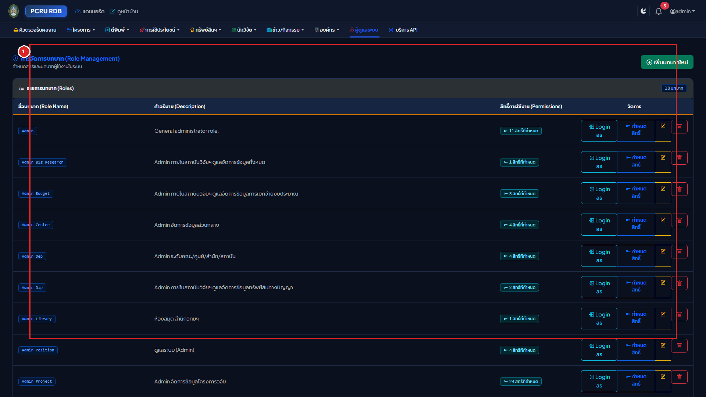
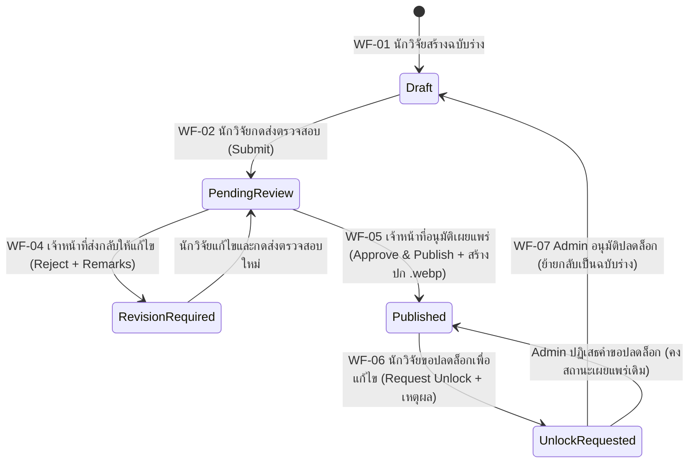
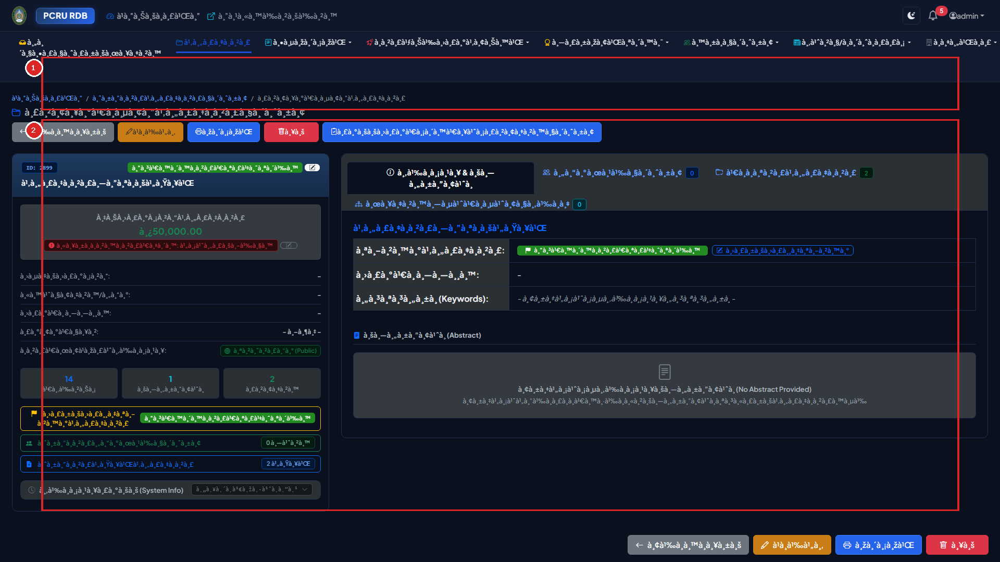
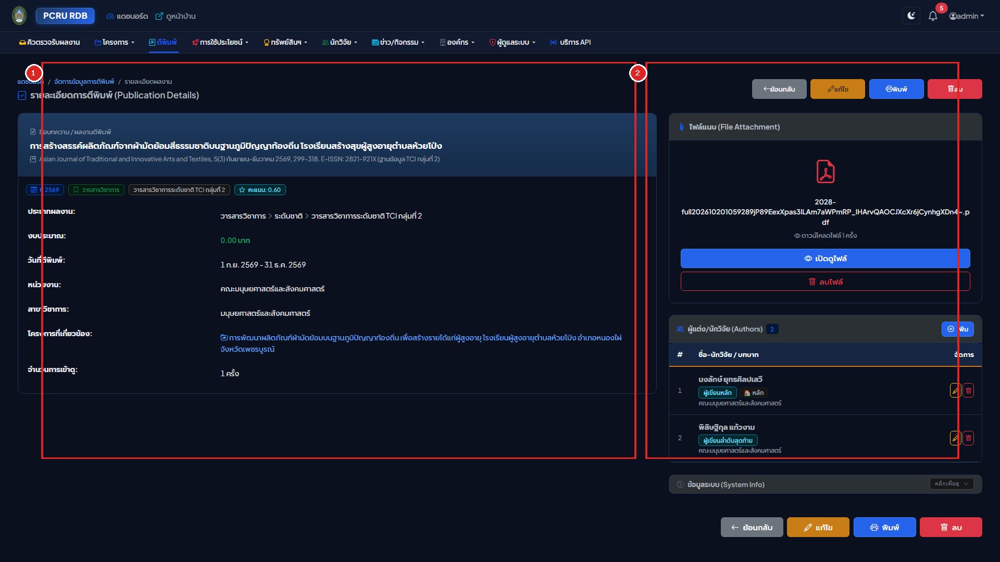

# เล่มที่ 2: คู่มือการใช้งานระบบหลังบ้าน (Volume 2: Backend Administrative & Researcher Manual)
## ระบบฐานข้อมูลงานวิจัย มหาวิทยาลัยราชภัฏเพชรบูรณ์ (PCRU Research Database)

> [!NOTE]
> **ข้อมูลจำเพาะของเอกสาร (Document Control)**
> - **รหัสเอกสาร**: `PCRU-RDB-MAN-VOL2-2569`
> - **กลุ่มผู้ใช้งานเป้าหมาย**: นักวิจัย (Researcher), ผู้ทรงคุณวุฒิประเมินงานวิจัย (Reviewer), ผู้ประสานงานคณะ (Faculty Coordinator), เจ้าหน้าที่สถาบันวิจัยและพัฒนา (Admin / Domain Admin) และผู้ดูแลระบบสูงสุด (Super Admin)
> - **URL เข้าสู่ระบบหลังบ้าน**: `http://laravel_rdb.test/login` ➔ `/backend/site`

---

## สารบัญ (Table of Contents)
1. [บทที่ 1: การเข้าสู่ระบบและความปลอดภัยของบัญชี (Authentication & Account Security)](#บทที่-1-การเข้าสู่ระบบและความปลอดภัยของบัญชี-authentication--account-security)
2. [บทที่ 2: โครงสร้างบทบาท สิทธิ์การใช้งาน และการจำลองสิทธิ์ (RBAC & Impersonation)](#บทที่-2-โครงสร้างบทบาท-สิทธิ์การใช้งาน-และการจำลองสิทธิ์-rbac--impersonation)
3. [บทที่ 3: วงจรชีวิตการส่งร่าง ตรวจสอบ และอนุมัติเปิดเผยผลงาน (Workflow Lifecycle: WF-01 ถึง WF-07)](#บทที่-3-วงจรชีวิตการส่งร่าง-ตรวจสอบ-และอนุมัติเปิดเผยผลงาน-workflow-lifecycle-wf-01-ถึง-wf-07)
4. [บทที่ 4: การบริหารจัดการโครงการวิจัยขั้นสูง ระบบนับหน้า PDF และปก .webp](#บทที่-4-การบริหารจัดการโครงการวิจัยขั้นสูง-ระบบนับหน้า-pdf-และปก-webp)
5. [บทที่ 5: ระบบตรวจประเมินเล่มรายงานวิจัยฉบับสมบูรณ์ (Peer Review Subsystem)](#บทที่-5-ระบบตรวจประเมินเล่มรายงานวิจัยฉบับสมบูรณ์-peer-review-subsystem)
6. [บทที่ 6: การบริหารจัดการผลงานตีพิมพ์ ทรัพย์สินทางปัญญา และการใช้ประโยชน์](#บทที่-6-การบริหารจัดการผลงานตีพิมพ์-ทรัพย์สินทางปัญญา-และการใช้ประโยชน์)
7. [บทที่ 7: การบริหารข้อมูลนักวิจัยและการเชื่อมโยงฐานข้อมูลสากล (Scopus & ORCID)](#บทที่-7-การบริหารข้อมูลนักวิจัยและการเชื่อมโยงฐานข้อมูลสากล-scopus--orcid)
8. [บทที่ 8: การส่งออกข้อมูล UTF-8 BOM Excel และการเชื่อมต่อคลังปัญญา DSpace SAF](#บทที่-8-การส่งออกข้อมูล-utf-8-bom-excel-และการเชื่อมต่อคลังปัญญา-dspace-saf)
9. [บทที่ 9: ประวัติการใช้งาน (Audit Logs) และการตั้งค่าความปลอดภัยของระบบ](#บทที่-9-ประวัติการใช้งาน-audit-logs-และการตั้งค่าความปลอดภัยของระบบ)

---

## บทที่ 1: การเข้าสู่ระบบและความปลอดภัยของบัญชี (Authentication & Account Security)


### 1.1 ขั้นตอนการเข้าสู่ระบบ (Sign-in Procedure)
1. คลิกปุ่ม **"เข้าสู่ระบบ (Login)"** ที่มุมขวาบนของหน้าเว็บหลัก หรือไปที่ URL `/login`
2. **วิธีที่ 1: เข้าสู่ระบบด้วย Google Workspace มหาวิทยาลัย (แนะนำสำหรับอาจารย์และบุคลากร)** (กรอบ `[1]`):
   * คลิกปุ่ม **"เข้าสู่ระบบด้วยบัญชี Google (@pcru.ac.th)"**
   * เลือกอีเมลของมหาวิทยาลัย ระบบจะตรวจสอบและเชื่อมโยงกับข้อมูลนักวิจัยในฐานข้อมูลโดยอัตโนมัติ
3. **วิธีที่ 2: เข้าสู่ระบบด้วยชื่อผู้ใช้และรหัสผ่าน (สำหรับผู้ดูแลระบบและบัญชีเดิม)** (กรอบ `[2]`):
   * คลิกเปิดส่วนฟอร์มเข้าสู่ระบบ กรอก **Username / Email** และ **Password**
   * กดปุ่ม **"เข้าสู่ระบบ"** เพื่อเข้าสู่หน้าแดชบอร์ดหลังบ้าน (`/backend/site`)

> [!IMPORTANT]
> **นโยบายการสมัครสมาชิกใหม่**: ระบบไม่อนุญาตให้บุคคลภายนอกสมัครสมาชิกด้วยตนเองผ่านฟอร์มปกติ การลงทะเบียนผู้ใช้งานใหม่ทั้งหมดต้องผ่าน **Google SSO ของมหาวิทยาลัย** และผ่านการอนุมัติผูกโปรไฟล์นักวิจัย (Onboarding Approval) จากผู้ดูแลระบบเท่านั้น เพื่อป้องกันบัญชีปลอม

### 1.2 ภาพรวมหน้าแดชบอร์ดหลังบ้าน (`/backend/site`)


* **หมายเลข `[1]` แถบเมนูจัดการหลังบ้านและศูนย์แจ้งเตือน (Backend Navbar & Notification Bell)**: แสดงเมนูตามสิทธิ์ของผู้ใช้, ปุ่มสลับบทบาท (Role Switcher), กระดิ่งแจ้งเตือนงานใหม่ และเมนูโปรไฟล์
* **หมายเลข `[2]` การ์ดสรุปสถานะงานวิจัยและงานรอดำเนินการ**: แสดงจำนวนโครงการ, งานตีพิมพ์ และรายการที่รอตรวจสอบ
* **หมายเลข `[3]` กราฟวิเคราะห์สถิติและรายการเคลื่อนไหวล่าสุด**: แสดงสถิติแยกตามปีงบประมาณ พ.ศ.

---

## บทที่ 2: โครงสร้างบทบาท สิทธิ์การใช้งาน และการจำลองสิทธิ์ (RBAC & Impersonation)

````carousel

<!-- slide -->

````

### 2.1 ตารางระดับสิทธิ์ผู้ใช้งานในระบบ (Role Permission Matrix)

| ชื่อบทบาท (Role) | ขอบเขตการเข้าถึงข้อมูล (Data Scope) | สิทธิ์การดำเนินการหลัก |
| :--- | :--- | :--- |
| **The Creator / Super Admin** | ทั้งมหาวิทยาลัย (All Faculties) | จัดการทุกโมดูล, ตั้งค่าระบบ, จัดการสิทธิ์ RBAC, จำลองสิทธิ์ (Impersonate), ดู Audit Logs |
| **Admin / Admin Research** | ทั้งมหาวิทยาลัย | ตรวจรับและอนุมัติผลงานทุกประเภท, ส่งออกข้อมูล Excel และ DSpace SAF |
| **Domain Admins** (`Admin Project`, `Admin Published`, `Admin Dip`, `Admin Utilize`) | ทั้งมหาวิทยาลัย (เฉพาะโมดูลที่รับผิดชอบ) | เพิ่ม/แก้ไข/อนุมัติข้อมูลเฉพาะในโมดูลที่ได้รับมอบหมายโดยตรงโดยไม่ต้องรอปลดล็อก |
| **Faculty Coordinator** | เฉพาะคณะ/หน่วยงานที่สังกัด | ตรวจสอบและกลั่นกรองผลงานของอาจารย์ในคณะตนเอง |
| **Researcher (นักวิจัย)** | **เฉพาะผลงานของตนเองเท่านั้น (Strict Isolation)** | สร้างร่างผลงาน, อัปโหลดไฟล์ PDF, ส่งตรวจรับ, ขอปลดล็อกเพื่อแก้ไข, ประเมินเล่มรายงานตามที่ได้รับมอบหมาย |

### 2.2 การจำลองสิทธิ์เป็นนักวิจัยหรือผู้ใช้รายอื่น (User Impersonation)
ฟังก์ชันสำหรับ Super Admin เพื่อใช้ตรวจสอบหน้าจอหรือช่วยเหลืออาจารย์ที่มีปัญหาการใช้งานโดยไม่ต้องขอรหัสผ่านของอาจารย์:
1. ไปที่เมนู **"จัดการผู้ใช้งาน"** (`/backend/user`) หรือ **"ทำเนียบนักวิจัย"** (`/backend/rdb_researcher`)
2. ค้นหาชื่อนักวิจัยที่ต้องการตรวจสอบ แล้วคลิกปุ่มไอคอน **"จำลองสิทธิ์ (Impersonate)"**
3. ระบบจะสลับเข้าสู่มุมมองของนักวิจัยท่านนั้นทันที โดยแสดงแถบแจ้งเตือนสีเหลืองด้านบนสุดของหน้าจอ
4. เมื่อตรวจสอบเสร็จสิ้น ให้คลิกปุ่ม **"หยุดการจำลองสิทธิ์ (Stop Impersonating)"** บนแถบด้านบนเพื่อกลับสู่บัญชีผู้ดูแลระบบตามเดิม

---

## บทที่ 3: วงจรชีวิตการส่งร่าง ตรวจสอบ และอนุมัติเปิดเผยผลงาน (Workflow Lifecycle: WF-01 ถึง WF-07)

ระบบควบคุมคุณภาพข้อมูลวิจัยด้วยกลไก **State-Driven Approval Workflow** เพื่อป้องกันการแก้ไขข้อมูลโดยพลการหลังจากเผยแพร่แล้ว และรับประกันว่าข้อมูลที่แสดงหน้าบ้านผ่านการตรวจสอบจากสถาบันวิจัยและพัฒนาแล้วทุกรายการ:




### 3.1 คู่มือปฏิบัติสำหรับนักวิจัย (Researcher Submission Steps)
1. **ขั้นที่ 1: การบันทึกฉบับร่าง (`WF-01 Draft`)**
   * เมื่อนักวิจัยกดเพิ่มข้อมูลในโมดูลโครงการวิจัย, ผลงานตีพิมพ์, ทรัพย์สินทางปัญญา หรือการนำไปใช้ประโยชน์ รายการใหม่จะมีสถานะเริ่มต้นเป็น **`ฉบับร่าง (Draft)`**
   * ในสถานะนี้ นักวิจัยสามารถแก้ไขข้อมูลและเปลี่ยนไฟล์แนบได้ตลอดเวลา โดยข้อมูลจะยังไม่ปรากฏบนหน้าบ้านสาธารณะ
2. **ขั้นที่ 2: การกดส่งผลงานให้เจ้าหน้าที่ตรวจสอบ (`WF-02 Submit for Review`)**
   * เมื่อกรอกข้อมูลและแนบไฟล์ PDF ครบถ้วนแล้ว ให้เข้าที่หน้ารายละเอียดของรายการนั้น
   * คลิกปุ่มสีน้ำเงิน **"ส่งตรวจสอบ (Submit for Review)"**
   * สถานะจะเปลี่ยนเป็น **`รอตรวจสอบ (Pending Review)`** แบบฟอร์มจะถูกล็อกชั่วคราว และระบบจะส่งแจ้งเตือนไปยังเจ้าหน้าที่สถาบันวิจัยฯ ทันที
3. **ขั้นที่ 3: กรณีได้รับแจ้งให้แก้ไขข้อมูล (`WF-04 Revision Required`)**
   * หากเจ้าหน้าที่ตรวจพบข้อมูลไม่สมบูรณ์ นักวิจัยจะได้รับการแจ้งเตือนผ่านกระดิ่งแจ้งเตือน พร้อมกล่องข้อความสีแดงแสดง **"เหตุผลและข้อเสนอแนะจากผู้ตรวจสอบ"**
   * นักวิจัยสามารถคลิก **"แก้ไขข้อมูล"** ปรับปรุงตามคำแนะนำ แล้วกด **"ส่งตรวจสอบ"** อีกครั้ง
4. **ขั้นที่ 4: การขอปลดล็อกเพื่อแก้ไขผลงานที่เผยแพร่แล้ว (`WF-06 Request Unlock`)**
   * เมื่อผลงานได้รับอนุมัติเป็น **`เผยแพร่แล้ว (Published)`** ปุ่มแก้ไขและปุ่มลบจะถูกซ่อนและล็อกไว้ตามมาตรฐานธรรมาภิบาลข้อมูล
   * หากนักวิจัยมีความจำเป็นต้องแก้ไขข้อมูล ให้คลิกปุ่ม **"ขอปลดล็อกเพื่อแก้ไข (Request Unlock)"** กรอกเหตุผลความจำเป็น แล้วกดยืนยันเพื่อรอ Admin อนุมัติ

### 3.2 คู่มือปฏิบัติสำหรับเจ้าหน้าที่และผู้ดูแลระบบ (Admin Review Queue Steps)
1. คลิกเมนู **"คิวงานตรวจสอบ (Review Queue)"** (`/backend/workflow/queue`)
2. ในส่วนที่ `[1]` เลือกแท็บประเภทผลงานที่ต้องการตรวจ: **โครงการวิจัย**, **ผลงานตีพิมพ์**, **ทรัพย์สินทางปัญญา**, **การนำไปใช้ประโยชน์** หรือ **คำขอปลดล็อกแก้ไข**
3. ในส่วนที่ `[2]` คลิกเปิดดูรายละเอียดและตรวจสอบไฟล์เอกสารแนบของนักวิจัย:
   * **กรณีข้อมูลถูกต้องสมบูรณ์ (`WF-05`)**: คลิกปุ่มสีเขียว **"อนุมัติและเผยแพร่ (Approve)"** ➔ ระบบจะเปลี่ยนสถานะเป็น `Published`, เปิดการแสดงผลหน้าบ้าน (`data_show = 1`) และสั่งสร้างภาพปก `.webp` อัตโนมัติทันที
   * **กรณีต้องแก้ไข (`WF-04`)**: คลิกปุ่มสีแดง **"ส่งกลับแก้ไข (Reject)"** ➔ กรอกหมายเหตุชี้แจงจุดที่ต้องแก้ไข แล้วกดยืนยัน
   * **กรณีพิจารณาคำขอปลดล็อก (`WF-07`)**: ในแท็บคำขอปลดล็อก คลิก **"อนุมัติปลดล็อก"** เพื่อคืนสถานะกลับเป็น `Draft` ให้นักวิจัยแก้ไข หรือคลิก **"ปฏิเสธคำขอ"** เพื่อคงสถานะเผยแพร่เดิม

---

## บทที่ 4: การบริหารจัดการโครงการวิจัยขั้นสูง ระบบนับหน้า PDF และปก .webp

````carousel

<!-- slide -->

````

### 4.1 การสร้างและแก้ไขข้อมูลโครงการวิจัย (`/backend/rdb_project`)
1. คลิกปุ่ม **"+ เพิ่มโครงการวิจัยใหม่"** มุมขวาบนของหน้ารายการ
2. กรอกข้อมูลตามขั้นตอนของฟอร์ม:
   * **ข้อมูลหลัก**: รหัสโครงการ, ปีงบประมาณ พ.ศ., ประเภททุนวิจัย, ชื่อโครงการ (ไทย/อังกฤษ)
   * **ระยะเวลาโครงการ**: เลือกวันที่เริ่มต้นและวันที่สิ้นสุดจากปฏิทิน พ.ศ. (ระบบแปลงเก็บเป็น ISO `YYYY-MM-DD` อัตโนมัติ)
   * **งบประมาณ**: ระบุงบประมาณรวม และสามารถจำแนกงบประมาณรายงวดในหน้ารายละเอียดโครงการ
3. ในหน้ารายละเอียดโครงการ (`/backend/rdb_project/{id}`) สามารถเพิ่มรายชื่อ **คณะผู้วิจัย** พร้อมระบุตำแหน่งในโครงการ (หัวหน้าโครงการ,ที่ปรึกษา, ผู้ร่วมวิจัย) และสัดส่วนร้อยละของการทำวิจัย

### 4.2 การอัปโหลดไฟล์รายงานและการทำงานอัตโนมัติของเครื่องยนต์ PDF (Automated PDF Engine)
เมื่อมีการอัปโหลดไฟล์ PDF เล่มรายงานฉบับสมบูรณ์ (`pro_file`) ในหน้ารายละเอียดโครงการ ระบบจะทำงานอัตโนมัติ 3 ขั้นตอนทันที:
1. **การจัดเก็บไฟล์ปลอดภัย (UUID Safe Storage)**: เปลี่ยนชื่อไฟล์ภายในเป็นรหัสปลอดภัยและจัดเก็บใน `storage/app/public/project/`
2. **การตรวจนับจำนวนหน้าอัตโนมัติ (4-Tier PDF Page Counter)**:
   * ระบบเรียกใช้ `Poppler pdftotext` / `PdfParser` / `FPDI` นับจำนวนหน้าทั้งหมดของไฟล์ PDF (รองรับแม้แต่ไฟล์ PDF ที่ตั้งรหัสป้องกันการแก้ไข) และบันทึกจำนวนหน้าลงฟิลด์ `pro_page_num` ทันทีด้วยความแม่นยำ 99.99%
3. **การสกัดหน้าแรกเป็นภาพปก `.webp` อัตโนมัติ (5-Tier WebP Cover Generator)**:
   * ระบบดึงหน้าแรกของไฟล์ PDF แปลงเป็นภาพ `.webp` ความละเอียดสูงขนาดกะทัดรัด บันทึกไว้ที่ `storage/app/public/project/covers/` เพื่อใช้แสดงเป็นภาพปกหน้าแรกทั้งในหน้าบ้านและหลังบ้าน

### 4.3 การสลับสถานะการเปิดเผยเล่มรายงาน (`pro_file_show` Toggle)
ในหน้ารายละเอียดโครงการวิจัย การ์ด **"รายงานฉบับสมบูรณ์"** ผู้ดูแลระบบสามารถคลิกสลับสถานะการเปิดเผยไฟล์ได้ 3 สถานะทันที:
* **`เปิด (0 - Public)`**: เปิดให้ประชาชนทั่วไปดาวน์โหลดเล่มรายงานได้ และระบบจะสร้างภาพปก `.webp` ทันทีหากยังไม่มี
* **`ปิด (1 - Concealed)`**: ปกปิดเล่มรายงานไม่ให้ดาวน์โหลด (แสดงเฉพาะข้อมูลโครงการและบทคัดย่อ)
* **`ร่าง (2 - Draft)`**: สถานะระหว่างดำเนินการตรวจรับ

---

## บทที่ 5: ระบบตรวจประเมินเล่มรายงานวิจัยฉบับสมบูรณ์ (Peer Review Subsystem)


ระบบรองรับการประเมินคุณภาพรายงานวิจัยฉบับสมบูรณ์แบบ **Single-Blind Peer Review** (ผู้ทรงคุณวุฒิทราบชื่อผู้วิจัย แต่ผู้วิจัยไม่ทราบชื่อผู้ทรงคุณวุฒิ) โดยมีขั้นตอนครบวงจรดังนี้:

### 5.1 การสร้างและปรับแต่งแบบประเมิน (Dynamic Rubric Form Designer)
1. ผู้ดูแลระบบเข้าเมนู **"ระบบประเมินรายงานวิจัย"** ➔ คลิกปุ่ม **"จัดการเกณฑ์แบบประเมิน (Rubric Templates)"** (`/backend/project-reviews/templates`)
2. สามารถสร้างชุดแบบประเมิน กำหนดหัวข้อเกณฑ์การประเมิน (Criteria), คะแนนเต็มของแต่ละข้อ และกำหนดระดับสเกลการให้คะแนน (เช่น สเกล 1-5 หรือคะแนนดิบ) ได้อย่างอิสระ

### 5.2 ขั้นตอนการส่งเล่มรายงานและมอบหมายผู้ทรงคุณวุฒิ
1. **นักวิจัยส่งไฟล์เล่มรายงานเพื่อรับการประเมิน**:
   * เข้าที่หน้าประเมินของโครงการ (`/backend/project-reviews/project/{pro_id}`)
   * เลือกประเภทการส่ง (`ส่งร่างครั้งแรก Initial Draft`, `ส่งฉบับแก้ไขตามข้อเสนอแนะ Revised Draft`, หรือ `ส่งเล่มสมบูรณ์ Final Report`) และอัปโหลดไฟล์ PDF
2. **ผู้ดูแลระบบมอบหมายผู้ทรงคุณวุฒิ (Assign Reviewers)**:
   * ค้นหาและเลือกผู้ทรงคุณวุฒิ 2-3 ท่าน เลือกแบบประเมินที่ต้องการใช้ และกำหนดวันครบกำหนดส่งผลประเมิน
3. **ผู้ทรงคุณวุฒิบันทึกผลการประเมิน**:
   * ผู้ทรงคุณวุฒิเข้าเมนู **"งานประเมินของฉัน (My Reviews)"** (`/backend/project-reviews/my-reviews`)
   * กดตอบรับการประเมิน เปิดอ่านไฟล์รายงาน กรอกคะแนนรายข้อ ความคิดเห็นเชิงวิชาการ และแนบไฟล์ที่มีการคอมเมนต์กลับเข้าสู่ระบบ
4. **การสรุปผลและอนุมัติเล่มรายงานสมบูรณ์ (`Approve Final Report`)**:
   * เมื่อผู้ทรงคุณวุฒิประเมินครบและนักวิจัยส่งเล่มสมบูรณ์ที่แก้ไขเรียบร้อยแล้ว ผู้ดูแลระบบกดปุ่ม **"อนุมัติเล่มรายงานฉบับสมบูรณ์"**
   * ระบบจะปรับสถานะโครงการเป็นเสร็จสิ้นสมบูรณ์ และสร้างภาพปก `.webp` พร้อมเปิดเผยแพร่โดยอัตโนมัติ

---

## บทที่ 6: การบริหารจัดการผลงานตีพิมพ์ ทรัพย์สินทางปัญญา และการใช้ประโยชน์

````carousel

<!-- slide -->

<!-- slide -->

<!-- slide -->

````

### 6.1 การจัดการผลงานตีพิมพ์ (`/backend/rdb_published`)
1. คลิก **"+ เพิ่มผลงานตีพิมพ์"** กรอกชื่อบทความ, ชื่อวารสาร, ปี พ.ศ., ประเภทฐานข้อมูลวารสาร, งบประมาณสนับสนุนการตีพิมพ์ และเชื่อมโยงโครงการวิจัยต้นทาง (ถ้ามี)
2. เมื่ออัปโหลดไฟล์ PDF บทความ (`pub_file`) ระบบจะตรวจนับจำนวนหน้าลงฟิลด์ `pub_numfile` และสกัดหน้าแรกเป็นภาพปก `.webp` แสดงในหน้ารายละเอียดทันที
3. ในหน้ารายละเอียด สามารถเพิ่มรายชื่อผู้แต่งร่วม (Co-Authors) และระบุสถานะเป็นผู้ประพันธ์ชื่อแรก (First Author) หรือผู้ประพันธ์บรรณกิจ (Corresponding Author)

### 6.2 การจัดการทรัพย์สินทางปัญญา (`/backend/rdb_dip`) และการนำไปใช้ประโยชน์ (`/backend/rdbprojectutilize`)
* **ทรัพย์สินทางปัญญา**: บันทึกเลขที่คำขอ, ประเภทสิทธิบัตร/อนุสิทธิบัตร/ลิขสิทธิ์, วันที่ยื่นคำขอ, วันที่จดทะเบียน และแนบไฟล์เอกสารรับรอง
* **การนำไปใช้ประโยชน์**: ค้นหาโครงการวิจัยต้นทางด้วยระบบ Autocomplete, เลือกประเภทการใช้ประโยชน์ 4 มิติ, ระบุพื้นที่ (จังหวัด/อำเภอ/ตำบล) และแนบไฟล์หลักฐานรับรองผลกระทบ

---

## บทที่ 7: การบริหารข้อมูลนักวิจัยและการเชื่อมโยงฐานข้อมูลสากล (Scopus & ORCID)


### ขั้นตอนการจัดการข้อมูลนักวิจัย (`/backend/rdb_researcher`)
1. **การตรวจสอบรหัสประจำตัวประชาชน 13 หลัก**: ระบบมีอัลกอริทึมตรวจสอบหลักตรวจสอบ (Check Digit Modulo 11) ตามมาตรฐานกรมการปกครอง เพื่อป้องกันการกรอกเลขบัตรประชาชนผิดพลาด
2. **การเชื่อมโยงฐานข้อมูล Scopus และ ORCID**:
   * ระบุ **Scopus Author ID** และ **ORCID iD** (รูปแบบ `XXXX-XXXX-XXXX-XXXX`)
   * ระบบรองรับการซิงก์ค่าดัชนีทางวิชาการ (**h-index**, จำนวนการอ้างอิงสะสม) เพื่อนำมาแสดงในแดชบอร์ดศักยภาพนักวิจัยของมหาวิทยาลัย

---

## บทที่ 8: การส่งออกข้อมูล UTF-8 BOM Excel และการเชื่อมต่อคลังปัญญา DSpace SAF


### 8.1 การส่งออกรายงานข้อมูลเป็นไฟล์ CSV / Microsoft Excel (UTF-8 BOM)
ในหน้ารายการของโครงการวิจัย, ผลงานตีพิมพ์, นักวิจัย และการนำไปใช้ประโยชน์:
1. เลือกตัวกรองข้อมูลที่ต้องการ (เช่น กรองเฉพาะปีงบประมาณ 2568 หรือเฉพาะคณะที่ต้องการ)
2. คลิกปุ่ม **"ส่งออก Excel / CSV (Export)"**
3. ระบบจะสตรีมไฟล์ `.csv` ที่ฝังรหัส **UTF-8 BOM (`\xEF\xBB\xBF`)** และผ่านการป้องกัน CSV Formula Injection ทำให้สามารถดับเบิลคลิกเปิดในโปรแกรม **Microsoft Excel** ได้ทันทีโดยตัวอักษรภาษาไทยถูกต้อง 100% ไม่มีปัญหาภาษาต่างดาว

### 8.2 การส่งออกแพ็กเกจคลังปัญญา DSpace (DSpace Simple Archive Format - SAF ZIP)
สำหรับเจ้าหน้าที่บรรณารักษ์และผู้ดูแลคลังปัญญามหาวิทยาลัย (Institutional Repository):
1. เข้าที่เมนู **"ส่งออก DSpace (Batch Mode)"** ในโมดูลโครงการวิจัย (`/backend/rdb_project/dspace`) หรือผลงานตีพิมพ์ (`/backend/rdb_published/dspace`)
2. เลือกขนาดกลุ่มการส่งออก (เช่น ชุดละ 20 หรือ 50 รายการ)
3. คลิกปุ่ม **"ดาวน์โหลดแพ็กเกจ DSpace ชุดที่ X"** ➔ ระบบจะสร้างไฟล์ `.zip` ตามโครงสร้างมาตรฐาน DSpace SAF ที่ประกอบด้วยไฟล์ `dublin_core.xml` (พร้อมข้อมูลเลขหน้าอัตโนมัติ), ไฟล์ `contents` และไฟล์ PDF ฉบับเต็ม
4. หลังจากนำเข้าสู่ระบบ DSpace สำเร็จ ให้คลิกปุ่มเครื่องหมายถูก **`✓ อัปเดตสถานะส่งออกแล้ว`** เพื่อบันทึกว่าชุดข้อมูลดังกล่าวถูกส่งออกเรียบร้อยแล้ว

### 8.3 คำสั่งดูแลรักษาระบบผ่าน CLI สำหรับผู้ดูแลระบบเซิร์ฟเวอร์ (Artisan Maintenance Commands)
ผู้ดูแลระบบสามารถรันคำสั่งประมวลผลย้อนหลังทั้งฐานข้อมูลผ่าน Terminal ได้ตลอดเวลา:
```powershell
# 1. คำสั่งตรวจนับและบันทึกจำนวนหน้า PDF อัตโนมัติย้อนหลังทั้งระบบ
php artisan rdb:count-pdf-pages --module=all

# 2. คำสั่งสกัดหน้าแรกของ PDF มาสร้างเป็นภาพปก .webp ย้อนหลังทั้งระบบ
php artisan rdb:generate-pdf-covers --module=all
```

---

## บทที่ 9: ประวัติการใช้งาน (Audit Logs) และการตั้งค่าความปลอดภัยของระบบ

````carousel

<!-- slide -->

````

### 9.1 การตรวจสอบประวัติการกระทำในระบบ (`/backend/audit-logs`)
1. ผู้ดูแลระบบสามารถกรองดูประวัติการใช้งานตาม **ชื่อผู้ใช้**, **ประเภทเหตุการณ์** (`created`, `updated`, `deleted`, `submit`, `approve`, `reject`, `request_unlock`) หรือ **ประเภทข้อมูล**
2. คลิกปุ่ม **"ดูรายละเอียดการเปลี่ยนแปลง"** เพื่อเปรียบเทียบค่าข้อมูลเดิม (**Old Values**) และค่าข้อมูลใหม่ (**New Values**) พร้อมดูหมายเลข IP Address และเวลาที่ดำเนินการอย่างละเอียด

### 9.2 การตั้งค่านโยบายการเข้าถึงเอกสาร (`/backend/settings/access-control`)
1. ไปที่เมนู **"ตั้งค่าการควบคุมการเข้าถึง"**
2. ผู้ดูแลระบบสามารถกำหนดนโยบายระดับมหาวิทยาลัยได้ว่า การดาวน์โหลดไฟล์เอกสารวิจัยฉบับเต็มในหน้าบ้านจะอนุญาตให้:
   * **เปิดให้ดาวน์โหลดได้โดยเสรีสำหรับสาธารณะ (Public Access)** (ค่าเริ่มต้นสำหรับเอกสารที่ตั้งค่าเปิดเผย) หรือ
   * **บังคับให้ต้องเข้าสู่ระบบก่อนดาวน์โหลด (Authenticated Only)**
3. คลิก **"บันทึกการตั้งค่า"** เพื่อบังคับใช้นโยบายทั้งระบบทันที

